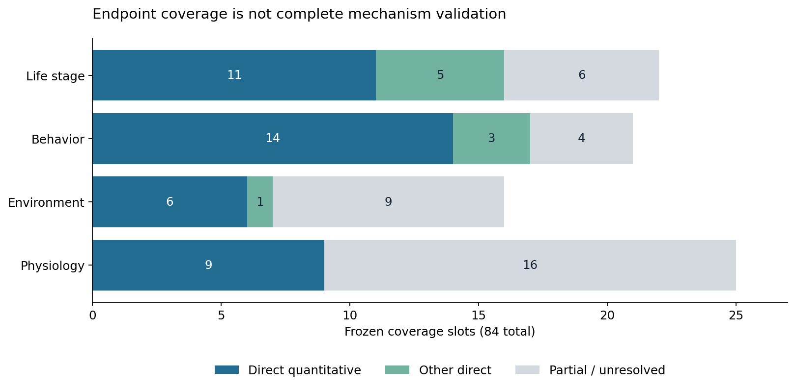
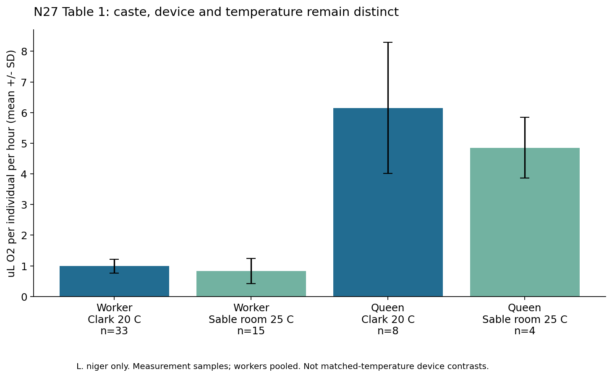
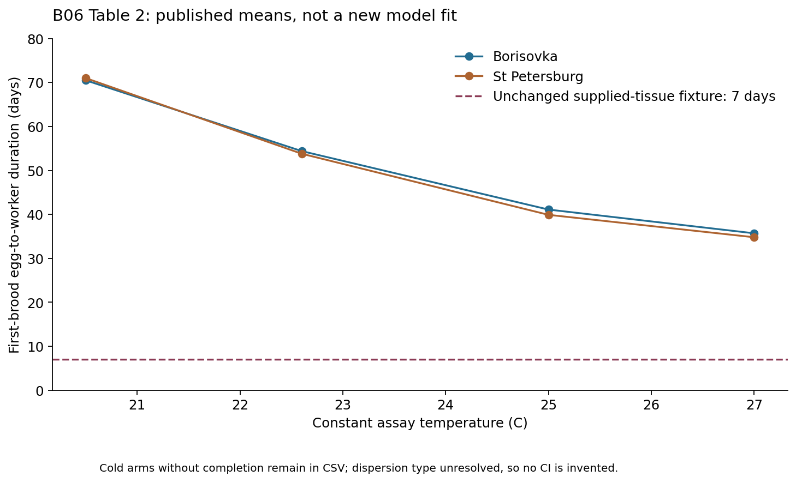

# Ant biology evidence atlas — S6.3.2.1

Current authorized implementation extension: [S6.3.3 P01/P10](research/s6_3_3/README.md), frozen in document52. This atlas is the continuing scientific reference. Historical artifacts/source checks remain in research/s6_3_2_1/baseline; root parameter/state audits and SQLite include separately namespaced current records. No source endpoint is promoted to numerical parameter calibration. The coverage and historical research conclusions below are retained as the reviewed baseline.

This is a traceable research baseline, **not a calibrated ant simulator or a completed systematic review**. The target is *Lasius niger*. Other species occupy separate records and cannot supply an unmarked substitute for a target-species measurement. No Simulation Core code, biological default, action, history or experiment outcome was changed.

The [frozen protocol](docs/51_S6_3_2_1_Evidence_Atlas_Protocol.md) was committed as `765032d` before atlas construction. The unchanged source baseline is `2e1a5fa129821176954f26a88f56791635bc8cda`. The [file index and reproduction guide](research/s6_3_2_1/README.md) describes every delivery and the [schema](research/s6_3_2_1/SCHEMA.md) defines joins, missingness and units.

## What is supported, and what is not

Direct experiments support active maternal care and reversible queen specialization, condition-dependent founding output, temperature-dependent first-brood development, caste-related respiration, heterogeneous local food exchange, learned and chemical route information, conditional marking, and substrate/environment-sensitive construction. They do **not** identify every transition probability or validate the current numerical implementation. See source-specific pages, tables, samples and limitations in the [reading register](research/s6_3_2_1/SOURCE_READING_REGISTER.csv), with identifiers resolved in [BIBLIOGRAPHY.bib](BIBLIOGRAPHY.bib).

Current strong conflicts include the permanent Worker-only care gate, an environment-independent seven-day supplied-tissue lifecycle, and unconditional loaded-move marking as a complete recruitment model. Common caste/stage physiology, fixed task weights, exact neighbor-store sensing and perfect route replay remain uncalibrated approximations. Conserved resource bookkeeping is necessary engineering correctness; it cannot establish biological fidelity. The [state-machine audit](STATE_MACHINE_EVIDENCE_AUDIT.md) links 70 rule groups to actual functions and 881 lexical source contexts.

**Zero existing biological parameters are newly calibrated.** The [parameter matrix](PARAMETER_PROVENANCE.csv) contains all 119 declared fields in the inherited 16-struct inventory, 1,209 declaration/assignment/API expressions, 469 supplemental contexts, and 881 additional implicit source contexts: 2,559 traceable records, not 2,559 independent biological coefficients. Current values remain F / `ENGINEERING_FIXTURE`. Mechanism support, source evidence grade, fitted coefficients and adopted Core values are different concepts.

## Coverage, with explicit denominators

A direct quantitative slot means at least one relevant endpoint is measured. It does not mean that all ages, environments, triggers, durations and transitions in that slot are covered. The frozen axes overlap biologically; a paper or record can inform multiple slots. Counts are generated from [COVERAGE.csv](research/s6_3_2_1/COVERAGE.csv).

| Frozen axis | Slots | Direct quantitative endpoint | Additional direct qualitative/observational endpoint | Partial, extrapolated, abstract, exposure-only, theory or unknown |
|---|---:|---:|---:|---:|
| Caste/life stage | 22 | 11 (50.0%) | 5 | 6 |
| Behavior | 21 | 14 (66.7%) | 3 | 4 |
| Environment | 16 | 6 (37.5%) | 1 | 9 |
| Physiology | 25 | 9 (36.0%) | 0 | 16 |
| Total slots | 84 | 40 (47.6%) | 9 | 35 |

The 49-reference reading register distinguishes **47 full texts with selected relevant sections actually read**, one first-page/abstract-only paper (N03), and one original chemistry source accessed through a secondary thermochemical compilation (B22). Downloading is not reading: [acquisition receipts](research/s6_3_2_1/acquisition_receipts.json) record access attempts, while the reading register records what was inspected. N19 is explicitly an unreviewed preprint, not peer-reviewed evidence. The original instar paper supplied by the user contains only printed p9, not pp9–13; it has not been promoted to full-text status.

There are 292 curated measurements/qualitative results (A217, B38, C21, D15, E1) and 818 separately stored licensed repository rows. Mixed-ant field aggregates are D for transfer to the target even when verified samples are mostly L. niger. These are not independent experiments or independent biological replicates. In particular, 20 condition means repeat outcomes, 20 LTe50 values are authors' fitted estimates, and 57 metabolic records are pooled batches. No figure values were digitized in this release. Approximate percentages explicitly stated by authors are labelled `TEXT_REPORTED_APPROXIMATION`.

## Species and life-stage boundaries

The [species database](SPECIES_DATABASE.csv) contains the target plus 14 separately identified species. It is a boundary register, not a claim of complete natural histories for all 15. Within *L. niger*, Queen, Worker, Male and premating reproductive females are distinct. Brood tender, forager, young worker and old worker are not morphologically separate castes. Smaller first-generation workers are not a soldier caste. Pheidole minor/soldier observations and fire-ant excavation cannot be imported as black-garden-ant caste structure. Historical Japanese naming is checked against the explicitly separate *L. japonicus* records.

The [caste/life-stage matrix](CASTE_LIFE_STAGE_MATRIX.csv) keeps egg, larval instars, aggregated larva, prepupa, pupa, callow, worker age categories, founding/established queens, sexual stages and overwintering separate. B06 measures first-brood development at controlled temperatures, not every instar. N03 gives abstract-only instar information; N23 independently examines late larval morphology, not instar durations. Callow maturation, male postflight survival and stage-specific water requirements remain incomplete. A combined prepupa+pupa endpoint cannot be silently fitted as pupa alone.

## Behavior and local self-organization

The [behavior database](BEHAVIOR_EVIDENCE_DATABASE.csv) distinguishes observed acts, probabilities, duration, conditional outcomes and negative results. The [21-behavior facet matrix](research/s6_3_2_1/BEHAVIOR_FACETS.csv) explicitly separates known/unknown triggers, probabilities, durations, termination/transitions and individual variation. The source audit separately states the actual Core gate. A reported food load is not a compulsory collection threshold; an observed association between age and role is not a fixed chronological task schedule; a mark on the ground is not proof that another ant follows it.

N14's brood/food contrasts now include group-specific intake and drinking-time means/SD, separate marking intensity, and authors' stopping-volume logistic fits. Exploring ants and returning ants have different denominators. Brood effects on participation must not be converted into an unmeasured universal increase in marking intensity. N01 measures oral-contact timing; B08 measures temporal network heterogeneity. Neither supplies a queen-directed mass-transfer coefficient or a justification for a 16-candidate sampling budget. Retain SD-04 and SD-08 until the entire opportunity → local contact → recipient choice → committed transfer → absorption chain is validated.

The current average initial uninterrupted following of about two steps and weak single-scout social recruitment remain negative model evidence. B14/B15/B16/B17 and N20 give assay-specific route/learning constraints, not permission to increase a trail weight until recruitment succeeds. N25 reports substrate-dependent kinematics but no convincing coarse-substrate preference/learning under its protocol; that negative result remains. N17 reports role-dependent aggregation responses to red light, not sleep. N27 finds no circadian metabolic rhythm in its isolated mixed-worker pools; this cannot establish absence of rhythms in intact colonies. Grooming, repair, water management and defensive task transitions remain substantially underdetermined.

## Physiology, environment and dimensional checks

The [physiology](PHYSIOLOGY_DATA.csv), [environment](ENVIRONMENT_RESPONSE_DATABASE.csv) and [unit-conversion](research/s6_3_2_1/UNIT_CONVERSIONS.csv) tables preserve original units and conditions. Temperature is not a single multiplier: egg, larval growth, pupal development, adult acclimation, drought survival and cold lethality are distinct endpoints. Relative humidity, gravimetric soil moisture, volumetric water content and soil water potential are not interchangeable. Reporting an assay at 60% RH does not measure an RH response curve.

N27 Table1 provides direct *L. niger* oxygen measurements, including 0.99 ±0.23 uL O2/h per worker at20 C (33 measurement samples) and 6.15 ±2.14 per queen (8 samples). Workers were pooled as specified by the experiment; these are not 33 independently known-age colonies. Sable results use room25 C and a different device. The allometric exponents 0.6492/1.039 derive from three species and pooled worker measurements; they are D-grade fitted quantities, **not species-specific individual constants**. B04's normalized respiration, fresh worker-pool mass and cellular energy-charge assay cannot be used as whole-individual usable energy reserves. Source arithmetic/sample discrepancies are retained in [contradictions and gaps](CONTRADICTIONS_AND_GAPS.md).

The Core default carbohydrate credit 1,000,000 nJ/ug equals **1 kJ/g**, while the B22 sucrose combustion magnitude is about16.49 kJ/g. Gross heat is not net accessible ant energy. No automatic replacement follows from this comparison. Similarly,1 nJ/ms equals1 uW; uL O2/h can be converted only with an explicit substrate-dependent oxycaloric assumption; uL CO2/h/mg cannot use the O2 conversion without an appropriate respiratory quotient. N27 explicitly reports unreliable RQ estimates. A sexual-adult production energy is not an egg cost. Crop volume requires liquid composition/density before converting to nutrient mass; ingestion seconds do not calibrate gut absorption.

The 432 N07 survival records preserve uncertain early death times and raw status0/1 despite a conflicting README1/2 legend. No silent relabeling, exact-time hazard fitting or water-loss flux is performed. N10's 289 CTmin observations,20 fitted LTe50 estimates,57 metabolic batches and20 overlapping summaries retain species and treatment. *L. niger* metabolic null effects do not disappear when another species responds. CC0 factual exports are distributed; copyrighted PDFs and extracted full texts remain ignored local files.

## Model research and validation boundary

The [correction roadmap](MODEL_CORRECTION_ROADMAP.md) proposes simple, falsifiable candidate mechanisms. The [20-design validation catalog](MODEL_VALIDATION_CATALOG.md) distinguishes calibration from independent validation and records missing simulator mechanisms. **None was executed as a new biological validation or fitted in this atlas.** Existing unchanged-model probes and colony experiments remain separately identified engineering/model evidence in S6.3.2 and earlier reports.

Do not enter S6.4 on the basis of the number of papers, regression success or survival in one supplied fixture. Queen care/plasticity, physical physiological compartments and observation-compatible timing, stage-specific thermal development and reproducible biological comparison contracts remain foundational gaps. Additional water, age, egg-cost and natural-colony data are still needed. The scientific conclusions and the performance qualification are independent. This stage stops for review.
