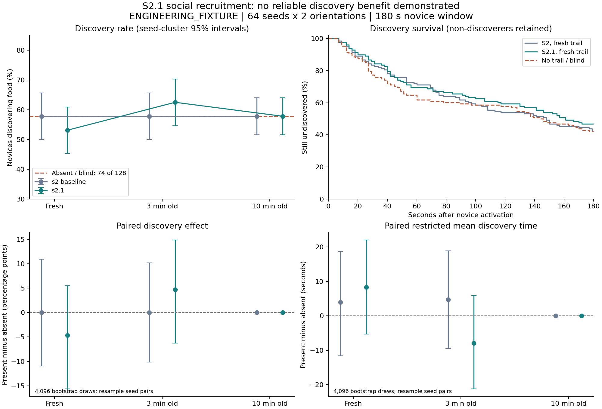
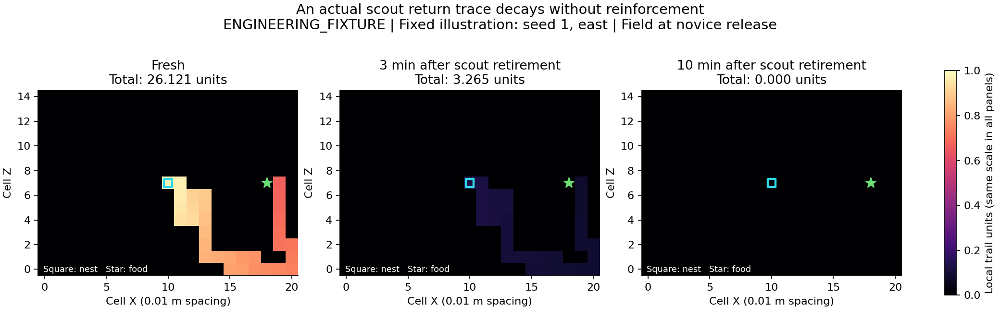
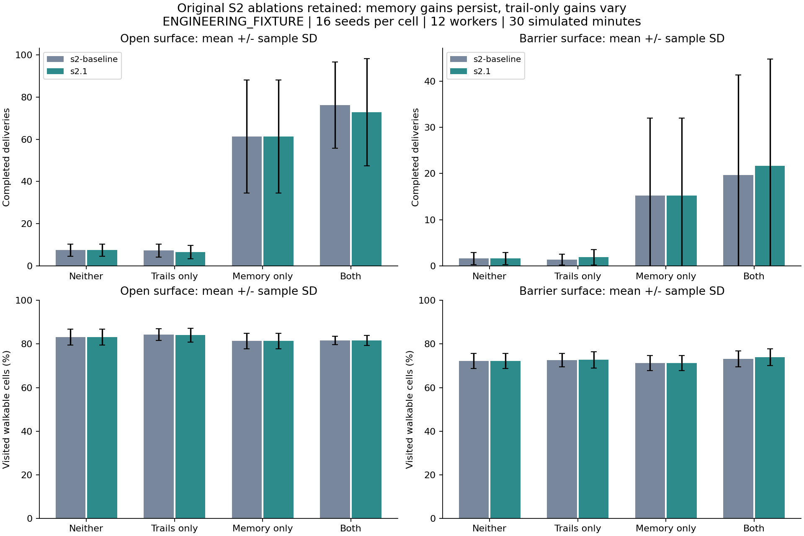

# S2.1 Results: Foraging Model Validation & Fixes

**Acceptance: CONDITIONAL PASS.** The two demonstrated implementation defects are fixed, the controlled validation is complete, and negative findings are retained. Reliable positive social recruitment is **not established** by the declared experiment. This is not approval to begin S3. Development stops on `codex/s2.1-foraging-validation` for independent Code Review.

All scenario values, coefficients, ages, windows and population sizes in this report are `ENGINEERING_FIXTURE`. None is presented as a measured Lasius niger constant.

## Scope and provenance

- Base: `codex/s2-foraging`, commit `21bc61be501a488cf2f8f296673151294291e9ac`.
- Protocol, instrumentation and pre-fix evidence: `8bf22a96ee504ddd3b27b2881ed62553e1c536b1`, committed before changing food choice or trail response.
- Fixed implementation and complete experiment data: `6541ffe1768a952da66d0425000647146d0eae1c`.
- Design: [frozen protocol and ADRs](docs/28_S2_1_Validation_Protocol.md). Evidence: [combined raw trials](S2_1_EXPERIMENTS.csv), [data dictionary and reproduction](experiments/s2_1/README.md), [input hashes](experiments/s2_1/input_hashes.json).
- S0-S2 historical reports/data remain unchanged. No physiology, new quality/nutrition model, 3D navigation, Unity, Game Master or external model integration was added.

## Diagnosis before fixes

| Audit question | Source and measured evidence | Disposition |
|---|---|---|
| Do equal food sources prefer an ID? | The old nearest-food tie used `food.resource < best->resource`. All 4,096 seeds selected the smaller ID; all changed physical destination after an ID swap. | Defect: replace only the equal-distance tie. |
| Are weak signals represented? | The old response added `floor(signal / 16 * 180)`. A 0.04-unit cue contributed zero, despite exceeding the 0.001 visibility cutoff. It changed no destinations in 4,096 paired draws but produced 681 FollowTrail labels. | Defect: preserve fractional precision; do not increase coefficients. |
| Is deposition disconnected or instantaneous? | Signal is deposited at the arrival of an actual loaded return move, one unit before capping at 16. Every one of the 128 autonomous scout paths formed a continuous trace from nest to the food sensing neighborhood. The source cell has no fabricated deposit. | No demonstrated continuity defect; preserve timing and location. |
| Can another worker sense it? | A dormant novice starts with no food cue or learned route, but can sense adjacent cells containing its colony's scout deposits. Blind-field controls have the same physical trajectories as absence. | Local social transmission exists; this alone does not prove useful recruitment. |
| Does decay operate? | A 60-second half-life applies analytically. The release field after three minutes is exactly one eighth of the fresh field within numerical tolerance; after ten minutes every initial scout trace is below cutoff. | Preserve decay and sparse pruning. |
| Could private behavior hide the signal? | Loaded/bounded return, local food and valid route memory precede weighted exploration. The model also excludes immediate backtracking when alternatives exist, discourages already visited cells and favors heading persistence. | Preserve priorities, isolate memory by disabling it in the social experiment, retain broad memory ablations. |

These findings were collected before fixes. The baseline fresh-trace recruitment rate was 74/128 with and without trails, with no reliable time advantage. Its route overlap rose by 2.37 percentage points (paired 95% interval 0.07 to 4.59), which did not produce a discovery advantage. A trace could already affect movement; the evidence does not support attributing all poor recruitment to missing deposits or numerical truncation.

## Minimal changes

1. **Food ties.** Keep nearest reachable food priority and the existing equal modeled quality. Canonicalize tied candidates by physical cell, then use unbiased rejection sampling from a separate per-individual, per-decision food RNG domain. ResourceId and cue enumeration no longer determine the physical choice. Duplicate cues cannot receive extra votes. Approach facts record the selected local source, as collection facts already did. Actual resource competition remains governed by the existing deterministic transaction arbitration.
2. **Trail precision.** Multiply all eligible exploration, persistence and trail weights by the same `2^20` scale, retaining fractional trail contributions instead of truncating to whole units. Maximum totals remain safely within uint64. No deposit, response weight, cap, cutoff, sensor radius, memory, duration or movement parameter was increased. With no eligible signal, or response weight zero, the original integer draw remains unchanged.
3. **Controlled novice activation.** Permit a previously dormant seeded adult worker's first activation at its nest after time zero. It uses the existing validated transaction, cannot reset an existing forager, and schedules its wake after the closed timestamp boundary. Restore accepts the corresponding genuine late activation fact. Budget/allocation failures roll back the activation, queue and fact atomically. This instrumentation existed in both baseline and fixed experiments.
4. **Versioning.** Binary schema stays 3; physics becomes 4 because behavior and activation semantics changed. Previous physics versions, including S2 physics 3, are explicitly rejected. No save is silently reinterpreted. The temporary host budgets, undo journals, phase watermark, stable identities, evidence counters and per-ingredient accounting remain.

No global food coordinates enter worker decisions. The experiment observer records the scout's route for measurement only; neither worker receives that route. No trail directly completes a task or moves an ant. A novice must make local choices, travel, collect and return through ordinary events.

## Controlled social experiment

The fixed protocol uses seeds 1-64 and east/west mirrored food placements, with one autonomously trained scout and one initially dormant novice on a 21 x 15 open surface. Grid spacing is 0.01 m; food begins eight cells from the nest, outside the two-cell local food sensor. Carrying capacity is 1,000 ug and initial food stock is 4,000,000 ug. The observer allows 1,800 seconds for the scout's first delivery, then retires it through the existing explicit lifecycle fixture one millisecond later. This artificial removal is an experimental control, not a mortality model.

All 128 seed/orientation training pairs succeeded with identical training time/path/stock across the paired conditions and model versions. No seed was replaced. The novice has zero decisions, no cargo and no learned route. Memory is disabled throughout the social fixture. Treatments are trail present, trail absent and field present with response weight zero (blind). Each uses matched release delays of 0, 180 or 600 seconds and a 180-second novice window. Food, terrain, worker state and window match within pairs.

The two versions produce 2,304 social rows. First discovery is a committed decision recording a visible local food cue; it precedes arrival/collection. Undiscovered novices remain in the analysis and are censored at 180 seconds. Restricted mean time includes those full-window observations. Uncertainty uses 4,096 bootstrap draws, analysis seed 2101, resampling 64 seed clusters containing both orientations. Wilson intervals are also supplied separately by orientation. Intervals are descriptive and unadjusted for multiple comparisons.

### Discovery and time

Each row below summarizes 128 novices. Absent/blind first-discovery outcomes are identical at all three delays and in both versions.

| Model / condition | Discovered | Rate | Restricted mean time, s | Difference in rate vs absent, percentage points (paired 95% interval) |
|---|---:|---:|---:|---|
| Absent or blind | 74 | 57.81% | 113.65 | Reference |
| S2 baseline, fresh | 74 | 57.81% | 117.59 | 0.00 (-10.94, 10.94) |
| S2 baseline, 180 s old | 74 | 57.81% | 118.36 | 0.00 (-10.16, 10.16) |
| S2.1, fresh | 68 | 53.13% | 121.98 | -4.69 (-15.63, 5.47) |
| S2.1, 180 s old | 80 | 62.50% | 105.78 | +4.69 (-6.25, 14.84) |
| S2.1, 600 s old | 74 | 57.81% | 113.65 | 0.00 (0.00, 0.00), expired-trace control |

The fixed fresh-trace restricted time difference is **+8.33 s** (95% interval -5.30 to +22.04); the 180-second-aged difference is **-7.87 s** (-21.19 to +5.88). Positive time differences mean slower discovery. Neither comparison establishes benefit. Exact identity in the expired-trace control is a checked mechanism property, not proof of ecological equivalence in other conditions.

| Fraction still undiscovered | 30 s | 60 s | 120 s | 180 s, censored |
|---|---:|---:|---:|---:|
| Absent / blind | 77.34% | 61.72% | 57.81% | 42.19% |
| S2 baseline, fresh | 83.59% | 71.09% | 53.91% | 42.19% |
| S2.1, fresh | 85.94% | 69.53% | 59.38% | 46.88% |



### Movement, overlap, field and food

Means include non-discoverers. Path length and edge overlap stop at discovery or censoring; food totals cover the full window and include novice transfers only.

| Fixed condition | Path until discovery/censor, m | Scout-route edge overlap | Collected, ug | Delivered, ug | Initial field, units |
|---|---:|---:|---:|---:|---:|
| Absent | 1.0302 | 6.46% | 796.88 | 664.06 | 0 |
| Blind, fresh | 1.0302 | 6.46% | 796.88 | 664.06 | 20.8478 |
| Present, fresh | 1.1056 | 6.54% | 695.31 | 578.13 | 20.8478 |
| Present, 180 s old | 0.9589 | 5.45% | 921.88 | 726.56 | 2.6060 |
| Present, 600 s old | 1.0302 | 6.46% | 851.56 | 718.75 | 0 |

Fresh-trace overlap changes by +0.081 percentage points (paired 95% interval -1.54 to +1.64), and delivery changes by -85.94 ug (-226.56 to +54.69). The apparent aged-field gain is also uncertain: +62.50 ug (-101.56 to +218.75). The expired condition can differ in **later** deliveries because a successful novice subsequently deposits its own signal; its initial discovery path/time still match absence exactly. Do not interpret later deliveries as recruitment from an expired scout trace.

All initial fresh traces have 100% return-cell coverage. All raw cell distributions, strengths and their 30-second samples are retained: 260,648 sparse rows across both models. The illustration below uses fixed seed 1/east, not a seed selected for recruitment success. Source and nest markers are observer annotations. The same intensity scale is used in all panels.



## Resource choice and local response results

- Across 4,096 seeds, east/west equal-food choices are **2,058 / 2,038**. Swapping IDs, swapping source positions while retaining IDs, or reordering local cues leaves the physical choice invariant. North/south arrangements and three-way ties are also tested. Runtime creation-order swaps preserve actual motion and save/restore.
- The old ID-swap physical-change count was 4,096; the fixed count is **zero**. Every seed and both orientations are in the raw choice audit.
- A 131,072-seed local response regression observes 21,889 east choices without signal, 22,453 with 0.04 units and 39,051 with 1 unit. Expected probabilities under unchanged coefficients are 10/60, 10.45/60.45 and 21.25/71.25; all measured rates are within 0.004. This establishes a represented fractional response, not improved group foraging.
- Zero-response and sub-cutoff physical choices match absence. The source audit's number of changed paired destinations after rescaling is not an effect size: changing the draw modulus changes RNG-to-choice mapping. Rate distributions and matched behavioral outcomes are the relevant evidence.
- FollowTrail labels remain descriptive. A blind ant may randomly choose a cell bearing signal and receive that label despite a zero coefficient. The report uses independent controls and actual trajectories instead of treating label counts as causal recruitment.

## Original ablations retained

The original 16 seeds x 2 layouts x 4 treatments, 12 workers and 30 simulated minutes were rerun unchanged. All 128 fixed runs and their 7,808 samples are retained alongside historical S2 outputs. None and memory-only results are exactly unchanged, providing a useful no-signal regression control. Each completed delivery here transfers 1,000 ug.

| Layout / treatment | S2 mean deliveries | S2.1 mean deliveries (sample SD) | S2.1 coverage | S2.1 deliveries / started trips |
|---|---:|---:|---:|---:|
| Open / neither | 7.500 | 7.500 (2.898) | 83.18% | 4.17% |
| Open / trails only | 7.313 | 6.563 (3.204) | 84.03% | 3.53% |
| Open / memory only | 61.250 | 61.250 (26.734) | 81.34% | 30.81% |
| Open / both | 76.125 | 72.875 (25.398) | 81.70% | 32.64% |
| Barrier / neither | 1.625 | 1.625 (1.310) | 72.19% | 0.94% |
| Barrier / trails only | 1.375 | 1.875 (1.668) | 72.70% | 1.09% |
| Barrier / memory only | 15.188 | 15.188 (16.826) | 71.23% | 8.33% |
| Barrier / both | 19.625 | 21.625 (23.169) | 73.96% | 10.74% |

Memory reuse persists: mean memory-directed moves are 2,258.06 / 2,621.31 for memory-only / both on the open layout, and 559.38 / 807.31 on the barrier layout. Combined delivery means remain above memory-only means; trail-only delivery effects change sign by layout. These pooled outcomes include repeated experienced trips and cannot establish recruitment of naive workers. Coverage, revisits, route modes, first discoveries, food and field timeseries remain available in the CSVs.



## Verification

Local environment: Windows x64 build 10.0.26200, Intel Core i7-13620H, pinned LLVM-MinGW 20261104 / Clang 23.1.5, CMake 3.31.10 and Ninja 1.13.2. The core uses only C++20 standard-library dependencies. Analysis uses Python's standard library; optional figure dependencies are separately pinned in `tools/s2_1_plot_requirements.txt`.

| Check | Executed command | Result |
|---|---|---|
| Debug | `pwsh -NoProfile -File tools/build_windows.ps1 -Configuration Debug` | PASS, 51/51, 13.00 s test time |
| Release | `pwsh -NoProfile -File tools/build_windows.ps1 -Configuration Release` | PASS, 51/51, 2.54 s |
| ASan + UBSan | `pwsh -NoProfile -File tools/build_windows.ps1 -Configuration Debug -BuildDirectory build/sanitized -Sanitizers` | PASS, 51/51, 36.96 s; halt-on-error enabled |
| Fixed social/choice matrix | `./build/release/antworld_s2_1_experiment.exe experiments/s2_1/fixed 64 s2.1` | PASS, 1,152 social and 24,576 choice/response rows |
| Original ablation rerun | `./build/release/antworld_s2_experiment.exe experiments/s2_1/ablations 16 1800000` | PASS, 128 runs and 7,808 samples |
| Evidence audit | `python tools/analyze_s2_1.py --check` | PASS, 51,712 combined rows and 260,648 field samples |
| Both ablation audits | `python tools/analyze_s2.py experiments/s2 --check` and `python tools/analyze_s2.py experiments/s2_1/ablations --check` | PASS |
| Manifest / English policy | `python tools/verify_handoff.py`; `python tools/check_repository.py` | PASS; PNG labels/metadata manually reviewed |
| Figures | `python tools/plot_s2_1.py --packages .tools/s2_1-python` | PASS, six SVG/PNG files; all three figures visually checked |
| Release benchmarks | `pwsh -NoProfile -File tools/benchmark_s2_windows.ps1 -OutputDirectory out/s2_1-performance` | PASS, all four retained fixtures |
| Clean exported source and full reproduction | See reproduction record below | PASS: baseline 43/43 (3.74 s), fixed 51/51 (4.43 s); eight raw files match exactly |
| GitHub CI | [implementation run](https://github.com/Aquaticfuller/AntWorld/actions/runs/42480604088) at `6541ffe` | PASS: all five jobs, 51 tests each; Windows Debug/Release, Linux Debug/Release and Linux ASan/UBSan with leak detection |

All 43 S0-S2 registrations remain. The eight additions are `S2_1_BIAS`, `S2_1_RUNTIME_BIAS`, `S2_1_RESPONSE`, `S2_1_CONTINUITY`, `S2_1_ACTIVATION`, `S2_1_SOCIAL`, `S2_1_EXPERIMENT_SMOKE` and `S2_1_ALLOCATION_FAILURE`. They cover ID/position/cue-order swaps, unbiased multiway ties, numeric response, actual trace continuity/decay/local visibility, delayed activation, old-physics rejection, same-build determinism, full/chunked/restored evolution, matched blind/absent trajectories, and atomic failures. Allocation injection reaches seven late-activation, 44 restore and nine decision failure points. Retained S2 colony-isolation, barrier/locality, arbitrary corruption, scheduling and rollback tests continue to run. No positive recruitment gain is hardcoded as a test expectation.

### Clean-source reproduction record

Exported only tracked `cpp/` and `scenarios/` from `8bf22a9` and `6541ffe` into separate new directories using `git archive`. Configured independent Ninja Release build directories with the same pinned compiler, built all targets and ran CTest (43 baseline / 51 fixed passes). Then ran:

```powershell
./build/s2_1-clean-baseline/antworld_s2_1_experiment.exe out/s2_1-reproduced-baseline 64 s2-baseline
./build/s2_1-clean-current/antworld_s2_1_experiment.exe out/s2_1-reproduced-fixed 64 s2.1
./build/s2_1-clean-current/antworld_s2_experiment.exe out/s2_1-reproduced-ablations 16 1800000
python tools/verify_s2_1_reproduction.py --baseline out/s2_1-reproduced-baseline --fixed out/s2_1-reproduced-fixed --ablations out/s2_1-reproduced-ablations --report out/s2_1-reproduction.json
```

All six social/choice/field files and both raw ablation files match the committed evidence exactly after newline normalization only. [Reproduction hashes and row counts](experiments/s2_1/reproduction.json) record this independent rerun. This verifies that the delivered data does not depend on untracked source edits. Full configure/build and optional plotting commands are in the [experiment README](experiments/s2_1/README.md).

### Performance

Raw measurements are in [performance/](experiments/s2_1/performance/README.md). Benchmarks run sequentially after the build/test work; all are engineering microbenchmarks, not full-world guarantees.

| Active workers | Advance p50 / p95, us | Simulated seconds / wall second | Checkpoint bytes | Save / restore, ms |
|---:|---:|---:|---:|---:|
| 16 | 54.8 / 76.5 | 20,445.95 | 885,375 | 2.57 / 2.81 |
| 128 | 487.3 / 636.7 | 2,225.42 | 6,900,087 | 19.15 / 24.75 |
| 512 | 1,762.6 / 2,209.6 | 619.63 | 27,500,799 | 75.45 / 134.27 |

The 32-active-transaction fixture's median advance is 23.6 / 17.8 / 17.9 us against populations of 32 / 2,000 / 20,000 stored ants, respectively. Scheduler schedule/cancel medians are 0.306 / 0.345 / 0.393 us at 128 / 1,024 / 4,096 pending events. Sampled process peaks are 177,344,512 bytes for active foragers and 38,514,688 bytes for fixed-active transactions. The retained S0 diagnostic median advance is 0.0316 ms. Results are of the same order as historical S2 measurements; these single host runs do not establish a statistical performance regression bound. Save size still grows with retained history, and large fixtures explicitly raise temporary host budgets.

## Changed-file map

- Core: `cpp/src/behavior.cpp`, `cpp/src/foraging.cpp`, `cpp/src/checkpoint.cpp`, `cpp/include/antworld/core/{behavior,world_runtime}.hpp`.
- Fixtures/verification: `cpp/apps/{s2_1_fixture.hpp,antworld_s2_1_experiment.cpp,antworld_s2_1_audit.cpp}`, `cpp/tests/{test_s2_1.cpp,test_allocation_failure.cpp}`, `cpp/CMakeLists.txt`, `.github/workflows/ci.yml`.
- Evidence/tooling: `S2_1_EXPERIMENTS.csv`, `experiments/s2_1/`, `tools/{analyze_s2_1.py,verify_s2_1_reproduction.py,plot_s2_1.py,s2_1_plot_requirements.txt,benchmark_s2_windows.ps1}`.
- Documentation: `AGENTS.md`, `CODEX_START_HERE.md`, root READMEs, design index, open questions, traceability, S2 supersession note, document 28, changelog, manifest and this report. Core activation/checkpoint edits and AGENTS changes are in the baseline instrumentation commit and remain part of the S2.1 branch diff.

## Interpretation, remaining issues and gate

**Demonstrated defects:** lower-ID food preference and a numerical interval of zero response to visible weak signal. Both are corrected with direct regression evidence.

**Unresolved model behavior:** local signal is scalar and directionless; it does not indicate which end leads to food. Bounded route handling, persistence, visited-cell penalties and state priorities can compete with signal. These are concrete model properties, not established explanations for the measured lack of recruitment. The present experiment does not identify which property must change, and no new recruitment rule was added speculatively.

**Parameter sensitivity:** fresh versus aged signal produces opposite point estimates, with intervals including zero. Natural decay was a planned control; no coefficient search was performed. The weak response fix represents the existing weights more accurately but does not demonstrate that those weights are biologically or behaviorally appropriate.

**Experimental limits:** one scout, one novice per trial, a single unreinforced initial trace, static ample food, two mirrored placements, a small open grid and a 180-second discovery window. Multiple reinforcing scouts, different geometries, longer windows or calibrated chemical responses could behave differently. They were not tested as replacements after seeing negative results. The broad 12-worker ablations remain complementary evidence and also lack a consistent trail-only benefit. Current-trip homing remains in all conditions; only learned inter-trip memory is ablated.

**Gate decision:** implementation corrections, local causality controls, resource conservation, reproducible evidence and the five-job CI matrix pass. A claim that pheromones reliably recruit naive workers does not pass on the current evidence. Therefore **CONDITIONAL PASS for S2.1**, with the unresolved recruitment question explicitly carried to independent review. The branch is ready for that review; S3 is not authorized and has not started.
