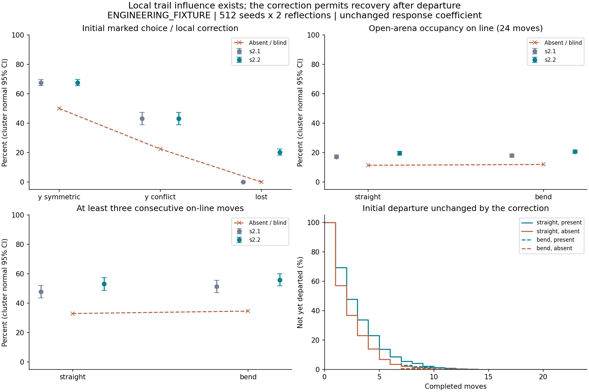
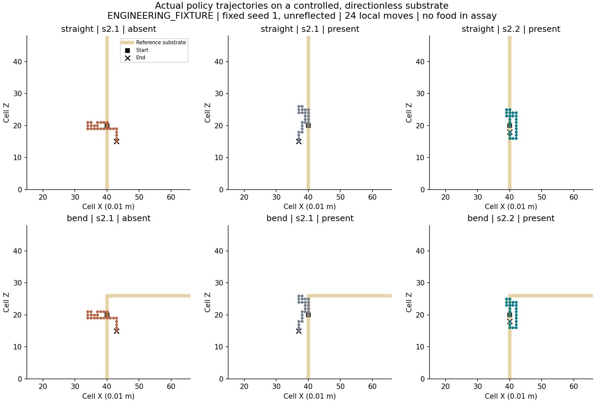
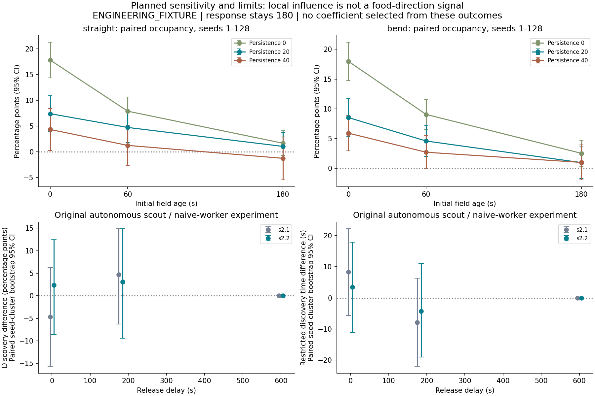

# S2.2 Results: Trail-following Mechanism Validation

**Scoped acceptance: PASS for local trail influence and the frozen continuous-following criterion.** A scalar local trail changes naive marked-arm choice, open-arena occupancy and the probability of consecutive on-line steps under the declared conditions. This effect already existed in S2.1. A narrow correction now permits recovery towards the only adjacent signal instead of categorically excluding it.

This is **not** evidence of high-fidelity uninterrupted following or reliable colony recruitment. Every primary continuous trial departed at least once within 24 moves. The original single-scout social experiment still has uncertainty intervals spanning zero. Development stops at S2.2 for independent review; S3 is not authorized.

All model coefficients, geometry, signal units, times and numerical scenario values are `ENGINEERING_FIXTURE`, not measured Lasius niger constants.

## Provenance and frozen design

- Base: `c3d24e83aebc95840dbcd96629334dd2d1212f82`, `codex/s2.1-foraging-validation`.
- Protocol and primary literature committed before changes: `1b9bdbd`.
- Unmodified S2.1 behavior, new assay harness and all 55,296 baseline trials: `173d372`.
- Production correction, regressions and fixed data: `f486b2582e838057d49ed92e46954dd4b599433b`, `codex/s2.2-trail-validation`.
- [Frozen protocol and ADR](docs/29_S2_2_Validation_Protocol.md), [literature rationale](docs/30_S2_2_Literature_and_Model_Rationale.md), [data dictionary/reproduction](experiments/s2_2/README.md).

All S2.1 original reports, combined CSV, raw trials, field samples, summaries and figures remain unchanged. A Git comparison against the base confirms no changes under `experiments/s2_1/`, `S2_1_RESULTS.md` or `S2_1_EXPERIMENTS.csv`. S0-S2 historical evidence is also retained.

The new [S2_2_EXPERIMENTS.csv](S2_2_EXPERIMENTS.csv) contains **110,592 local trials**, 55,296 per model, including every complete trajectory. Integrated social evidence is separately stored in [social/](experiments/s2_2/social/social.csv), with 1,152 trials, 24,576 choice diagnostics and 130,875 sparse field samples. The original 128-run broad ablation matrix and all 7,808 time samples were also rerun.

## Scientific basis and diagnostic reasoning

The literature supports testing distinct endpoints, not transferring a success percentage into code. In Lasius niger, leaving a marked segment increased U-turning even without route memory; the reported speed/straightness synergy depended on memory. This motivates a local correction hypothesis, not a forced reversal or calibrated coefficient. [Czaczkes et al. 2011](https://doi.org/10.1098/rsbl.2011.0067)

Branch geometry can compete with pheromone, so the model should not invariably choose a marked turn over a straighter alternative. The laboratory angles differ from this cardinal-grid fixture. [Forster et al. 2014](https://doi.org/10.1111/eth.12248) Open-arena occupancy near a trail is also a different endpoint from speed, straightness or initial Y-maze choice. [Poissonnier et al. 2026](https://doi.org/10.1007/s00040-026-01106-9) The literature review includes trial variability and a negative route-learning study; neither perfect following nor universal memory benefit is assumed.

| Existing rule | Source-derived prediction | Measurement and decision |
|---|---|---|
| Heading persistence adds 20 | A straight alternative can outweigh a marked turn | At the asymmetric junction, marked-turn choice is 43.16%, versus 22.46% without signal: signal matters but does not dominate. Retained. |
| Already visited candidate has base weight 1 rather than 10 | Graded suppression can weaken revisits despite signal | The visited non-predecessor probe chooses the marked candidate 22.66% with signal versus 3.03% without. Retained as an uncalibrated fixture. |
| Experienced predecessor excluded when alternatives exist | The only locally visible trail can receive exactly zero probability after departure | The lost-cue baseline correction rate is zero across every declared seed/condition. This categorical exclusion is the minimal change target. |
| Local scalar concentration adds a graded contribution | Supports attraction without identifying which direction leads to food | Symmetric branch choice and open-arena following effects are positive before modification. No extra field direction or stronger coefficient is needed to establish local influence. |
| Food, loaded/bounded return and valid memory have priority | May suppress trail-mediated exploration in integrated runs | Preserve priorities; disable learned memory in local and social assays and keep original memory ablations. |

For the fresh primary fixture, equal unvisited Y alternatives have weights 21.25 and 10, predicting a marked-arm probability of 0.68. A marked turn against an unmarked persistent continuation has weights 21.25 and 30. In the lost-cue probe, the original predecessor veto overrides every finite concentration. Admitting it retains its visited weight: 1 + 11.25 versus other weights totaling 50. These calculations describe the engineering model, not ant sensory physiology.

## Minimal production change

`choose_behavior()` now admits the experienced predecessor into its ordinary weighted choice **only when it is the sole adjacent above-cutoff signal and trail response is enabled**. The visited-cell penalty remains. Other stochastic alternatives remain. When another signal is visible, the existing predecessor exclusion remains. Local food, memory and loaded return still take precedence.

The predecessor belongs to the bounded loop-erased trace; after closing a loop, it need not be the immediately prior physical cell. The experiment therefore measures physical U-turns independently. The new condition can also act near a trail end; it is an engineering inference from local correction evidence, not a claim that ants implement this exact Boolean rule.

No production coefficient, deposit, half-life, cutoff, sensor radius, movement speed, route capacity or memory lifetime changed. No new state or chemical injection API was added. No path, global food coordinate, chemical arrow, teleportation or task-completion shortcut enters the policy. The single-writer commit/undo paths and material ledgers are unchanged. Binary schema remains 3; physics is **5**, with atomic rejection of previous physics, including S2.1 physics 4.

## Local assay and uncertainty

Six contexts separate symmetric/conflicting junction choice, straight/bent continuous lines, sole-predecessor recovery and the visited penalty. Present, absent and blind (field present, response zero) treatments use mirrored geometry and identical seeds. Primary age zero / persistence 20 uses seeds 1-512; each other age/persistence cell uses seeds 1-128. Ages are 0/60/180 seconds; persistence values are 0/20/40. Response stays 180. Decay proceeds during the trial, with no field reinforcement.

The two Y arms are staircase paths on the existing cardinal lattice. Their first symmetric exits are both lateral; this is a Y topology test, **not a continuous-angle replication**. Junction observations are one decision. Continuous validation uses 24 freely chosen moves in an open arena, so walls do not force tracking. Workers receive no food cues or learned routes, only a short physically adjacent approach history and four local scalar samples.

These are detached production-policy assays on controlled experimental substrates, not fabricated colony deposits or committed WorldRuntime facts. The independent social regression below exercises actual autonomous deposits, movement transactions, resource balances and saves. The assay updates a bounded loop-erased trace and records its entire physical trajectory; no intended route is fed to the policy.

Primary differences use 4,096 bootstrap draws resampling seed clusters containing both mirrors, analysis RNG seed 2202. Other intervals are normal approximations over seed-cluster means. The balanced sensitivity table uses the common predeclared seeds 1-128 for every cell while retaining all 512 primary seeds in acceptance results. Intervals are descriptive, unadjusted for multiple comparisons, and not biological population estimates. All failed choices and departures remain; no seed was removed or replaced.

## Local results

Rates below pool 512 seeds x 2 reflections. Present-minus-absent intervals are paired seed-cluster bootstrap intervals. Blind paths exactly match absence. The marked-arm result and initial departure behavior do not change between S2.1 and S2.2.

| Primary endpoint | Absent / blind | S2.1 present | S2.2 present | S2.2 minus absent, percentage points (95% interval) |
|---|---:|---:|---:|---|
| Symmetric Y, marked first branch | 50.00% | 67.68% | 67.68% | +17.68 [15.53, 19.73] |
| Straight, on-line occupancy | 11.39% | 17.28% | 19.69% | +8.30 [6.65, 9.90] |
| Straight, at least three consecutive on-line moves | 33.01% | 47.85% | 53.13% | +20.12 [14.06, 25.98] |
| Bend, on-line occupancy | 11.95% | 18.04% | 20.72% | +8.77 [7.28, 10.21] |
| Bend, at least three consecutive on-line moves | 34.67% | 51.37% | 55.96% | +21.29 [15.53, 26.95] |
| Lost cue, immediate correction to signal | 0.00% | 0.00% | 20.31% | +20.31 [18.16, 22.36] |

Compared directly with S2.1 present trials, the correction adds **2.41 occupancy percentage points** on the straight line (95% interval 1.22 to 3.61), and **2.68 points** on the bend (1.46 to 3.86). Three-step streak probability changes by +5.27 points [1.56,8.98] and +4.59 [0.98,8.30], respectively. The predeclared local criterion was already satisfied by the untouched S2.1 baseline; the change addresses recovery rather than manufacturing that result.

**Limits and movement costs:** the mean initial consecutive run with signal is only 2.10 steps on the straight line and 2.05 on the bend. Only 8.59% have not yet departed after six moves; after twelve moves this is 0.39% / 0.49%. Every primary trial has departed by move 24. These initial departure sequences are exactly unchanged by the correction. The mean maximum run including later reacquisition is 3.17 / 3.22 moves. More later tracking therefore does not mean uninterrupted navigation.

The correction increases physical U-turns by 0.354 per straight trial and 0.397 per bend trial. Direct new-minus-old net-displacement differences are approximately -0.00002 m [-0.00354,0.00351] and -0.00165 m [-0.00474,0.00143]. There is no demonstrated increase in outward progress, and the scalar line supplies no outward food direction. All trials travel the same 0.24 m total, so occupancy gains are not shorter completed trips.

## Planned parameter sensitivity

The straight-line occupancy effect weakens as the field ages, and depends on persistence. This table uses the common 128-seed sensitivity set, so its fresh/persistence-20 estimate differs slightly from the 512-seed primary estimate. Response coefficient remains 180 in every present condition.

| Age | Persistence 0: effect, pp (95% interval) | Persistence 20 | Persistence 40 |
|---|---|---|---|
| Fresh | +17.81 [14.36,21.25] | +7.39 [3.88,10.90] | +4.33 [0.28,8.38] |
| 60 s | +7.88 [5.12,10.64] | +4.72 [1.80,7.64] | +1.24 [-2.64,5.11] |
| 180 s | +1.66 [-0.74,4.06] | +1.04 [-1.61,3.69] | -1.27 [-5.43,2.89] |

The negative aged/high-persistence point estimate is retained. Reducing persistence was a diagnostic condition, not a selected production setting. These results identify sensitivity in the current competing-cue model; they do not calibrate the correct biological balance. All bend, visited, lost and Y sensitivity cells and their intervals remain in [sensitivity_balanced.csv](experiments/s2_2/sensitivity_balanced.csv).

## Original social recruitment and broad regressions

The exact S2.1 real-scout protocol was rerun: 64 seeds, two mirrored source locations, matched training/stock/state, present/absent/blind, delays 0/180/600 seconds, no learned memory and a 180-second novice window. All 128 seed/orientation training pairs succeeded, with the same paths/times/initial fields as S2.1. No food route was supplied to the novice. Non-discoverers remain censored at the end of the window; restricted means include them.

| Condition, 128 novices each | Discovery | Restricted discovery time, s | Mean novice delivery, ug | Discovery difference vs absent, pp (95% interval) |
|---|---:|---:|---:|---|
| Absent / blind, both versions | 74 (57.81%) | 113.65 | 664.06 | Reference |
| S2.1 present, fresh | 68 (53.13%) | 121.98 | 578.13 | -4.69, uncertain |
| S2.2 present, fresh | 77 (60.16%) | 117.05 | 703.13 | +2.34 [-8.59,12.50] |
| S2.1 present, 180 s old | 80 (62.50%) | 105.78 | 726.56 | +4.69, uncertain |
| S2.2 present, 180 s old | 78 (60.94%) | 109.40 | 726.56 | +3.13 [-9.38,14.84] |
| S2.2 present, 600 s old | 74 (57.81%) | 113.65 | 710.94 | 0.00, identical initial-discovery control |

Fresh-trace restricted discovery time differs from absence by +3.40 s [-11.24,17.86], and delivery by +39.06 ug [-140.63,218.75]. These intervals do not establish improved social recruitment. At 600 seconds the scout trace has vanished and discovery time/path matches absence; later deliveries can differ because a successful novice deposits its own trail. Old and new social intervals are recomputed with analysis seed 2202 for this comparison; original S2.1 intervals using seed 2101 remain unchanged in their historical report.

The unchanged broad 16-seed matrix also remains mixed:

| Layout / treatment | S2.1 mean deliveries | S2.2 mean deliveries | S2.2 coverage |
|---|---:|---:|---:|
| Open / neither | 7.500 | 7.500 | 83.18% |
| Open / trails only | 6.563 | 7.125 | 83.33% |
| Open / memory only | 61.250 | 61.250 | 81.34% |
| Open / both | 72.875 | 80.938 | 82.63% |
| Barrier / neither | 1.625 | 1.625 | 72.19% |
| Barrier / trails only | 1.875 | 1.375 | 72.73% |
| Barrier / memory only | 15.188 | 15.188 | 71.23% |
| Barrier / both | 21.625 | 20.688 | 74.69% |

None/memory-only rows are exactly unchanged. Aggregates include sample SD, ranges and paired comparisons in the data directory. Each delivery in this fixture is 1,000 ug. Broad delivery changes include experienced returns and cannot substitute for the naive-worker recruitment test. The barrier trail-only decline is not hidden.

## Distinct remaining explanations

1. **Local detectability and response:** demonstrated, with explicit absent/blind controls. Lack of social benefit is not evidence that the signal has no effect.
2. **Route direction:** occupancy of a directionless line does not select its foodward end. Recovery can add reversals without increasing progress. No artificial directional chemical encoding was added.
3. **Path shape:** the symmetric junction, conflicting heading, bend and actual scout trace are different problems. Lattice steps, loop erasure and persistence still constrain navigation. An arbitrary experienced route is not equivalent to a prepared straight line.
4. **Signal age:** the planned decay controls show weaker/uncertain local effects at low signal. The real scout's cells have different deposition times, unlike the uniformly prepared local substrate. No half-life or signal strength was increased.
5. **Experimental conditions:** the social fixture has one retired scout, one novice, a single initial trace and a short window. It does not test sustained multi-scout reinforcement, other substrates or calibrated sensory steering. The broad matrix is complementary, not proof of a particular causal explanation.

These are distinguishable model properties and experimental limitations, not a claim to have identified a single cause of weak recruitment. Future changes need their own question and review. No additional tuning followed the fixed matrix.

## Verification and reproduction

Environment: Windows x64 build 10.0.26200, Intel Core i7-13620H, pinned LLVM-MinGW 20261104 / Clang 23.1.5, CMake 3.31.10, Ninja 1.13.2. C++ uses only the standard library. Analysis uses Python's standard library; figures reuse the separately pinned matplotlib requirements.

| Check | Executed command / evidence | Result |
|---|---|---|
| Debug | `pwsh -NoProfile -File tools/build_windows.ps1 -Configuration Debug` | PASS, 56/56, 20.81 s test time |
| Release | `pwsh -NoProfile -File tools/build_windows.ps1 -Configuration Release` | PASS, 56/56, 2.63 s |
| ASan + UBSan | `pwsh -NoProfile -File tools/build_windows.ps1 -Configuration Debug -BuildDirectory build/sanitized -Sanitizers` | PASS, 56/56, 45.99 s; halt-on-error enabled |
| Hosted CI | [implementation run at f486b25](https://github.com/Aquaticfuller/AntWorld/actions/runs/42498942275) | PASS, all five jobs: Windows/Linux Debug/Release and Linux Clang ASan/UBSan with leak detection |
| Local matrix | `./build/release/antworld_s2_2_experiment.exe experiments/s2_2/fixed 512` | PASS, 55,296 rows |
| Social matrix | `./build/release/antworld_s2_1_experiment.exe experiments/s2_2/social 64 s2.2` | PASS, all 1,152 trials and final checkpoint round trips |
| Broad matrix | `./build/release/antworld_s2_experiment.exe experiments/s2_2/ablations 16 1800000` | PASS, 128 runs / 7,808 samples with ingredient conservation |
| Analysis | `python tools/analyze_s2_2.py`; `python tools/analyze_s2.py experiments/s2_2/ablations` | PASS; CI regenerates/checks committed evidence |
| Repository | `python tools/verify_handoff.py`; `python tools/check_repository.py`; `git diff --check` | PASS; image labels and English metadata manually checked |
| Figures | `python tools/plot_s2_2.py --packages .tools/s2_1-python` | PASS, three SVG/PNG pairs; visually checked |
| Independent clean builds | Export `173d372` and `f486b25` tracked `cpp/` and `scenarios/`, configure separate Release builds, run CTest | PASS, baseline 51/51 (4.74 s), fixed 56/56 (5.17 s) |
| Full clean reproduction | Rerun both local matrices, fixed social and fixed broad matrix; `tools/verify_s2_2_reproduction.py` | PASS, all seven raw files exactly match after CRLF/LF normalization only |

All 51 S0-S2.1 tests remain. Five additions are `S2_2_MODEL`, `S2_2_LOCALITY`, `S2_2_CONTINUOUS`, `S2_2_REPLAY`, and `S2_2_EXPERIMENT_SMOKE`. They cover correction eligibility/distribution, other-signal exclusion, memory/return priority, below-cutoff behavior, mirrored three-way junctions, legal single-edge movement, repeated policy trajectories, exact blind controls, real resource balances, full/chunked/restored continuation and atomic old-physics rejection. The existing allocation-failure tests still exercise the unchanged transaction paths. The S2.1 experiment smoke registration now obtains the model label from the compiled physics instead of falsely labeling physics 5 as S2.1.

An initial new MODEL test incorrectly left memory disabled while asserting memory priority; enabling it in that specific subcase corrected the test fixture. The production priority rule was not changed. Final builds above include that correction.

Full commands, input definitions and baseline export instructions are in the [experiment README](experiments/s2_2/README.md). [Reproduction hashes](experiments/s2_2/reproduction.json) record seven independent raw-file comparisons. Cross-platform floating-point byte identity is not promised; all platforms run the behavioral regressions.

### Performance

`pwsh -NoProfile -File tools/benchmark_s2_windows.ps1 -OutputDirectory out/s2_2-performance` ran all four retained Release fixtures sequentially after builds/tests. [Raw outputs](experiments/s2_2/performance/active_workers.csv) are retained.

| Active workers | Advance p50 / p95, us | Simulated seconds / wall second | Checkpoint bytes | Save / restore, ms |
|---:|---:|---:|---:|---:|
| 16 | 54.6 / 87.8 | 19,080.13 | 885,375 | 4.46 / 3.67 |
| 128 | 482.4 / 689.7 | 2,141.55 | 6,899,967 | 20.78 / 24.27 |
| 512 | 1,709.3 / 2,195.9 | 637.23 | 27,501,055 | 74.12 / 133.17 |

With 32 active transactions against 32/2,000/20,000 stored ants, median advance is 23.3/17.8/17.6 us. Scheduler schedule/cancel medians are 0.280/0.329/0.367 us at 128/1,024/4,096 pending events. Sampled peak process working set is 160,677,888 bytes for the active-forager fixture and 43,085,824 bytes for fixed-active transactions. S0 diagnostic median advance is 0.031 ms. This is consistent with the prior order of cost and introduces no whole-State copy; one host run does not establish a statistical regression bound. Checkpoints still grow with retained history, and large fixtures raise temporary host limits explicitly.

## Changed files and final gate

Production changes are confined to `cpp/src/behavior.cpp`, physics/comment declarations in `cpp/include/antworld/core/`, and experiment labeling/build registration. New fixtures/tests are `cpp/apps/s2_2_fixture.hpp`, `cpp/apps/antworld_s2_2_experiment.cpp` and `cpp/tests/test_s2_2.cpp`. Analysis, plotting and reproduction helpers are `tools/{analyze_s2_2.py,plot_s2_2.py,verify_s2_2_reproduction.py}`. Raw/derived evidence is under `experiments/s2_2/` and the root CSV; CI, repository entry points, documents 29/30, traceability, changelog and this report identify the new gate. No transaction, resource transfer, Unity, Game Master or S3 implementation was added.

The frozen local criterion is met before and after the minimal fix, with seed-cluster intervals above zero for marked-arm choice, straight occupancy and three-step streak probability. The fix additionally removes an absolute local correction obstruction while preserving all numerical weights. **S2.2 local mechanism validation passes; uninterrupted navigation, biological calibration and reliable social recruitment remain unproven.** The review branch is the stopping point. Only the user's next independent review can authorize S3.
