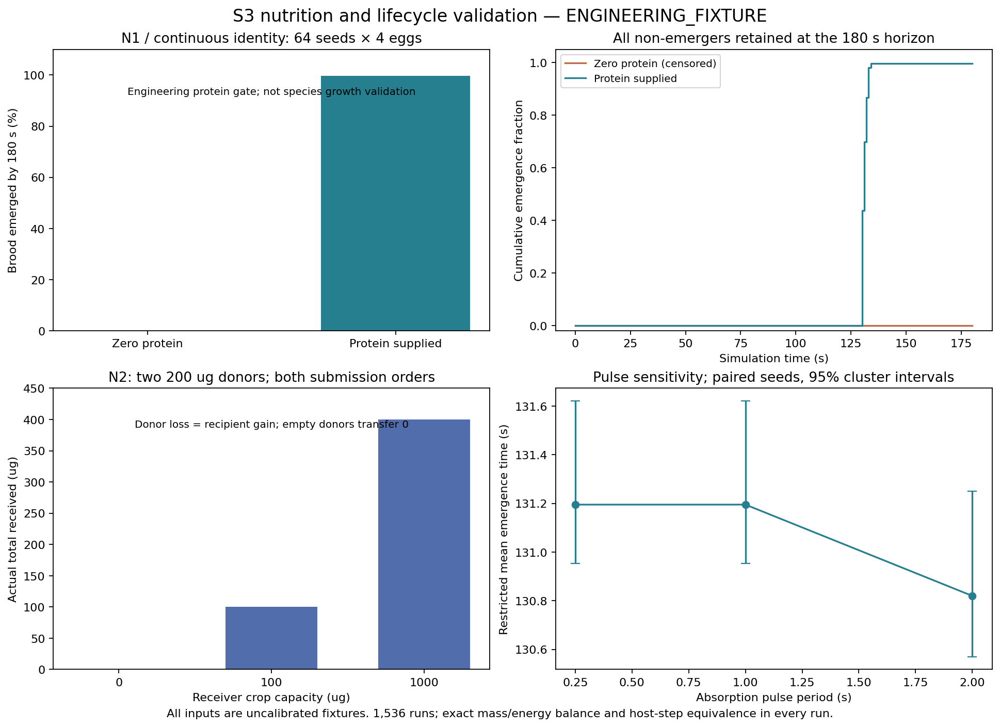

# S3: Physiology, Nutrition, Trophallaxis and Brood

Acceptance: **CONDITIONAL PASS**, subject to independent Code Review. Implemented mechanism invariants pass local verification; biological calibration, surplus nutrition redistribution and dense contact-query scaling remain open. S4 has not been started and is not authorized.

Branch: codex/s3-physiology. Approved parent: 18b0c9f5d5b5d60504a48ac193dce53c59f001d0. The implementation protocol was frozen in abe846e before changing the core. Final tested C++ source: 2acf069f50a5f019ed364634d2eef75429b10a3b. All previous reports, raw data and 56 CTest registrations are retained. Every biological parameter remains **ENGINEERING_FIXTURE**.

## Implemented behavior and accounting

Optional individual physiology separates carried parcels, crop, body energy, body water and retained larval protein. Explicit fixture initialization records initial reserves; actual cargo ingestion and physical nest withdrawal debit existing inventory. Trophallaxis validates living participants, same-colony contact, recipient stage/capacity and available donor stock. Partial success transfers exactly the same ingredient vector out of the donor and into the recipient. Shared-source competition retains deterministic seeded arbitration, independent of request submission order across individuals.

Energy expenditure and body-water loss integrate analytically between events. Fixed nutrient pulses convert actual carbohydrate mass to energy using a versioned yield, absorb crop water and retain larval protein. No colony-wide averaging or humidity-as-drinking shortcut exists. Oxidized carbohydrate, lost water and dissipated energy are explicit sinks. Dead inventories remain accounted. Initial inputs and potential future carbohydrate energy are overflow-checked before committing additions.

The automatic lifetime is Egg -> Larva -> Pupa -> Adult, with the same AntId and birth record. Larval progress requires retained protein and positive reserves. Death can interrupt any stage; depletion is handled in the environment phase before later same-time actions. There is no fixed lifespan timer, new adult identity or unsourced growth. Legacy forced lifecycle fixtures remain only for individuals without enabled physiology; S3 development cannot be bypassed with those fixtures.

Individual Paused/Rest/Nurse/Forage programs can be activated or switched during a run. Pausing cancels owned behavior work while continuing metabolism and retaining cargo, crop and experienced routes. Resumption uses the existing route. Nursing observes contacting nestmates and physical nest stock, with private deterministic random ties; it does not inspect distant needs. These APIs are engineering controls for individual experiments, not a colony labor-allocation interface. The S2.2 food sensing and trail-choice algorithm/coefficients are unchanged.

Every mutation extends the existing single-writer undo journal. Whole-world copies are not introduced. A failed transfer, schedule insertion, state change, AdvanceTo or restore leaves the prior authoritative checkpoint unchanged. Read-only physiology queries project continuous state to current committed time without consuming RNG or editing stored rows.

## Numerical contract and persistence

Schema **4**, physics **6**, magic AWCKPT4. Older saves are rejected explicitly; there is no silent migration. The S3 appendix stores all individual configuration, original reserves, crop, body state, explicit sinks, sub-microgram remainders, development progress, private decision counters and owned schedules. Restore checks ingredient/energy balances, replays physiology against committed evidence, checks stage/contact/ownership invariants and swaps only a validated world. Queued trophallaxis recipients use the generic payload field as a world-local EntityId; facts carry their WorldId and the same recipient payload.

Body energy is integer nanojoules internally, exposed as joules. Power is nanojoules per millisecond; water rates are micrograms per second with a persistent remainder. Host step partition error is **zero** for this piecewise model, including checkpoint continuation. A non-integral depletion time rounds to the first representable millisecond, less than 1 ms late; no later-phase action at that boundary succeeds. Unabsorbed crop cannot resurrect an already depleted individual.

Absorption is a discrete model pulse, not a claim of exact continuous digestion. Its maximum per-pulse amount is the configured rate times period, plus less than 1 ug from the retained fractional credit, capped by actual stock/capacity. Changing pulse period changes the model and can change timing and social allocation. The sensitivity experiment reports this separately from exact host-step consistency. Stage durations 30/60/30 seconds and the 100 ug larval protein gate are testing fixtures, not natural developmental times.

## Verification

Local environment: Windows 10.0.26200 x64, Intel Core i7-13620H; pinned LLVM-MinGW 20261104 (Clang 23.1.5), CMake 3.31.10, Ninja 1.13.2; C++20 standard library only. Strict compiler warnings are errors. The final suite has 56 retained registrations and 15 S3 registrations.

| Check | Status / evidence |
|---|---|
| Debug | PASS: 71/71, 20.61 s |
| Release | PASS: 71/71, 4.52 s |
| ASan/UBSan | PASS: 71/71, 105.20 s, no findings |
| GitHub Actions | PASS: all five jobs on tested source 2acf069; Windows MSVC Debug/Release, Ubuntu GCC Debug/Release, Ubuntu Clang ASan/UBSan with leak detection. [Verified run](https://github.com/Aquaticfuller/AntWorld/actions/runs/42507846473) |
| Multi-seed experiment | PASS: 1,536 runs, 5,376 individual records, all 64 prescribed seeds |
| Mass, energy, partition equivalence | PASS in every run; exact integer balances and matching checkpoints |
| Semantic corruption | PASS: re-signed malformed physiological fields rejected without changing live state |
| Allocation failures | PASS: ten S3 sweeps, 6/10/3/7/11/9/11/77/7/7 allocation points in Release |
| Performance | PASS measured fixtures; dense nursing scaling limitation retained below |
| Clean source reproduction | PASS: clean export of 2acf069f50a5f019ed364634d2eef75429b10a3b, 71/71 tests (6.13 s), all three raw artifacts identical across 1,536 reruns |

S3 tests: INITIALIZATION, INTEGRATION, EXCHANGE, CONSTRAINTS, INGESTION, THRESHOLDS, LIFECYCLE, BEHAVIOR, REPLAY, ROLLBACK, LOCALITY, CORRUPTION, ALLOCATION_LIMIT, ALLOCATION_FAILURE, EXPERIMENT_SMOKE. They cover SCH-05/07/23, document-21 N1/N2, death-before-action ordering, whole-advance rollback and allocation failure. ALLOCATION_LIMIT retains the observed negative nutrition result; it does not assert biological adequacy. Existing S0-S2.2 tests retain their original names and mechanism assertions.

The first Linux CI evidence audit failed because the generated hash manifest used platform-native path separators. Windows audits and Clang sanitizer tests passed. Added bounded public audit diagnostics, identified the exact stale file, and changed only manifest keys to portable POSIX paths. Original CSV bytes and C++ model outcomes were unchanged; the failure is retained here rather than reported as an uninterrupted CI pass.

After that audit fix, GCC rejected two compact loop/follow-up lines in the new experiment/test code under `-Werror=misleading-indentation`. Added explicit braces and separate follow-up statements; execution semantics and model parameters are unchanged. Compiler warnings remain errors.

Both issues are resolved in the successful run linked above. Local tests were rerun after the final source formatting change; sanitizer wall time includes contention from concurrent clean builds and is not a performance benchmark. The final raw reproduction hashes match the initial implementation exactly. Repository language/manifest checks passed; the new PNG and metadata were visually checked in English.

## Complete experimental evidence

Raw data: S3_EXPERIMENTS.csv, experiments/s3/raw/individuals.csv and raw/configuration.json. Two initial stages x two protein conditions x three pulse periods x 64 seeds give 768 nutrition/development runs. Three recipient capacities x supplied/empty donors x forward/reverse submissions x 64 seeds give 768 exchange runs. Every run also checks irregular host stepping and restored continuation.

Intervals below are seed-cluster percentile bootstrap intervals, 4096 resamples with analysis seed 3003. Four brood in one seed are not independent samples. Non-emergers remain in the restricted mean at the full 180-second observation horizon. Constant intervals describe these fixed fixtures, not certainty about natural colonies.

| Primary result, 1000 ms pulses | Protein supplied | Zero protein |
|---|---|---|
| N1, initially larval: emergence by 180 s | 256/256 (100%) | 0/256 |
| N1 restricted mean emergence | 102.070 s [101.980, 102.156] | 180 s |
| N1 actual internal transfer mass per run | 1179.719 ug [1153.000, 1203.781] | 0 ug |
| Initially egg: emergence by 180 s | 255/256; 99.609% [98.828, 100] | 0/256 |
| Initially egg restricted mean emergence | 131.195 s [130.953, 131.621] | 180 s |
| Initially egg retained tissue protein per run | 399.688 ug [399.063, 400] | 0 ug |

In N2, receiver capacities 0/100/1000 ug receive exactly 0/100/400 ug from two supplied 200 ug donors. Empty donors transfer zero. Reversing submission order changes no individual's final ingredient inventory; shortage winners vary across seeds. These transfers are internal circulation, not additional colony intake.

The negative development result is explicit: **seed 43**, 1000 ms pulses, entity 6 remains a larva with 80 ug tissue protein. Entities 4/5/7 each received 240 ug protein and retain 140 ug in crop after incorporating 100 ug. Total input 800 ug = retained tissue 380 ug + crop 420 ug. Concurrent local gifts can oversupply recipients; these minimal programs do not mobilize surplus crop in emerged workers. This is a model limitation, not a conservation error. No coefficients or seeds were changed after observing it. See open debt SD-04 and the dedicated regression.

Sensitivity uses the same seeds and initial state at 250/1000/2000 ms pulses. At 250 ms, the reported primary endpoints equal the 1000 ms fixture. At 2000 ms, the paired restricted emergence difference is -0.602 s [-0.641, -0.563] for initial larvae and -0.375 s [-0.410, -0.336] for initial eggs. N1 internal transfer increases by 44.563 ug [36.000, 54.875]; final energy is unchanged. These are model/discretization interactions, not improved biological calibration or a reason to replace the frozen default.



## Performance and remaining limits

Release measurements cover ten simulated seconds with 1-second host advances. At 1,000 registered individuals, no active nurse costs 10.576 ms total (p95 1.337 ms/advance); one active nurse costs 12.123 ms (p95 1.478 ms). With all 1,000 nursing at one location, total cost is 1455.01 ms (p95 176.357 ms). The current local-contact reference query scans registered physiology rows: dense activity is quadratic and needs a contact index before scaling (TD-01). There is no global biological knowledge despite the implementation scan.

The dense 1,000-nurse save is 5,619,630 bytes; save/restore 15.904/20.343 ms. Sampled peak process working set for the S3 matrix is 33,288,192 bytes. Initial capacity validation also scans existing physiology during fixture seeding; initialization timing is excluded from AdvanceTo measurements. The S3 per-individual update and undo path do not copy the full world.

Retained S2 benchmark at 512 active workers: p95 2445.4 us/advance, 616.43 simulated seconds per wall second. S1 fixed 32 active actions among 32/2,000/20,000 stored ants has p95 31.0/20.0/20.5 us. Scheduler schedule/cancel p95 is 0.410/0.393/0.666 us for 128/1,024/4,096 pending events. Hardware noise limits comparisons; these are bounded engineering fixtures, not full-world population promises. All raw timings and sampled memory are retained.

Scientific debts SD-01/02/03 remain open: initial continuous trail following averages only about two steps; reliable long-distance tracking is unproven; real social recruitment benefit remains nonsignificant. S3 adds no food oracle, directional chemical arrow or trail tuning. SD-04/05 record nutrition redistribution and uncalibrated physiology. Climate dependence, egg laying, liquid-versus-solid digestion detail, tissue maintenance, mature mortality hazards, brood relocation and integrated S6 colony ecology remain outside this implementation. No Unity, GM or S4 geometry was added.

## Changed areas and reproduction

- Public physiology types and runtime methods; new physiology implementation and checkpoint appendix.
- Existing event/scheduler, action resolution, undo map and surface evidence auditing extended for physiology and behavior switching.
- S3 tests, reusable fixture, experiment and performance executables; CI includes historical and S3 data audits.
- Analysis, plotting, raw/derived data, scientific debts, current instructions, README and manifest.

```powershell
./tools/build_windows.ps1 -Configuration Debug
./tools/build_windows.ps1 -Configuration Release
$env:ASAN_OPTIONS='halt_on_error=1'
$env:UBSAN_OPTIONS='halt_on_error=1:print_stacktrace=1'
./tools/build_windows.ps1 -Configuration Debug -BuildDirectory build/sanitized -Sanitizers
./build/release/antworld_s3_experiment.exe out/s3-reproduction 64
python tools/verify_s3_reproduction.py out/s3-reproduction --source-commit <tested-commit> --report out/s3-reproduction.json
python tools/analyze_s3.py --check
python tools/plot_s3.py --packages .tools/s2_1-python
./tools/benchmark_s3_windows.ps1 -OutputDirectory out/s3-performance
python tools/verify_handoff.py
python tools/check_repository.py
```

See experiments/s3/README.md for pinned plot dependencies, file definitions and portable CMake commands. Independent review must decide the next gate. Development stops at S3.

The clean-source check exported only committed cpp/ and scenarios/ using `git archive`, configured a new Release build directory with the pinned toolchain, executed all 71 CTest registrations, then ran `antworld_s3_experiment out/s3-clean-final-reproduction 64`. `python tools/verify_s3_reproduction.py out/s3-clean-final-reproduction --source-commit 2acf069f50a5f019ed364634d2eef75429b10a3b` produced the committed reproduction.json. No prior build cache or untracked source was included.
