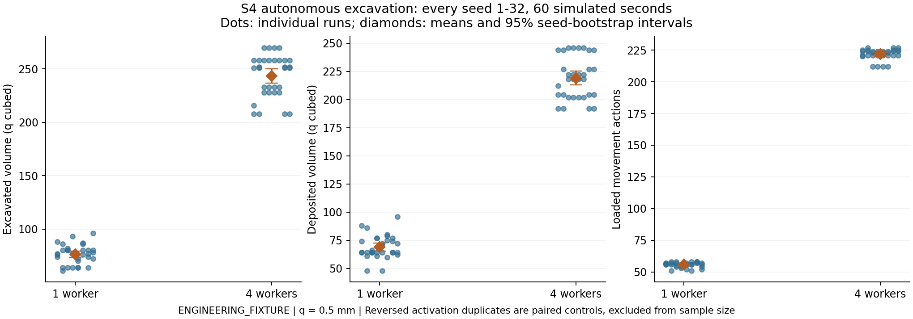
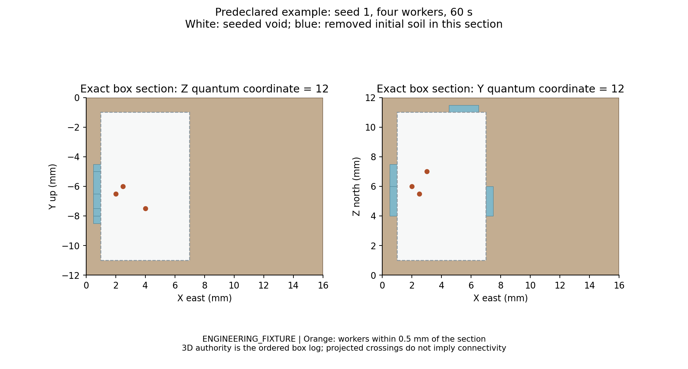

# S4 results: 3D excavation and connectivity

**Engineering assessment: PASS within the frozen box-kernel scope, subject to independent Code Review. S5 is not authorized.** No Unity, Game Master, durable database layer, climate solver or S5/S6 integration was implemented.

The approved S3 baseline is `288b01397ffada4397afdfe63e185dfd51c4c486`. Protocol/debt registration preceded code in `ab9c67b`. Implementation is `3ba707615024e9dfe3e5986e48279e0d80e18dc8`; the final C++ source is `8b64d1affe318c310f3be7ca9142003bcf6794aa`, which makes restored-index marker types explicit for MSVC. Branch: `codex/s4-excavation-connectivity`.

## Scope and implementation

| Area | Implemented behavior / source |
|---|---|
| Geometry authority | `GeometryConfig` initial solid, seeded voids and immutable rocks plus ordered Excavate/Fill box edits. `geometry_kernel.cpp` partitions relevant exact box boundaries and computes occupied/empty volume, rather than treating sampled occupancy as truth. |
| Material transactions | `excavation.cpp` validates actor, position revision, complete local reach envelope, accessible face, work duration, material, capacity and energy. Overlaps recompute against current material. Successful removal creates a stable parcel linked to edit, actor, source and committed fact. Drop, pickup and fill move actual inventories. |
| 3D motion and portals | `geometry.cpp` derives versioned local axis transitions with proved swept-body clearance. Bounded A* composes them into detached observer routes. Loaded food/soil enlarges the envelope. Routes and pending moves are revalidated against current geometry; fill immediately deletes passability. |
| Local SDF | True distance to the opposite material class in the exact local box arrangement, truncated to a declared band. Sparse bricks hold 125 samples, with source revisions. Explicit transactional rebuild and halo invalidation cross seams. Reads never build caches or consume RNG. |
| Contact and sensing | Generic indexed neighborhood query for geometry-enabled worlds. Trophallaxis, food/nest access, surface sensing and motion apply authoritative barriers. Nursing uses local candidates; distant need does not reach the individual model. |
| Individual excavation | Private deterministic choices among local frontiers and clear steps; bounded experienced trace to the known depot. No nest blueprint or global food knowledge. Runtime activation, pause, switching and death preserve actual soil and cancel owned work. |
| Persistence | Schema **5**, physics **7**. Persist authoritative geometry, ordered edits, provenance, parcels, requests, ledgers, traces and schedules. Rebuild indices and discard SDF warmness. Historical validation replays geometry at each fact's time, so a later fill neither legitimizes an earlier wall crossing nor invalidates an earlier legal contact. |
| Atomicity | Existing single-writer touched-entry undo journals extended to geometry, index, parcel, ownership, request, excavation and cache stores. No whole-State copy was introduced into ordinary mutations. Restore validates a replacement before publishing it. |

All numeric biological, material and behavioral choices remain **ENGINEERING_FIXTURE**. Coordinates are meters, X east/Y up/Z north; time is integer milliseconds. One coordinate quantum is 0.5 mm, hence one cubic quantum is 0.125 cubic mm. Homogeneous soil contains 100 ug dry material and 25 ug water per cubic quantum. Soil never becomes food or crop contents. Dig work debits body energy and credits dissipated energy; nutrition remains conserved independently.

The local graph is disposable. A portal is identified by endpoints and source revision; persistent semantic chamber/portal identities and lineage are not claimed. The worker model does not call the observer route search. Its outward-distance preference is relative to its known depot, not an undiscovered goal.

## Regression and geometry tests

**All 71 inherited tests are preserved; 18 S4 registrations bring the suite to 89.** No earlier raw experiment or S0-S3 results file changed. `cpp/src/behavior.cpp` is unchanged. The full S3 matrix was rerun under physics 7: all 1,536 summary rows and 5,376 individual rows match the archived biological results, excluding the intentional physics-version field. Seed 43 still produces the underfed larva and unused protein; see `experiments/s4/regression.json`.

| S4 test | Main assertion |
|---|---|
| INITIAL | Exact initial material, half-open boundaries, invalid setup/coordinates and atomic rejection. |
| MATERIAL | Repeated dig creates no extra material; real drop/pickup/fill; exhausted parcel IDs never reused. |
| OVERLAP | All seeds 1-32, reversed submissions, exact overlap accounting and deterministic actor arbitration. |
| CONSTRAINTS | Work duration, complete local reach, empty space, immutable rocks, carrying capacity and funded dig energy. |
| SDF | True distance for overlapping voids, identical shared-face samples, halo invalidation, cache reconstruction and eviction independence. |
| NAVIGATION | Different-depth projected crossings remain disconnected; real vertical space permits a route. |
| CLEARANCE | Exact unloaded passage boundary, larger-load rejection and only proved local portals. |
| CONTACT | Thin solid walls block nearby trophallaxis, neighbor sensing and movement. |
| AUTONOMY | Local removal/carry/deposit loop; split advances, replay, pause/restart and death. |
| ROLLBACK | Geometry/index budget failures leave geometry, soil and energy unchanged; queries are pure. |
| FILL_NAVIGATION | Real supplied fill invalidates a previously legal route and pending move/contact; pre-fill contact remains valid historical evidence. |
| NEIGHBORHOOD | Distant individuals are not scanned; move and restore update/rebuild the index. |
| CORRUPTION | Rehashed semantic tampering of edit, parcel, ledger, request, fact linkage and owned schedule is rejected atomically. |
| BUDGETS | Failed multi-brick rebuild restores prior caches; exhausted route budget never invents a path. |
| CONNECTIVITY | An actual committed dig opens a previously disconnected body-clear passage; the worker carries soil through it and deposits at its real destination. |
| SURFACE_BARRIER | Retained surface sensing cannot discover food through a new 3D barrier. |
| ALLOCATION_FAILURE | 13 fault sweeps, including configuration, index, soil actions, loaded movement, restore, cache rebuild and runtime task controls. |
| EXPERIMENT_SMOKE | Complete five-condition seed-1 matrix with conservation and restore checks. |

The recorded LLVM Release allocation sweep exercises **2,517 failing allocation positions** before successful completion across 13 operations. Counts depend on the standard library; the invariant is no partial authoritative mutation. A separate cache-budget test verifies cache contents themselves roll back, even though caches are absent from checkpoint bytes.

Document-12 mapping: GEOM-01/02/03/04/06/07/09/11/13/14 covered; GEOM-05 covers authority/cache seams only. Mesh/ABI/client portions of GEOM-05/08/12/15 and authority compaction GEOM-10 remain explicitly deferred under the pre-implementation protocol. Observation purity is tested headlessly. This is not a claim that the entire historical geometry/client plan is finished.

## Executed verification

| Run | Result | Observed CTest wall time |
|---|---|---:|
| Windows LLVM-MinGW Debug | PASS, 89/89 | 28.43 s |
| Windows LLVM-MinGW Release | PASS, 89/89 | 7.69 s |
| Windows Clang ASan + UBSan | PASS, 89/89 | 79.03 s |
| Clean archived-source Release | PASS, 89/89 | 7.93 s |
| GitHub MSVC Debug/Release, GCC Debug/Release, Clang ASan/UBSan | PASS, all five jobs and their full suites | See CI record |
| Complete S4 experiment matrix | PASS, 160 runs; all seeds 1-32 | See raw data |
| Clean-source S4 reproduction | PASS, all four raw files byte-equal after LF normalization | `clean_reproduction.json` |
| Full S3 semantic regression | PASS, 1,536 runs / 5,376 individual records unchanged | `regression.json` |
| Repository/evidence audits | PASS; preserved prior stage archives, English policy and design manifest | `tools/ci_verify.py` |

Compiler: pinned LLVM-MinGW 20261104 / Clang 23.1.5, CMake 3.31.10 and Ninja 1.13.2. Test durations include concurrent local validation load and are not performance measurements. `experiments/s4/verification.json` records the observed commands and totals.

GitHub source verification: [run 42514625334](https://github.com/Aquaticfuller/AntWorld/actions/runs/42514625334), source `8b64d1a`: **all five jobs completed successfully**, recorded in `experiments/s4/ci_source.json`. The preceding run exposed MSVC narrowing in restored index construction; explicit byte markers fixed the portability issue. The CI diagnostic wrapper now recognizes MSVC diagnostic syntax as well as GCC/Clang syntax. The delivery workflow additionally runs S4 performance and all 32 seeds with exact archived-output comparison on Linux Release.

During local development, two invalid test setups were corrected (crop contents above the existing capacity and a surface radius above the existing S2 limit). The corresponding production bounds were retained. Final tests above ran after those corrections and the portability fix.

## Multi-seed results

`S4_EXPERIMENTS.csv` duplicates the full raw summary for convenient review. `experiments/s4/raw/` retains all **160 runs, 1,612 actual edits and 3,872 trajectory samples** plus configuration. There is no seed filtering. The matrix contains one-worker autonomy, four-worker autonomy, reversed four-worker activation, and two overlapping digs in both submission orders.

Autonomous window: 60 simulated seconds, samples every 5 seconds, checkpoint at 30 seconds. Values below are means with 95% seed-bootstrap intervals from 4,096 resamples. Reversed controls are not counted as additional independent samples.

| Metric | One worker, 32 seeds | Four workers, 32 seeds |
|---|---:|---:|
| Successful geometry edits | 5.25 [4.91, 5.66] | 20.56 [20.03, 21.09] |
| Excavated cubic quanta | 76.34 [73.28, 79.31] | 243.63 [236.84, 250.31] |
| Deposited cubic quanta | 68.97 [65.53, 72.69] | 218.91 [212.81, 225.38] |
| Loaded movement actions | 55.72 [54.97, 56.38] | 221.91 [220.31, 223.28] |
| Deposited parcels | 4.75 [4.38, 5.19] | 18.50 [17.94, 19.09] |
| Rejected actions in this autonomous fixture | 0 | 0 |

Every autonomous run performs actual excavation, loaded movement and deposition. Material remaining in transit at the observation endpoint stays in identified carried parcels; it is not credited as delivered. Reversed activation reproduces the same physical edits, sampled trajectories and summary metrics. In overlap trials, each run removes exactly 24 cubic quanta (16 plus the remaining non-overlapping 8), despite two requested 16-quantum patches. The first actor wins 13/32 seeds and the second 19/32; reversing submission order leaves winners and quantities unchanged. This finite fixture is a regression check, not proof of all possible arbitration distributions.

All dry-mass, soil-water, nutrition-ingredient and energy residuals are zero in their declared integer units. Clean-source output hashes match the complete archived data. The observed four-worker totals do **not** establish biological cooperation, realistic excavation rates or nest architecture.





## Performance and limits

Release measurements use 30 samples per case, recorded separately from concurrent builds/tests. Host: Windows 10.0.26200 x64; processor identifier `Intel64 Family 6 Model 186 Stepping 2, GenuineIntel`. Compiler and sampled process memory are in `performance/environment.json`. The recorded performance source is `3ba7076`; the later change only makes the same 0/1/2 index-marker values explicitly `uint8_t` for MSVC.

| Operation | Fixture | p50 | p95 |
|---|---|---:|---:|
| Excavate commit (proposal already queued) | 1,000 remote edits, plus growing local history | 12.7 us | 22.5 us |
| Fill commit | Same fixture | 12.6 us | 16.3 us |
| 1,000 exact point queries | 200 / 1,000 remote edits | 66.2 / 68.0 us | 68.2 / 69.8 us |
| One SDF brick, 125 exact samples | 1,000 remote edits | 79.1 us | 84.0 us |
| Route query, 19 examined nodes | 1,000 remote edits | 72.85 us | 81.3 us |
| Checkpoint encode | 1,000 edits, 347,088 bytes | 1.215 ms | 1.498 ms |
| Strict checkpoint restore/audit | 200 / 1,000 repeated overlapping edits | 4.229 / 131.261 ms | 4.843 / 139.598 ms |
| Indexed neighborhood | 1,000 dispersed individuals; one examined candidate | 0.3 us | 0.6 us |
| Indexed neighborhood | 1,000 true co-located individuals; 1,000 candidates | 50.7 us | 60.5 us |

Raw p99/max values remain in `performance/summary.csv`; 30 samples do not support a robust tail-latency guarantee. Whole benchmark process sampled peak working set was **9,306,112 bytes** at 200 ms sampling; this is not isolated per-edit memory. Local edit queries avoid the entire distant history, but repeated edits in the same region and strict historical replay still grow expensive. The 1,000-edit save is a measured bounded fixture; 10,000-edit/months-long storage was **NOT RUN**, and no linear extrapolation is asserted.

Retained benchmarks also ran: S1 fixed 32 active workers among 20,000 stored ants has 17.1 us median advance; S2 512 active foragers has 1,780.7 us median advance boundary; S3 1,000 active nurses take 1,425.76 ms for 10 simulated seconds, versus 10.1463 ms with physiology alone. These describe different workloads and are not a full-world throughput claim. The dense nursing limitation is still visible.

Numerical scope: box volumes and homogeneous material quantities are exact integer arithmetic; coordinates have declared quantum precision. SDF distances are true floating-point distances at queried/sample points within the four-quantum band, not an interpolated globally accurate field. Collision/navigation validates authoritative boxes independently. Cubic swept envelopes deliberately reject some possible diagonal/oriented paths. Route-node, partition-cell and cache budgets fail explicitly; they never approximate an uncertain opening as clear.

## Recorded debts and next gate

- **SD-04 remains OPEN, due no later than S6.** Seed 43's underfed larva and unused protein are preserved. Investigate local demand-sensitive portions and surplus recirculation; no global nutrition averaging.
- **TD-01 is partially addressed, due before S6 scale tests.** Geometry worlds have a generic indexed query. Legacy geometry-disabled scans and true dense-contact scheduling still need work.
- **TD-02's S4 barrier requirement is implemented, awaiting independent review.** Actual and historical contacts obey real geometry with conservative clearance.
- **TD-03/04 remain OPEN:** local long-history acceleration/compaction, curved tools, heterogeneous/compacted soil, orientation-dependent bodies, semantic region/portal lineage and larger-scale benchmarks. Loose deposited parcels do not form collision piles; no granular mechanics or collapse model exists.
- **SD-01/02/03 remain OPEN:** approximately two-step initial trail following and unproven real social-recruitment benefit are not repaired or disguised by S4. No global food coordinates, directed chemicals or pheromone coefficient changes were introduced.
- **SD-06:** this minimal excavation policy has no species calibration or validated architectural outcome. Climate/brood-driven nest construction remains unimplemented.

See [document 08](docs/08_Open_Questions.md) for closure requirements. The next action is independent **S4 Code Review**, not automatic S5 development.

## Reproduction commands

```powershell
./tools/build_windows.ps1 -Configuration Debug
./tools/build_windows.ps1 -Configuration Release
$env:ASAN_OPTIONS='halt_on_error=1'
$env:UBSAN_OPTIONS='halt_on_error=1:print_stacktrace=1'
./tools/build_windows.ps1 -Configuration Debug -BuildDirectory build/sanitized -Sanitizers
./build/release/antworld_s4_experiment.exe out/s4-reproduced 32
./build/release/antworld_s3_experiment.exe out/s4-s3-regression 64
python tools/verify_s4_reproduction.py out/s4-reproduced --source-commit SOURCE_COMMIT --s3-regression out/s4-s3-regression --report out/s4-regression.json
./build/release/antworld_s4_benchmark.exe out/s4-performance.csv
./build/release/antworld_allocation_tests.exe S4
python tools/ci_verify.py
```

Use the actual checkout hash for `SOURCE_COMMIT`. Full clean-archive and figure-generation commands are in [the S4 archive README](experiments/s4/README.md). Preserve the original S0-S3 evidence directories when reproducing current executables.
