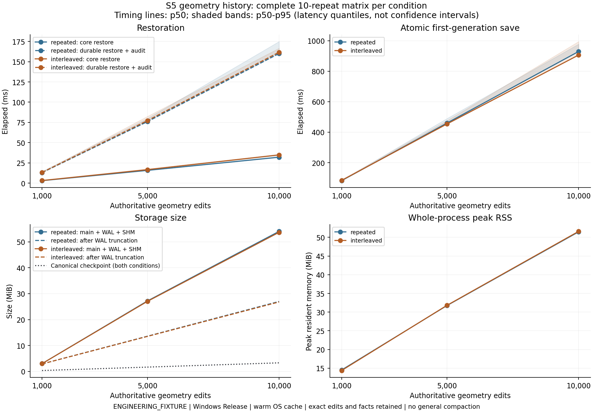
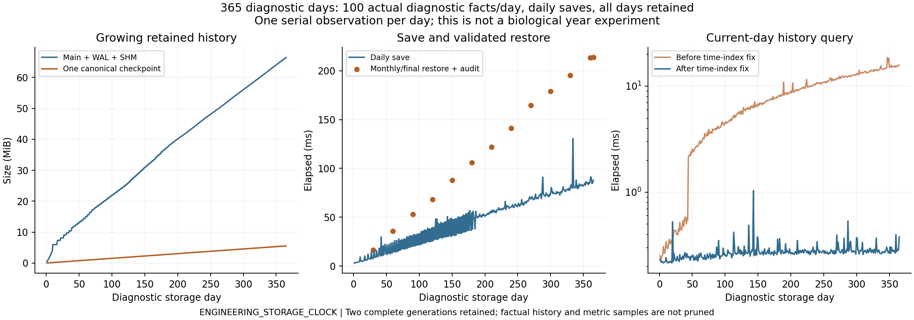

# S5 results: durable saves, history and analytics

**Engineering acceptance: PASS for the frozen S5 scope; independent Code Review pending.** Work stops here. S6, Unity and Game Master development have not started.

Branch: `codex/s5-durable-history`. Approved S4 baseline: `214fce398a29d26507e21c75f4f78f1485527e6b`. Protocol frozen at `27785b4` before implementation. Final measured C++ source: `fe4466cb09e913f4c4fe7863a0c5fd84eecf21da`; subsequent delivery changes contain documentation, raw evidence, analysis and CI verification. [Document 33](docs/33_S5_Persistence_History_and_Validation.md) records decisions and post-freeze clarifications. [Document 08](docs/08_Open_Questions.md) retains all scientific/technical debts.

## Implemented behavior

The authoritative C++ core remains independent of SQLite, Unity and any model API. The separate `antworld_storage` application library saves a complete canonical checkpoint, committed cursor, new factual events, world-qualified individual records, command receipts, metric observations and exact aggregates in **one SQLite transaction**. WAL, `synchronous=FULL`, foreign keys, schema/application checks and defensive mode are explicit. The default retention policy keeps two complete checkpoint generations and every required event/observation/receipt. Acknowledgement follows COMMIT.

Generation tokens reject stale writers, divergent event prefixes, a changed seed and rewound time/revision. Saving an unchanged committed state is idempotent. Idle time can advance without a core revision change; save identity therefore includes time as well as revision. Recovery validates checkpoint authority and its correspondence to event payloads/index columns, participants, individual histories, receipts, observations, flows and buckets. It never reconstructs continuation from a high-level journal or silently falls back from a corrupted acknowledged latest generation. An older retained generation can be explicitly inspected; its stale token cannot overwrite the current timeline.

The minimal typed `PlaceFoodCommand` verifies document-19 idempotency without adding a Game Master. The core validates a legal Input phase boundary, WorldId, stable 128-bit CommandId, immutable payload, bounds/solid clearance, quantity and host capacity. One successful command creates one actual resource, fact and receipt. Identical retries return the original receipt; payload conflicts fail. The durable helper constructs an application-owned candidate, commits it, then moves it into the live owner. Ordinary core mutations retain the undo journal and avoid whole-State copies.

**A COMMIT I/O error has an uncertain outcome.** `RecoveryRequired` blocks further saves on that connection; the application must reopen and recover. Either the complete old or complete new generation is acceptable after an unacknowledged failure; a mixed generation is not. An acknowledged commit must survive recovery. Exceptions before commit roll back. An after-commit fault hook cannot report a successful durable commit as a rollback. This distinction is tested with real SQLite VFS errors, not only application exceptions.

`antworld_archive` exposes `create`, `advance` and `inspect`. Creation uses the existing empty-world JSON profile; populated fixtures use the library. The public queries provide durable coverage, paginated history filtered by world/individual/time/kind, basic individual identity, sampled series, minute buckets and exact event-window flows. Queries do not advance simulation time or consume random state. Command, event and entity IDs are world-qualified; uint64 quantities use exact canonical hex text in SQLite rather than signed narrowing or floating SQL sums.

## History and statistics

[Document 34](docs/34_S5_Metric_Definitions.md) exports all **60 metric definitions** from the compiled catalog, including units and evidence. Population counts distinguish living adult castes, eggs, larvae, pupae and retained dead identities. Resource observations separate source food, cargo, nest stock, crop, body energy/hydration/tissue and explicit sinks. Event flows distinguish actual collection, delivery, metabolism, trophallaxis, emergence, death, moves, rejection and behavior changes. Soil metrics use actual edit volume, parcels and dry/water densities. World void volume is exact q3 with its quantum available for conversion to m3; it is not attributed to an invented semantic nest or colony-owned chamber.

Snapshot gauges represent committed observation boundaries, with pure physiology projection to that time. Flow windows are half-open `[begin_ms,end_ms)` and reject requests beyond durable coverage. One-minute buckets retain count/sum/min/max/last and evidence cursors. Their means are **sample-weighted**, not time-weighted integrals. Missing observations remain gaps; internal transfers are not counted again as external intake. Overflow is checked and rolls back the save.

An individual's stable identity continues through its actual life transitions and death. Seed creation is explicitly a seeded record, not a fabricated biological birth. History pages include real donor and recipient participation. There is no inferred trip-success denominator, unobserved trajectory interpolation, fabricated temperature/humidity or future ecological event. Selected high-frequency deep tracking, world forking/lineage and GM memory remain later interfaces; the basic event history is sufficient for this S5 gate.

## Geometry performance diagnosis and minimal fix

The required long-history measurements preserve the original S4 benchmark before changing its query index. Repeated identical edits accumulated candidates despite being wholly overwritten, making chronological restore audits increasingly expensive. If a later edit has **exactly the same box**, it overwrites every point affected by the older box; that older entry cannot affect current material classification. The disposable index can therefore omit it. All ordered authoritative edits, facts, parcels and material accounting remain, and historical validation still visits each real edit in order. Runtime rollback restores index changes; load rebuilds it.

`S5_EQUIVALENCE` compares a full ordered index with the reduced index over 256 edits, interleaved overlaps, material classification/volume, signed distances and clearance. The original thin-wall, contact, fill/blockage, route invalidation and restore regressions remain. This is **not geometry history compaction**, and it does not solve arbitrary distinct-shape growth.

Matched original S4 fixture, 30 restore samples per count, warm Windows Release:

| Actual edits | Approved S4 restore p50 | Same fixture under S5 p50 |
|---:|---:|---:|
| 200 | 4.336 ms | 0.590 ms |
| 1,000 | 131.057 ms | 2.899 ms |

Both complete raw benchmark files are retained. The only measured checkpoint-size change is +8 bytes for the empty receipt-count field. Query candidate reductions are intentional; all fixture identities/counts and navigation results remain. The new S5 matrix below uses a separate declared fixture, so its numbers are not substituted for this matched comparison.

## Executed validation

All **89 inherited S0-S4 tests remain**, plus 19 S5 registrations: **108 total**. No earlier raw report or experimental archive was rewritten. S4 corruption-test offsets were updated for the appended count; their semantic checks remain.

| Configuration at final C++ source | Result | CTest wall time |
|---|---|---:|
| Windows Clang Debug | 108/108 PASS | 32.89 s |
| Windows Clang Release | 108/108 PASS | 9.71 s |
| Windows Clang ASan + UBSan, including SQLite | 108/108 PASS | 117.50 s |
| Fresh archived source, new Release build | 108/108 PASS | 14.19 s |
| Fresh source, `ANTWORLD_STORAGE=OFF` | 90/90 PASS | 7.03 s |

The core-only build includes all 89 inherited tests and the core command allocation test. Suite durations are verification runtimes, not controlled performance comparisons. [All 522 test executions](experiments/s5/executed_tests.csv) and [verification metadata](experiments/s5/verification.json) are retained.

The five [GitHub CI jobs for final C++ source](https://github.com/Aquaticfuller/AntWorld/actions/runs/42521726576) completed successfully: Ubuntu Debug/Release, Windows Debug/Release and Linux Clang ASan/UBSan with leak detection. The delivery workflow also audits every S5 raw file and summary and reproduces all 32 S5 seeds on Linux Release, alongside the existing full S4 reproduction. CI execution is distinct from local verification; immutable run URLs identify the tested source.

| New test group | Evidence / contract |
|---|---|
| `S5_ATOMIC`, `S5_CRASH` | Atomic checkpoint/history/metrics/retention; actual child termination before transaction, after checkpoint, after history, before and after COMMIT. |
| `S5_IO_FAILURE`, `S5_WAL_CRASH` | Inject each of 75 write and 2 sync failure positions through the Windows fixture VFS; terminate during actual WAL write; reopen and validate a complete outcome. SCH-25 recovery mechanism. |
| `S5_COMMANDS`, `S5_ALLOCATION_FAILURE` | Idempotent receipts, conflicting retries, legal phase boundary, wrong world, allocation rollback and persistence. SCH-10/20. |
| `S5_ISOLATION`, `S5_STORAGE_LIMITS` | Identical local IDs in independent worlds, stale writers, timeline/seed conflicts, budget refusal and atomic aggregate overflow. SCH-17. |
| `S5_METRICS`, `S5_BEHAVIORS` | Actual population/stages/death/programs, material/energy balances, donor/recipient transfers and real behavior switches. SCH-27. |
| `S5_WINDOWS`, `S5_HISTORY`, `S5_UINT64` | Half-open windows, missing observations, time-index and participant pagination, exact uint64 boundaries and no double-counted transfers. |
| `S5_CORRUPTION` | Reject damaged checkpoint, structured history/evidence, identity, samples/buckets, unsupported versions and journal-only recovery. SCH-21. |
| `S5_GEOMETRY`, `S5_EQUIVALENCE` | Actual repeated/interleaved dig-fill accounting, route/restore equivalence and derived-index proof checks. |
| `S5_EXPERIMENT_SMOKE`, `S5_HISTORY_STORAGE_SMOKE`, `S5_ARCHIVE_CLI` | Runnable persistence comparison, diagnostic history and create/reopen/advance/inspect workflow. |

SCH-19/20 continuation checks cover implemented queues, RNG, phase watermarks, IDs, physiological programs, trails/memory, geometry and material. They do not claim unimplemented laying/weather. SCH-25 uses synchronous application persistence; background orchestration and physical power-cut tests are **NOT RUN**. Recovery is verified at actual process/I/O boundaries, not advertised as device-independent power-loss proof.

## Multi-seed and prior-stage reproduction

Seeds **1..32**, both retained physiology and excavation fixtures, save/reload every **5 s or 30 s**: **128/128 exact canonical continuations**, with zero carbohydrate, protein, water and energy residuals. Geometry ledgers and event-derived deaths are reconciled within each run. Changing save frequency changes observations/generation count but no simulated outcome, pending queue or random state. A clean archive of final C++ source reproduced every simulation CSV field; only filesystem-dependent database allocation bytes are excluded from cross-platform CSV comparison. The C++ runner independently requires full checkpoint byte equality.

Selected outcomes across 32 independent seeds, 95% percentile seed-bootstrap intervals (4,096 draws; paired save-frequency copies not counted twice):

| Fixture / endpoint | Mean | 95% interval |
|---|---:|---:|
| Physiology, adult workers at 180 s | 6 | [6, 6] |
| Physiology, actual emergences | 4 | [4, 4] |
| Physiology, internal nutrient transfer | 993.75 ug | [981.25, 1000] |
| Excavation, actual geometry edits at 60 s | 5.250 | [4.875, 5.656] |
| Excavation, excavated q3 | 76.344 | [73.281, 79.375] |
| Excavation, deposited q3 | 68.969 | [65.469, 72.594] |

These are conservation/continuation controls, not biological improvement claims. Degenerate intervals indicate identical sampled outcomes, not population certainty. The S5 subset does not include seed 43 and cannot resolve SD-04.

The **entire S3 1,536-run matrix and 5,376 individual rows** was also rerun: every biological value matches the original, including seed 43's remaining larva and surplus protein, excluding only the previously declared physics-version label. The **entire S4 160-run matrix** matches all semantic values, ordered edits, trajectories and configuration; checkpoint size changes only by the declared +8 bytes. [Regression record](experiments/s5/prior_stage_regression.json) and [clean reproduction](experiments/s5/clean_reproduction.json) preserve the checks. All earlier tests and raw audits, including S2-S2.2 negative recruitment evidence, remain.

## Long geometry history measurements

Hardware: Intel i7-13620H (10 cores/16 logical processors), 16,890,519,552 bytes RAM, Windows 11 x64 build 26200; Clang 23.1.5 / LLVM-MinGW 20261104, CMake 3.31.10, Ninja 1.13.2, SQLite 3.54.1. Full [environment](experiments/s5/environment.json) and per-file [source provenance](experiments/s5/manifest.json) are recorded.

Each condition/count has 10 measured repetitions, no excluded runs, warm OS cache and no concurrent build. `repeated` uses one overwritten patch; `interleaved` uses two distinct overlapping boxes with real separate carriers. All edits and facts remain. Values below are medians in milliseconds; the raw/summary files also retain p95, p99 and maximum. Validated durable load includes database evidence checks, canonical equality and a connectivity query, so it is a broader operation than core restore.

| Condition | Edits | Encode | Core restore | Atomic save | Durable load + audit | History + flow query |
|---|---:|---:|---:|---:|---:|---:|
| repeated | 1,000 | 1.188 | 2.984 | 81.818 | 12.955 | 0.193 |
| repeated | 5,000 | 5.305 | 15.703 | 460.026 | 75.967 | 0.287 |
| repeated | 10,000 | 10.327 | 31.969 | 930.002 | 160.148 | 0.380 |
| interleaved | 1,000 | 1.183 | 3.190 | 83.692 | 13.222 | 0.307 |
| interleaved | 5,000 | 5.246 | 16.628 | 453.918 | 77.226 | 0.951 |
| interleaved | 10,000 | 10.276 | 34.843 | 906.757 | 161.730 | 1.684 |

At 10,000 edits, repeated/interleaved atomic-save p95 is **978.234 / 995.413 ms**, maximum **978.622 / 1024.791 ms**. Durable-load p95 is **174.968 / 166.638 ms**. Ten samples describe this run, not a reliable production p99 guarantee. Save timing includes canonical encoding, metric generation and COMMIT into a fresh initialized database; database connection/schema setup is outside the timer.

| Edits | Canonical bytes, both conditions | Repeated DB + WAL + SHM / after WAL truncation | Interleaved DB + WAL + SHM / after truncation | Peak process RSS, repeated / interleaved |
|---:|---:|---:|---:|---:|
| 1,000 | 347,072 | 3,138,536 / 3,014,656 | 3,134,416 / 3,010,560 | 14.516 / 14.375 MiB |
| 5,000 | 1,729,072 | 28,505,288 / 14,237,696 | 28,340,968 / 14,155,776 | 31.746 / 31.809 MiB |
| 10,000 | 3,456,572 | 56,686,072 / 28,303,360 | 56,291,704 / 28,106,752 | 51.473 / 51.594 MiB |

RSS is a process high-water mark across ten iterations, including multiple runtimes/checkpoint buffers and validation maps. SQLite live allocation peaks near 4.4 MB and is reported separately in every row. Database sizes include evidence indexes and allocator reuse; they are not just checkpoint blobs. Neither general distinct-shape worst-case behavior nor indefinite memory bounds follows from this matrix.

The earlier diagnostic/entity/foraging/physiology performance runners were executed unchanged. Dense legacy nursing still costs about **1,376.7 ms** for the retained 1,000-active-nurse workload; TD-01 remains open. All raw earlier-runner outputs are retained, rather than claiming that faster geometry closes unrelated scale constraints.

## Diagnostic long-history experiment and query fix

The frozen 365-day **storage clock** schedules 100 diagnostic RNG events/day, saves daily and validates restoration monthly/finally. It uses one seeded adult without physiology; it is not an ecological year or an S6 integrated test. The final state has **36,502 facts**, **366 saved generations/observations**, two retained complete checkpoint blobs, **5,804,364 checkpoint bytes**, and **69,700,800 database + WAL + SHM bytes** (66.472 MiB). The final after-fix save/load measurements are **87.824 / 213.724 ms**; peak RSS is **44.680 MiB**. No evidence was pruned.

The initial history query used an EventId-ordered plan despite a bounded time range; its last-day query reached **15.699 ms**. Explicitly using `(world,time_ms,id)` for bounded time queries without an individual filter preserves cursor order because validated fact times are nondecreasing with EventId. The same last-day query then took **0.378 ms**; whole-run query medians were **8.085 / 0.268 ms** before/after. Both complete raw runs remain. Every time/event/generation/checkpoint/database-size column matches; this is a measured query-plan correction, not changed history. Each run has one sample per day, so no replicated-run confidence interval is claimed. Interleaved participant/flow queries still show measurable growth in the geometry table above.

## Versions, dependencies and remaining limits

- Checkpoint schema **6**, physics **7**, SQLite database schema **1**, metric definition **1**. The receipt count/records are appended; existing fixed event/queue/geometry layouts remain. Older checkpoint schemas reject explicitly; no migration is claimed.
- SQLite 3.54.1 is an application dependency pinned to SHA-256 `0a9c8e34352dad46006aa82836d5383bff9dc6bc9ce5a60553c05aa30e6ad1f9`. The core builds/tests without it. [SQLite atomic commit](https://sqlite.org/atomiccommit.html), [WAL](https://sqlite.org/wal.html) and [synchronous FULL](https://sqlite.org/pragma.html#pragma_synchronous) explain the durability assumptions; process/I/O tests do not replace device power-loss testing.
- **TD-03 is partially addressed.** Identical-box index reduction is proved/tested; authoritative edits and full histories still grow. The ~0.9 s fresh 10,000-edit atomic save is synchronous and may block an application caller. General geometry checkpoints/compaction are not implemented.
- **TD-06 remains open:** full journals stay in RAM and canonical blobs; factual events/raw samples/flows are retained indefinitely even though old checkpoint generations are pruned. Default record/event/save limits remain temporary configurable host budgets. Evidence-preserving archival and month-scale ecological storage budgets require later validation.
- **TD-07 remains open:** physical power loss, faulty hardware caches, network storage and asynchronous save orchestration were not tested. Local same-host SQLite WAL is required. FNV hashes detect accidental corruption, not malicious forgery. No authenticated archive/backup protocol is claimed.
- **TD-01** dense contacts is still due before S6 scale tests; **TD-04** complex shapes/piles/semantic identities and **TD-05** the separate S7 Geometry Dirty API remain open. SDF invalidations were not relabeled as full geometry notifications.
- **SD-01/02/03** limited initial following, unproven social recruitment and no-oracle/no-retuning constraints remain; **SD-04** local nutrition redistribution is due by S6; **SD-05/06** physiology calibration and realistic nesting organization remain research debts. No biological coefficient or individual policy was changed.

Exact build, archive, experiment, performance, plot and audit commands are in [experiments/s5/README.md](experiments/s5/README.md). The report, raw evidence, metric catalog, CI and source are submitted for independent review. **Stop at S5.**
