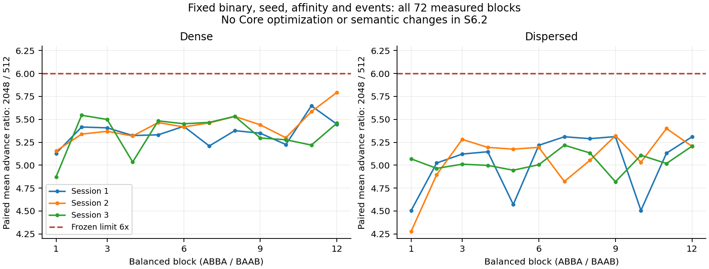
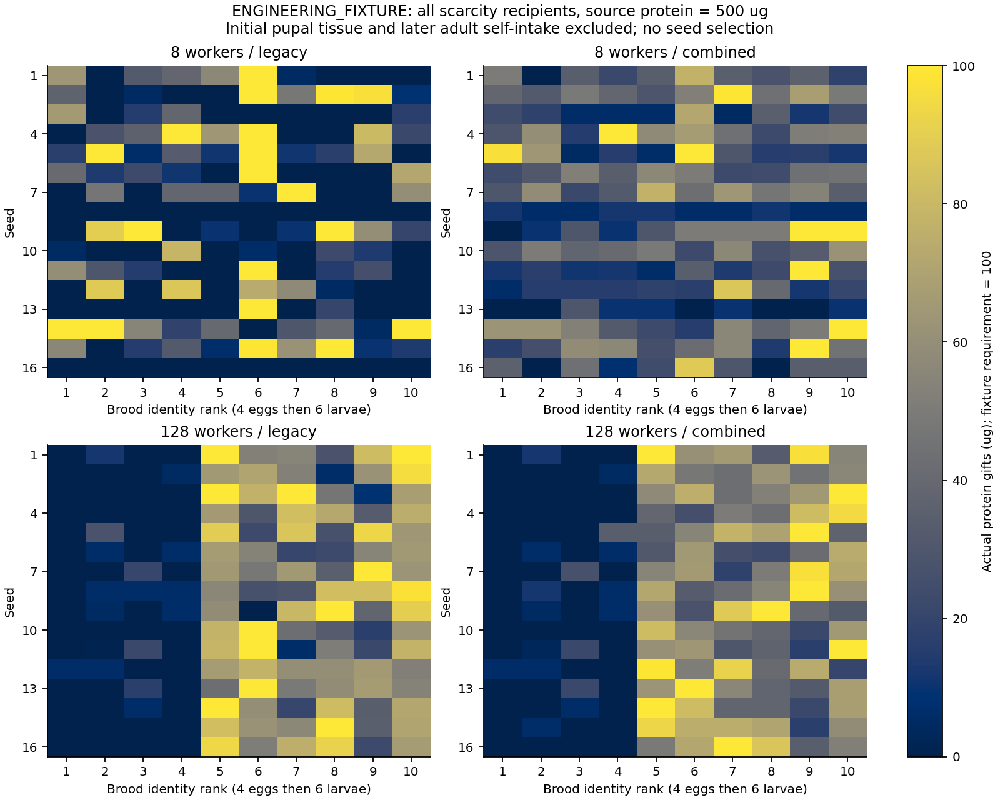

# S6.2: Performance Validation and Scarcity Diagnosis

**Engineering correctness: PASS. TD-01 frozen controlled-host performance gate: PASS. SD-04 scarcity diagnosis: completed, with negative outcomes and biological limitations OPEN.** Review recommendation: **CONDITIONAL PASS** for S6.2, subject to independent review of these limits. It does not authorize S7 or revise the prior S6.1 FAIL decision. No Simulation Core behavior, coefficient, contact frequency, RNG decision, event history or biological default changed.

Baseline: reviewed `4a4827c`. Independent branch: `codex/s6.2-performance-scarcity`. Protocol frozen at `3f6d1a9`; measured benchmark source `cc9004e`; final native nutrition/choice observer source `95bbc5a`. Schema 8 / physics 9 remain unchanged. [Provenance](experiments/s6_2/provenance.json) verifies that both Core source/header trees equal the S6.1 baseline and every earlier experiment file remains unchanged. All biological rules and values remain **ENGINEERING_FIXTURE**.

## What changed and why

The original S6.1 batch failed its 512->2,048 growth target at 24.229x, but lacked frequency/thermal telemetry and balanced ordering. S6.2 first froze [document 39](docs/39_S6_2_Performance_and_Scarcity_Protocol.md), then added host-only measurement and observation tools. The original S6.1 timing and nutritional data are retained, not replaced or reclassified as passes.

- `antworld_s6_2_benchmark` runs the original fixture with four independent phase timers, process CPU time/cycles, fixed process affinity, exact work/hash parity and restored continuation checks. The old benchmark is untouched.
- Windows PDH/topology/power telemetry and the user-provided HWiNFO CSV retain actual sensor timestamps, provider status, raw-prefix/column hashes and all complete samples. No service, driver, fan, voltage or global power-plan change was made by the measurement tools.
- `antworld_s6_2_nutrition` reconstructs immutable copies from ordered actual facts. It validates crop, tissue, body energy, water, stages, programs and nest stocks against the authoritative Core after every event timestamp, and reconstructs actual contact sampling/recipient choices. Observation does not supply information to ants.
- `antworld_s6_2_choice` isolates selection among initially equal, locally reachable larvae under fixed ID/mirror permutations. It uses actual decisions and transfers, never forced recipients.
- Two CTest observer/continuation regressions, retained-history audits, raw data, uncertainty calculations and eight figures were added. Existing 135 tests remain intact.

The controlled performance evidence did not justify another Core optimization. Nutritional evidence identifies allocation/timing limitations but no violated transfer invariant, systematic ID preference or lost committed protein requiring a new correction. Therefore no ecological rule was changed, and no parameter was tuned to increase emergence.

## TD-01: controlled performance

The primary experiment retains 288 measured samples plus 24 labeled warmups: three sessions, twelve ABBA/BAAB blocks per layout, two sizes per block, one unchanged uninstrumented Release executable. Additional fixed controls retain four 128-worker smoke cases, 32 collector-off cases, 16 exhaustive/bounded cases and 32 profiled cases: **396 native cases total**. Every case has the original state/trace/work counts, exact checkpoint equality and matching 1 s continuation after restore. No slow or hot sample was removed. This inherited fixture exercises stationary nursing contact selection among provisioned adults, not a moving underground colony or continuous successful trophallaxis workload; the integrated nutritional runs and inherited barrier tests cover those correctness mechanisms separately.

The host is an Intel Core i7-13620H, Windows build 26200, ten physical / sixteen logical processors. OS topology reports six efficiency-class-1 SMT cores and four class-0 cores. The frozen selector chose logical CPU 0; the observer excluded logical 0/1. Compiler: LLVM-MinGW 20261104, Clang 23.1.5, Release `-O3 -DNDEBUG`, normal profiling OFF. The power-plan GUID remained `85d583c5-cf2e-4197-80fd-3789a227a72c`; observed AC stayed on and battery saver stayed off. This is a controlled result for this host and fixture, not a universal throughput guarantee.

| Advance metric | Dense | Dispersed |
|---|---:|---:|
| Session 1 p50 ratio, 2,048 / 512 | 5.3764 | 5.2269 |
| Session 2 p50 ratio | 5.4933 | 5.1458 |
| Session 3 p50 ratio | 5.4295 | 5.0215 |
| Pooled original p50 ratio | **5.4383** | 5.1465 |
| Median paired block ratio | **5.4117** | 5.1145 |
| 95% hierarchical interval, paired median | **[5.3272, 5.4625]** | [5.0077, 5.1999] |
| Geometric mean paired ratio | 5.3749 | 5.0430 |
| 95% hierarchical interval, geometric mean | [5.3045, 5.4440] | [4.9536, 5.1271] |
| Largest / smallest session p50 ratio | 1.0218 | 1.0409 |

The original **<=6x** target passes, as do the stricter prespecified uncertainty checks: all three session ratios <=6, upper confidence bounds <=6 and session max/min <=1.25. Matched dense 2,048 exhaustive/bounded p50 speedup is **42.3566x**, exceeding the original >=4x gate. Bounded candidates remain <=16. Exhaustive and bounded policies each preserve their own baseline facts; different policies are not claimed to have identical decisions. [Raw paired blocks and derived gates](experiments/s6_2/analysis/performance.json) retain both original and paired estimators.

Dense phase timings, 72 measured samples per size, milliseconds:

| Phase | 512 p50 / p95 / p99 | 2,048 p50 / p95 / p99 |
|---|---:|---:|
| Setup | 17.850 / 19.977 / 22.711 | 329.586 / 353.035 / 358.029 |
| Simulation advance, 10 s | 40.495 / 45.426 / 47.373 | 220.223 / 232.068 / 236.041 |
| Checkpoint encode | 8.049 / 8.615 / 8.840 | 31.803 / 33.106 / 34.801 |
| Restore | 9.916 / 10.472 / 11.071 | 46.001 / 48.077 / 49.973 |

Every layout/session/phase p50/p95/p99/max is in [latency.csv](experiments/s6_2/analysis/latency.csv); raw CPU durations, cycle counts and UTC phase boundaries remain in `performance/*/session*/phases.csv`. Twenty-four samples per cell/session and 72 pooled do not establish production p99 guarantees. Setup is explicitly excluded from the inherited advance scaling gate, not hidden in an aggregate.

| Dense work/memory observation | 512 | 2,048 |
|---|---:|---:|
| Committed facts at 10 s | 15,874 | 63,490 |
| Pending events | 1,024 | 4,096 |
| Contact decisions | 4,608 | 18,432 |
| Examined candidates | 73,728 | 294,912 |
| Bucket queries | 124,416 | 497,664 |
| Tree visits | 725,657 | 3,749,887 |
| Checkpoint bytes | 2,877,816 | 11,508,600 |
| Median process RSS after restore, bytes | 20,801,536 | 51,623,936 |

Process-lifetime peak RSS reaches 94,625,792 bytes in the primary matrix. It is shared across sequential samples, including previous large worlds and allocator retention; it is not a per-world peak. Both restored and original worlds/checkpoint are resident at measurement. [Full memory/work distributions](experiments/s6_2/analysis/memory_work.csv) preserve all raw values and this scope.

### Attribution, telemetry and remaining uncertainty

Mean **exclusive** dense advance time in the instrumented control, milliseconds (eight runs per size):

| Category | 512 | 2,048 |
|---|---:|---:|
| Candidate sampling | 15.785 | 80.124 |
| Spatial validation | 1.833 | 7.490 |
| Event scheduler | 4.985 | 22.911 |
| Transaction/journal | 3.556 | 17.586 |
| Fact/history append | 1.362 | 4.711 |
| Physiology | 10.531 | 60.233 |
| Policy excluding nested scopes | 13.013 | 65.444 |
| Advance residual | 3.874 | 16.734 |
| Contact-index maintenance | 0 | 0 |

The index is not edited while these workers remain stationary. Setup index maintenance is separately measured: 0.551 / 3.452 ms exclusive, with 512 / 2,048 calls. Inclusive/exclusive values and calls for all phases are in [profile.csv](experiments/s6_2/analysis/profile.csv), with exact per-sample exclusive accounting. These are measured scope durations, not estimates from work counts; profiling overhead means they do not replace acceptance latency.

Setup remains expensive: physiological validation makes 131,328 versus 2,098,176 queries while seeding, consistent with validating the growing population after each enrollment. Instrumented setup physiology costs 8.547 versus 236.387 ms exclusive. This separate quadratic setup issue is recorded as **TD-08**; it is not cured by the advance gate. A future validated bulk-enrollment design must preserve every identity, fact and failure rollback. No such optimization was implemented here.

The actual HWiNFO CPU samples show P-core 0 at 43..66 C, package DTS at 53..69 C and package power at 2.821..26.020 W during primary session windows including brackets/idle gaps. No recorded thermal, critical-temperature or power-limit flag is set. Corrected P0 T0 effective frequency ranges 0.8..3,828.8 MHz including idle brackets, while reported P0 clock ranges 997.6..4,489.0 MHz. Windows frequency/performance estimates, collector durations, system busy time, power state and process CPU deltas are separately retained. Mean system busy is about 6.97% of all logical processors; individual samples reach 37.04%. Background load was observed, not assumed absent.

HWiNFO polls approximately every 2 s, while Windows sampling targets 100 ms. Thus absence of a sampled throttle flag does **not** exclude every brief throttling episode. Complete sensor samples bracket every session; one prefix has a partial trailing logger row, counted explicitly. A column-label mapping error affecting three effective-frequency labels was found during cross-checking and corrected from the same raw prefixes. The original translation and hashes remain as superseded evidence; temperatures, power and timings were unaffected. See [document 40](docs/40_S6_2_Measurement_and_Observer_Implementation.md) and [coverage](experiments/s6_2/analysis/sensor_coverage.csv).

Collector-off dense advance p50 is 43.863 / 222.796 ms, versus primary 40.495 / 220.223 ms. These separate control sessions do not support subtracting a causal collector-overhead constant; HWiNFO remained on in both. Block-level thermal/frequency/load correlations are descriptive, use coarse bracketing windows and are small in this dataset; they are not causal explanations. [Hardware summaries](experiments/s6_2/analysis/hardware_summary.csv), [background process deltas](experiments/s6_2/analysis/background_processes.csv) and [correlations](experiments/s6_2/analysis/environment_correlations.csv) retain the evidence.

**The S6.1 24.229x cause remains unidentified.** The controlled result establishes that the unchanged implementation meets the target under the frozen placement/order/host conditions. It cannot retrospectively attribute the previous batch to temperature, hybrid-core scheduling, background load or a particular algorithm. No threshold was relaxed, no history was pruned, and no favorable batch was selected from repeated attempts.

## SD-04: actual scarcity allocation

All **192** declared cases were rerun: seeds 1..16, 8/32/128 workers, 500/2,000 ug source protein, legacy/combined, 180 s. Every final state/trace hash and event/gift count equals its original S6.1 case. Normal observation, accelerated execution and restored continuation match byte-for-byte at each 30 s boundary. Ordered crop/tissue/energy/water reconstruction and all protein intake/gift/terminal stores reconcile. Initial pupae retain their supplied tissue; emergence keeps the same identity.

Across the complete matrix there are 6,260 gift resolutions: 5,823 transfer protein, 289 transfer other ingredients only, and 148 are rejected with no compatible ingredient demand remaining at resolution. The ordered pre-resolution state distinguishes those rejections from an empty total donor crop. All classifications and actual outcomes remain in the raw/derived tables; the two focal 500 ug scarcity cells below have no rejected gifts.

The following intervals use 4,096 paired-seed bootstrap resamples, seed 6206. They differ slightly from S6.1's bootstrap intervals because this protocol froze a new analysis seed; the observed endpoints are unchanged.

| Workers / source protein | Combined minus legacy protein transferred, ug (95% CI) | New emergences among 10 unsupplied brood (95% CI) | Unmet exposure difference, ug*s (95% CI) |
|---|---:|---:|---:|
| 8 / 500 | +76.19 [31.09, 128.56] | **-0.500 [-0.813, -0.188]** | -9,687.81 [-15,878.27, -4,253.61] |
| 8 / 2,000 | +249.63 [121.05, 406.91] | +4.313 [2.375, 6.250] | -47,489.88 [-67,353.08, -30,593.30] |
| 32 / 500 | +72.25 [35.15, 114.94] | -0.375 [-0.938, 0.188] | -12,377.44 [-18,175.04, -7,126.55] |
| 32 / 2,000 | +80.56 [8.38, 176.81] | +1.500 [0.313, 3.000] | -21,303.75 [-35,429.76, -10,807.67] |
| 128 / 500 | **-14.94 [-18.63, -11.19]** | -0.188 [-0.563, 0.188] | **+2,374.19 [1,766.95, 2,969.58]** |
| 128 / 2,000 | +8.19 [-19.79, 34.98] | +0.313 [-0.313, 0.875] | -2,009.63 [-6,986.14, 4,113.19] |

### Eight workers: more partial supply, fewer completions

At 500 ug, mean delivered protein rises 266.44->342.63 ug, but the ten initially unsupplied brood are fed more diffusely. Mean partially provisioned identities rise **4.5->9.0**, fully provisioned identities fall **1.0->0.4375**, and actual new emergences fall **0.875->0.375**. Gift-share concentration (HHI) falls 0.2407->0.1514. Mean protein-bearing gifts rise 9.44->46.13; all actual samples with reachable protein demand find a compatible larva, with no failed gift resolutions or canceled protein choices.

The unchanged model requires 100 ug absorbed tissue before 60 s larval plus 30 s pupal progress. Every observed emergence time equals its actual tissue-threshold time +90,000 ms. Fully supplied but unfinished identities have not had enough time; their mean counts are 0.125 legacy and 0.0625 combined. The main negative result is therefore **partial provisioning below threshold**, not disappearance of protein or an incorrect stage transition. Uniform locally eligible choice and a whole-food transfer mass cap distribute smaller gifts among more recipients. This is an engineering allocation tradeoff, not evidence that equal spreading is biologically optimal or that the threshold is calibrated.

### 128 workers: refill/gift timing, sampling and adult retention

At 500 ug, mean actual protein transfer falls 380.50->365.56 ug. The same **14.94 ug** difference remains in adult crops: 119.50->134.44 ug. There is no hidden loss. Protein-bearing gifts increase 22.44->43.06, but they contain less protein per gift; donation begins during the early limited-supply interval, with 354.56 / 334.69 ug already transferred before 30 s. The first six larvae can receive food before the four eggs hatch. The all-seed identity map makes this temporal eligibility difference visible; it is not a low-ID preference.

Actual protein-bearing nursing decisions decrease 66.50->52.25. Legacy samples only 26.19 of these opportunities because refill takes precedence; combined samples all 52.25. Of sampled opportunities, hits rise 22.44->43.06, and misses rise 3.75->9.19 (14.32% versus 17.58% of the respective aggregate opportunities). Thus bounded contact sampling can limit a particular opportunity, but **fewer total successful sampled contacts is not the explanation for lower transferred mass**. There are zero gift resolution failures and zero canceled protein choices in either 128/500 arm. No stock was discarded by failed transactions.

Ordered task/store reconstruction finds **zero initial-worker Nurse departures while holding protein** in either 128/500 arm. Protein residence during nursing falls 906.09->442.94 ug*s; protein held while foraging rises 20,828.44->23,324.06 ug*s. Other holders can remain in foraging ownership while brood still need protein; the correction does not make all holders nurses. Program switches rise only 251.69->253.75. These observations localize the unresolved limitation to supply timing, recipient availability, bounded local cues and who holds the remaining protein, rather than the earlier demonstrated premature Nurse-exit defect.

The original four-arm experiments remain available and are reanalyzed without rerunning or replacing them. For all sixteen 128/500 seeds, the **entire actual gift sequence** (times, donor/recipient, outcomes and each ingredient) is equal for legacy vs local-continuation-only, and for gift-first-only vs combined. This isolates the changed allocation in this condition to **gift/refill priority**, not an effect of the continuation flag. At 8/500 the flags interact: archived mean protein transfer is 266.44 legacy, 293.94 gift-first, 412.63 continuation-only and 342.63 combined. No single arm is declared universally best or substituted after seeing these outcomes. [Four-arm controls](experiments/s6_2/analysis/archived_ablations.csv) and [sequence comparisons](experiments/s6_2/analysis/dense_gift_sequence_comparison.csv) retain all comparisons.

### Equal local eligibility: no demonstrated systematic ID preference

The diagnostic retains 64 seeds x four ID/mirror permutations, with 64 actual gifts per case: **16,384 choices and 262,144 inclusion records**. A donor and 16 initially equal larvae are all within the normal contact radius. The assay-only 1 ug gift cap keeps every recipient below the 100 ug requirement for all 64 decisions; no ecological default changes. All sampled queries leave checkpoints unchanged and every restored continuation matches.

Inclusion is consistent with a 16-of-17 candidate sample (the donor may consume one candidate slot); conditional choice is uniform among eligible sampled recipients. The lower-half minus upper-half ID choice contrast is -0.00928, 95% interval [-0.03790, 0.02100], for the original ordering and -0.00537 [-0.03448, 0.02490] after reversing labels. Mirrors give the same corresponding contrasts in this symmetric fixture. Rank-wise distributions/intervals and logical-slot results are retained. These finite controls reveal no persistent lower-ID preference; they do not prove exact fairness for all geometries or species behavior. Mirror cases are not counted as independent seeds.

Observed rank-wise choice fractions range 5.566%..7.031%, versus a uniform-eligibility expectation of 6.25%; inclusion ranges 93.433%..95.068%, versus 94.118%. Some pointwise intervals exclude the expectation. They are not multiplicity-adjusted, and the endpoint contrasts do not rule out every subtle RNG/ID interaction. No favorable seed or permutation was selected to suppress these deviations.

No clear new implementation defect was established. **SD-04 remains OPEN** for calibrated demand signals, selective/partial provisioning, role-dependent nutrition intake and surplus recirculation. A future experiment should separately test local donation amount/refill thresholds and receipt/return opportunities while preserving actual stores and identity, under a new reviewed protocol. This is a research proposal, not an implemented global allocator, forced completion or approved parameter change.

## Verification, limitations and review disposition

| Executed local configuration | Passed / total | CTest seconds |
|---|---:|---:|
| Debug | 137 / 137 | 71.71 |
| Release | 137 / 137 | 27.90 |
| Windows ASan + UBSan | 137 / 137 | 211.33 |
| Clean exported source, Release | 137 / 137 | 19.60 |
| Storage-independent Core, Release | 117 / 117 | 14.34 |

All 135 inherited registrations are present; two new observer tests cover ordered scarcity reconstruction and equal-demand selection with unchanged-state queries/restoration. Existing rollback, 3D barrier, conservation, identity, command deduplication, crash recovery, SQLite evidence and historical scenario tests remain. Correctness runtimes may overlap builds/analysis and are not performance samples. The first Windows sanitizer invocation rejected `detect_leaks=1` before running test logic; its log remains, and the supported ASan/UBSan invocation passes all 137 with `detect_leaks=0`. Linux CI retains leak detection. [Executed tests and provenance](experiments/s6_2/verification.json) record actual results. [GitHub CI run 42560158436](https://github.com/Aquaticfuller/AntWorld/actions/runs/42560158436) at `7f1861e` passed all five jobs: Windows/Linux Debug/Release and Linux ASan/UBSan with leak detection. Linux Release also reproduced all twelve first-seed ordered nutrition cases and all 256 equal-demand cases, in addition to inherited multi-seed checks.

Scientific limitations are unchanged: SD-01/02 long-distance trails/social recruitment are unproven; SD-06 has no calibrated functional nesting feedback; SD-07 activity/rest is uncalibrated. S6.1's approximately 97.6% active-task ownership and resource-insensitive excavation remain negative evidence, not new S6.2 fixes. TD-03/06 full history and synchronous storage budgets remain open. TD-01's controlled advance target passes, while broader moving-contact/geometry workloads, other hosts and setup cost remain debts. TD-08 explicitly tracks the newly quantified setup cost. See [Open Questions](docs/08_Open_Questions.md).

Reproduction commands, metric definitions, raw CSV paths and immutable-source handling are in [the evidence README](experiments/s6_2/README.md). Run `python tools/ci_verify.py` for all inherited and new evidence audits; `python tools/analyze_s6_2_performance.py --check` and `python tools/analyze_s6_2_nutrition.py --check` independently regenerate this stage's conclusions. Figures use the complete fixed data, including the negative scarcity cells.

Measurement interfaces follow Microsoft's [processor topology contract](https://learn.microsoft.com/en-us/windows/win32/api/winnt/ns-winnt-processor_relationship), [language-neutral PDH counters](https://learn.microsoft.com/en-us/windows/win32/api/pdh/nf-pdh-pdhaddenglishcounterw), [power status fields](https://learn.microsoft.com/en-us/windows/win32/api/winbase/ns-winbase-system_power_status) and [performance-counter collection guidance](https://learn.microsoft.com/en-us/windows/win32/perfctrs/collecting-performance-data). These support host telemetry, not biological calibration.

**Stop for independent Code Review. No Unity, Game Master, laying, weather, LOD implementation or S7 work is included.**
