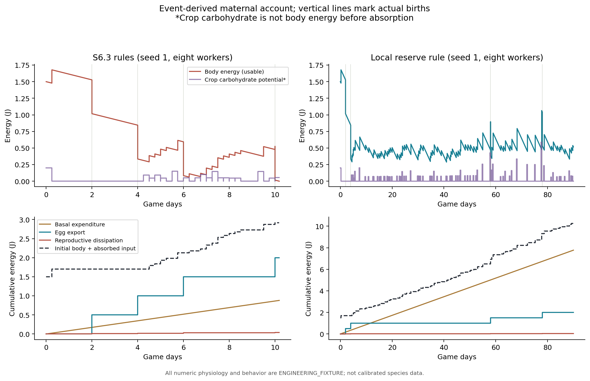
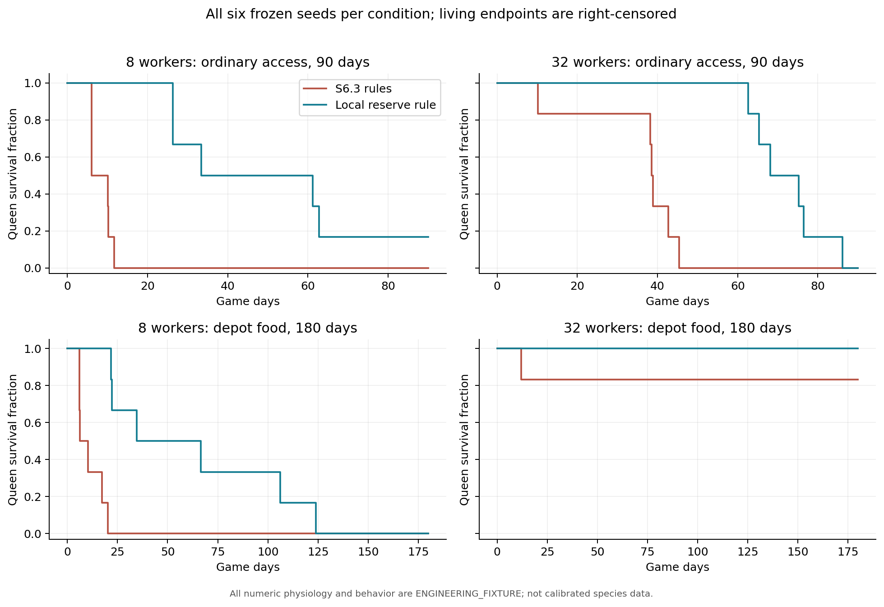
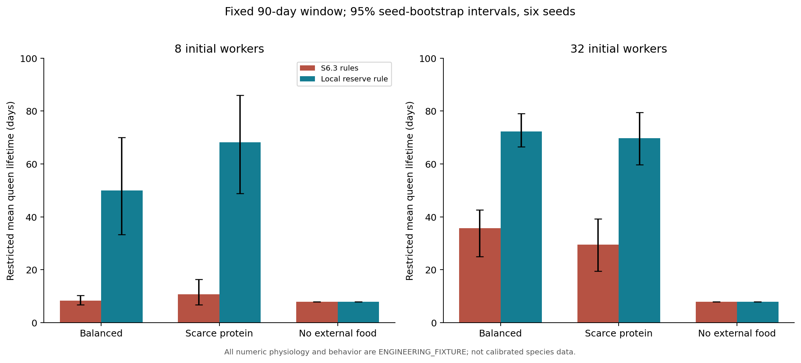
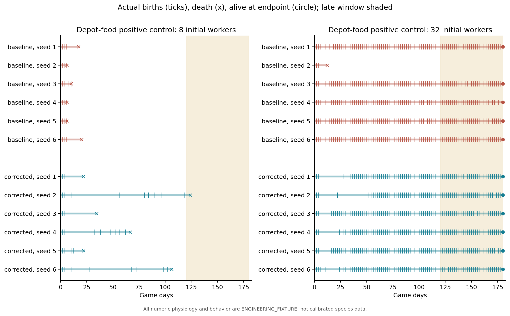
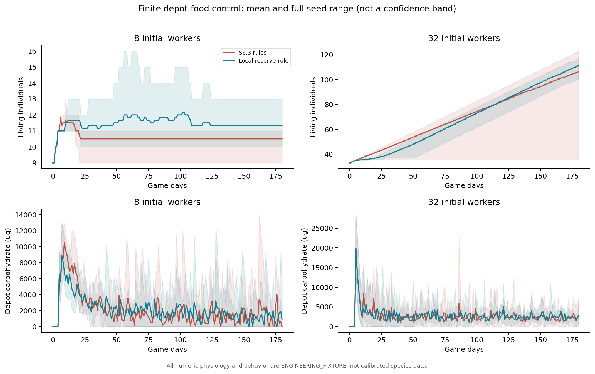
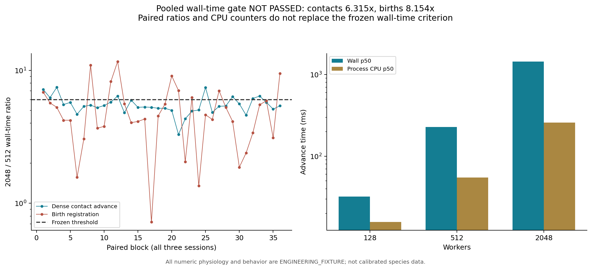

# S6.3.1 - Queen Provisioning and Reproductive Allocation Validation

**Engineering correctness: PASS. Mechanism validation: CONDITIONAL PASS within the frozen engineering fixtures. Performance revalidation: NOT PASSED, with substantial measurement uncertainty. Biological calibration: NOT ESTABLISHED. SD-08 remains OPEN.** This is not a full readiness pass. S6.4, Unity and later stages are not authorized by this result.

The evidence identifies an unsafe interaction between immediate egg funding and delayed nutrient absorption, implements one local maternal-maintenance gate, and demonstrates actual 180-day reproduction under the predeclared adequate-access condition. Ordinary-access colonies and small positive-control colonies still lose queens. No worker policy, food input, metabolism, egg cost, contact frequency or random decision rule was tuned to improve these outcomes.

## Scope, freezes and retained evidence

[Protocol 44](docs/44_S6_3_1_Frozen_Protocol.md) was committed as `f0d38b7` before experiments. [Observer clarification 45](docs/45_S6_3_1_Observer_Contracts.md) precedes measurement; [correction protocol 46](docs/46_S6_3_1_Correction_Protocol.md), committed as `3c5d1d1`, follows the complete unchanged-model diagnosis and precedes the correction. [Document 47](docs/47_S6_3_1_Verification_and_Metrics.md) defines representation, accounting and performance verification. Historical S0-S6.3 files, 153 tests, all negative/censored outcomes and S6.1's unexplained 24.229x timing batch remain.

The archive contains **432 complete executions**: 192 unchanged-model runs, 192 matched corrected runs and 48 predeclared shorter/longer horizon controls. Seeds are always 1-6; no seed or failed biological outcome is removed. Within each model, 36 historical conditions repeat causal conditions; these are reproducibility executions, not additional independent samples. All windows complete without capacity censoring. **7,222,847 decision observations** and every daily queen snapshot reconcile with independently reconstructed maternal accounts. All 432 runs match irregular accelerated continuation from a midpoint checkpoint; 32 selected worlds also match SQLite recovery and identity/flow queries.

[S6_3_1_EXPERIMENTS.csv](S6_3_1_EXPERIMENTS.csv) joins every configuration and outcome. [Raw evidence and reproduction](experiments/s6_3_1/README.md) describes the full CSV archive, selected-event semantics, exact native hashes, tools and source revisions. Native journal/save duplicates remain local with hashes and reproducible generation; the selected CSV is not represented as the entire fact journal.

## What the original mechanism actually did

All 48 historical primary queens again die from accounted body-energy depletion, reproducing original observations, canonical journals and final checkpoint bytes exactly. There is no missing nutrition or accounting deficit. Fifteen queens still have crop carbohydrate when they die. The crop/body distinction is functioning: crop carbohydrate becomes usable body energy only at an absorption pulse.

The clearest trace is seed 1, eight workers, balanced ordinary supply. At day 10, after absorption, event 1752 funds an egg. Body energy drops from 526,000,000 to 16,000,000 nJ: **4.444 hours of maintenance**, less than the six-hour absorption interval. Event 1775 transfers another 55 ug carbohydrate, but event 1779 records energy depletion before that carbohydrate is absorbed. At death the account is:

| Quantity | Actual amount |
|---|---:|
| Initial body energy | 1.500 J |
| Absorbed carbohydrate | 1,420 ug -> 1.420 J |
| Basal expenditure | 0.880 J |
| Four egg energy exports | 2.000 J |
| Reproductive dissipation | 0.040 J |
| Remaining body energy | 0 J |
| Initial + received crop carbohydrate | 200 + 1,275 ug |
| Remaining crop carbohydrate | 55 ug |
| Body water: initial + absorbed - loss - egg exports | 1,600 + 1,234 - 244 - 800 = 1,790 ug |
| Remaining crop water / protein | 44 / 20 ug |

Across the historical matrix, **21 of 293 births** leave insufficient body energy to reach the next absorption pulse; the shortest post-laying maintenance coverage is ten minutes. Some deaths have other supply/timing histories, so this is not claimed to explain every queen death.

The independent controls separate additional influences:

- All **24 supplied, non-laying** queens survive 90 days; none of the 24 matched supplied laying queens does. Suppression also removes offspring demand and future workers, so this is not an isolated instantaneous egg-cost estimate.
- Without external food, laying queens live 7.870 days and non-laying queens 19.676 days; neither group receives queen gifts. Turning off colony exchange under balanced external supply gives those same queen lifetimes. That control affects all trophallaxis, not only queen provisioning.
- In the unchanged 180-day depot-food positive control, **5/6 queens with 32 initial workers already survive and reproduce late**, while 0/6 with eight workers survives. Thus existing worker rules can deliver sufficient resources in some conditions; they are not categorically incapable of queen care.
- Independent absorption, behavior, lineage-basal and laying-interval controls give non-monotone outcomes. Only 1/6 queens survives in the unchanged four-day laying-interval arm; the other original sensitivity arms have no 90-day survivors. The lineage-basal arm changes inherited offspring metabolism too, as declared before measurement.

## The one implemented correction

`ReproductionConfig::maintenance_horizon` is an optional, local body-condition constraint. Before paying unchanged egg costs, body energy and water must strictly exceed the egg debit plus the mother's own integrated maintenance requirement over this horizon. Water uses the existing integer remainder. Crop contents are not counted as already absorbed energy. The primary fixture uses one configured reproduction interval, two days in the reference condition; it is an **ENGINEERING_FIXTURE allocation hypothesis**, not a measured species threshold.

A deferred attempt still occurs at its original scheduled time, spends nothing and does not force a later egg. Actual future absorption can make a later attempt affordable. Metabolism and mortality continue unchanged; no-food controls still die at their original times. The calculation uses no population scan, global stock, food coordinate, predicted contact, worker command or lifespan target. Worker choice and recipient arbitration are unchanged.

Positive horizons use explicit checkpoint schema 10 / physics 12, with enrollment evidence binding the horizon to the queen. Zero preserves schema 9 / physics 11 behavior and bytes. All 192 baseline runs were reproduced from the final source in legacy mode, including their observation streams and exact native hashes. Existing older schemas and tests remain supported. The optional diagnostic recorder is host-only, has no callback into Core, never supplies its queen-location counterfactual to ant decisions, and is absent from saved authority.

## Ordinary-access outcomes and uncertainty

The table reports the fixed 90-day restricted mean queen lifetime; living queens are administratively censored at day 90. Brackets are 95% paired seed-bootstrap intervals for the change, using 4,096 resamples and fixed seed 63101. Six seeds provide limited precision, not biological population calibration.

| Initial workers / supply | Old mean days | Corrected mean days | Paired change [95% interval] | Corrected survivors |
|---|---:|---:|---:|---:|
| 8 / balanced | 8.351 | 49.979 | +41.628 [24.014, 61.624] | 1/6 |
| 8 / scarce protein | 10.669 | 68.148 | +57.479 [33.436, 78.248] | 3/6 |
| 32 / balanced | 35.656 | 72.301 | +36.645 [27.772, 46.996] | 0/6 |
| 32 / scarce protein | 29.475 | 69.697 | +40.222 [23.866, 55.870] | 1/6 |
| 8 or 32 / no external food | 7.870 | 7.870 | 0 [0, 0] | 0/6 each |

In the full historical-condition comparison, unsafe post-laying energy exposures fall **21 -> 0**, births total **293 -> 353**, and queens alive at day 90 rise **0 -> 7/48**. These totals are descriptive; they are not pooled independent evidence on top of the causal matrix. The non-laying conditions are exactly unchanged. Balanced supply is a finite external release schedule, not a promise that every individual receives adequate daily nutrition.

Residual failures remain interpretable at event level. For example, corrected ordinary balanced seed 2 with 32 workers has 782 observer physical opportunities in its last 48 hours, but only four actual nutrition samples containing the queen with matching donor nutrients, no selection of the queen and no completed queen gift. At death, 712 ug carbohydrate remains at the depot and 1,788 ug in living-worker crops. Counts across observer contexts are not unique physical encounters. In corrected seed 5 with eight workers, 34,662 ug depot carbohydrate remains at queen death. Stock existence does not imply delivered or absorbed nutrition. The surviving local mechanism still has low-state demand signaling, bounded contact samples and competition among recipients; it has no queen-specific priority or anticipatory reproductive-supply request. Those are remaining hypotheses, not silently implemented fixes.

One corrected historical queen still dies with crop carbohydrate, despite no unsafe egg debit. Guarding reproductive allocation does not repair every delayed-absorption or delayed-delivery death. Scarce-protein groups can outlive balanced groups; different offspring burdens and ingredient mixtures are possible contributors, not identified causal explanations. No global redistribution or selective survival objective was introduced.

## Sustained reproduction and parameter sensitivity

The adequate-access control seeds a finite food source at the depot: per initial worker, 200,000 ug carbohydrate, 20,000 ug protein and 100,000 ug water. There is no later release or hidden replenishment. Workers must actually collect, deliver, ingest and exchange it; all autonomy remains enabled. This removes search/transport difficulty for the control and is not a claim about natural food production or normal nest feeding.

| 180-day depot-food control | Old queens alive | Corrected queens alive | Corrected births / emergences | Births in days 120-180 |
|---|---:|---:|---:|---:|
| 8 initial workers | 0/6 | 0/6 | Means 5.5 / 3.33 | 0 in every seed |
| 32 initial workers | 5/6 | 6/6 | Ranges 68-84 / 62-79 | 28-30 per seed |

All six corrected 32-worker queens lay an actual egg on day 180 and have completed offspring development. This meets the frozen **capability** endpoint. The descriptive Wilson interval for 6/6 survival is [0.610, 1.000]; 0/6 is [0, 0.390]. The paired survival gain in the 32-worker group is only +1/6, bootstrap interval [0, 0.5]. Mean births change by +5.0 [-8.17, 29.0] and emergence by +4.17 [-8.0, 26.0]. These data do not establish a general fecundity advantage. Eight-worker mean lifetime improves 11.009 -> 62.556 days, paired +51.547 [21.672, 84.992], but all queens still die, with unused depot carbohydrate. This negative outcome remains part of acceptance.

The predeclared horizon controls expose a substantial allocation trade-off:

| Horizon / balanced ordinary supply | 8-worker mean queen days / mean births | 32-worker mean queen days / mean births |
|---|---:|---:|
| One absorption period (6 hours) | 23.212 / 3.50 | 43.005 / 15.67 |
| One reproduction interval (primary, 2 days) | 49.979 / 4.50 | 72.301 / 18.00 |
| Two reproduction intervals (4 days) | 88.497 / 6.50 | 90.000 / 2.50 |

In the positive control, the longer horizon yields only 21.0 mean births with 32 workers, versus 78.67 under the primary horizon and 87.33 under the shorter horizon. Eight-worker survival is 2/6 with the longer horizon and 0/6 with the others. The four-day horizon was **not** selected because it improves survival. Its reduced reproduction highlights interaction with the unchanged quarter-capacity demand signal and worker provisioning. All six original independent schedule/metabolism sensitivity arms are also retained in the [condition table](experiments/s6_3_1/analysis/conditions.csv) and [paired differences](experiments/s6_3_1/analysis/paired_changes.csv). No schedule or threshold was fitted after these results.

## Biological interpretation

The [Lasius niger founding-feeding study, DOI 10.1093/biolinnean/blad149](https://academic.oup.com/biolinnean/article/142/4/397/7342048) supports a qualitative dependence of brood output on queen body condition and experimental feeding. It does not calibrate established-colony queen costs, reserve horizons or gift priority. [Pamminger et al., DOI 10.1016/j.jinsphys.2016.09.004](https://pubmed.ncbi.nlm.nih.gov/27614175/) experimentally connects reproductive physiology to hormonal regulation; this implementation contains no hormone model and does not import a universal survival-reproduction trade-off. The [L. niger food-dissemination experiment, DOI 10.1038/s41598-019-52019-6](https://www.nature.com/articles/s41598-019-52019-6) supports examining spatially heterogeneous local exchange, but its queenless/broodless worker conditions cannot establish queen-specific protein allocation.

The local maintenance gate is therefore a biologically motivated engineering hypothesis with a demonstrated internal effect. Body energy, egg composition, development durations, absorption pulses, queen demand, contact rates and task residence remain uncalibrated. No claim of realistic L. niger fecundity, lifespan, colony growth trajectory or long-term ecological completeness follows. SD-08 remains open for independently measured queen needs, provisioning rates, allocation timing and transport-limited conditions.

## Engineering verification and performance

Debug, Release and Windows ASan+UBSan each pass **161/161 tests**, preserving all 153 inherited tests. Eight additional cases cover observer invariance/rollback, strict energy/water funding, actual post-transfer resumption and pulse ordering, no-input death, solid-wall contact, rechecksummed contract corruption, autonomous supply/legacy controls, invalid/overflowing horizons and allocation-failure sweeps. Existing identity, scheduling, conservation, barrier, geometry, lifecycle, command, persistence and deterministic arbitration tests remain unchanged in their asserted semantics.

The initial five-job [GitHub CI run](https://github.com/Aquaticfuller/AntWorld/actions/runs/42590424266) passes Linux/Windows Debug/Release and Linux ASan/UBSan with leak detection. Windows sanitizer checks disable leak detection as in earlier stages. The [publication branch CI](https://github.com/Aquaticfuller/AntWorld/actions?query=branch%3Acodex%2Fs6.3.1-queen-validation) additionally audits the full archive and independently reconstructs/reproduces both seed-1 180-day positive controls, including the eight-worker negative outcome. [Verification receipts](experiments/s6_3_1/verification.json) identify the executed local checks and source lineage.

The frozen performance run uses the Intel Core i7-13620H (10 cores, 16 logical processors), Windows build 26200, logical processor 0 affinity, unchanged power plan, AC power and battery saver off. It begins after local builds, ecological runs and data analysis finish. Three balanced sessions retain **336 contact and 168 birth samples**, including all warmups. The first sandboxed CIM query failed before measurement; the retry uses authorized read-only host access and a new output directory. No timed run is discarded or repeated to obtain a pass.

| Dense workload | 128 p50 / p95 / p99 ms | 512 p50 / p95 / p99 ms | 2048 p50 / p95 / p99 ms |
|---|---:|---:|---:|
| Contact advance | 32.144 / 94.943 / 95.893 | 228.471 / 608.440 / 878.911 | 1,442.792 / 4,344.084 / 5,835.039 |
| Birth advance | 1.709 / 23.402 / 23.771 | 7.131 / 52.802 / 66.619 | 58.146 / 151.104 / 196.729 |

The dense contact ratio of pooled p50 values is **6.315x**, above the unchanged <=6x gate. A session/block bootstrap gives a very broad [3.342, 16.389] interval. The paired-block median is **5.375x [5.032, 5.745]**. Birth registration similarly gives pooled **8.154x [3.645, 9.799]**, versus paired **4.422x [4.080, 5.592]**. These paired results do not replace the declared wall-time criterion: **neither pooled wall-time regression is a pass**. The birth fixture still performs all N funded births and the contact fixture exactly matches historical state/trace hashes, fact counts and computation counts at each size/layout.

The raw host evidence supports measurement nonstationarity but does not identify its entire cause. System busy medians are 54.7-71.1% across contact sessions and 56.3-61.1% across birth sessions. HWiNFO records 48-67 C package temperatures, no asserted package thermal-throttling flag, roughly two-second sensor spacing and variable package power. Dense contact process CPU accounts for only 26.2%/22.9% of accumulated wall time at 512/2048. Paired process-cycle growth is **5.475x [5.318, 5.677]** for contacts and **4.248x [4.125, 4.564]** for births. Small birth CPU-time counters are often zero at their coarse resolution, so those zero samples remain explicit. Core-0 frequency/utility, power-limit flags, phase CPU/cycles, process snapshots and every timing row are retained. Neither missing thermal flags nor cycle ratios prove absence of scheduling, frequency, cache or background-work effects.

At 2048, contact runs retain 63,490 facts, 4,096 pending events, 294,912 candidates, an 11,508,600-byte checkpoint and median RSS 51,619,840 bytes. Birth runs retain 2,048 actual births, 14,339 facts, 8,192 pending events, a 5,702,703-byte checkpoint and median RSS 34,121,728 bytes. Separate setup, encode, restore, dispersed-layout and per-session distributions are in [performance analysis](experiments/s6_3_1/performance_analysis/latency.csv); [paired raw ratios](experiments/s6_3_1/performance_analysis/paired_ratios.csv), [CPU/cycle evidence](experiments/s6_3_1/performance_analysis/cpu_and_cycles.csv) and [telemetry summaries](experiments/s6_3_1/performance_analysis/telemetry.csv) preserve uncertainty rather than attributing it solely to an algorithm.

**Next measurement proposal, awaiting review:** retain the same binary/input/<=6x criterion; predeclare a dedicated quiet host session and a logged baseline-load qualification before starting the balanced schedule, then retain every run even if load subsequently rises. No background process is terminated, no system setting is changed and no algorithm or acceptance threshold is adjusted in this stage. The earlier controlled S6.2/S6.3 passes and S6.1's 24.229x anomaly remain separate evidence. This new noisy batch prevents a new performance-pass claim.

## Remaining debt and review boundary

SD-08 is partially addressed, not closed: unsafe egg allocation is removed within the declared horizon, but delivery, absorption timing and small-colony queen maintenance remain limited. SD-04 nutrition selection/recycling, SD-06 functional nest morphology, SD-07 activity/rest calibration and SD-01/02 long-distance trail/social recruitment remain open. TD-03/06 full-history memory and synchronous persistence, TD-04 geometry expression, TD-05 future geometry notifications and TD-08 broader dynamic-population scaling are preserved in [Open Questions](docs/08_Open_Questions.md).

Reproduction commands, exact source lineage, raw formats and performance protocol are in [the evidence README](experiments/s6_3_1/README.md). S6.3.1 stops for independent Code Review. It does not authorize S6.4, Unity, Game Master, weather, multiple species or S7-S9.
