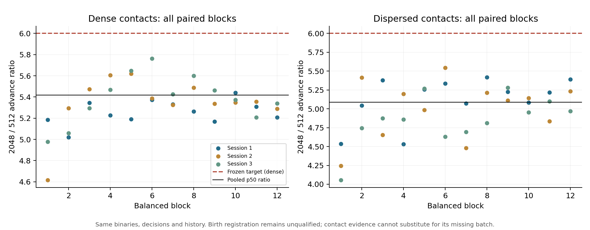
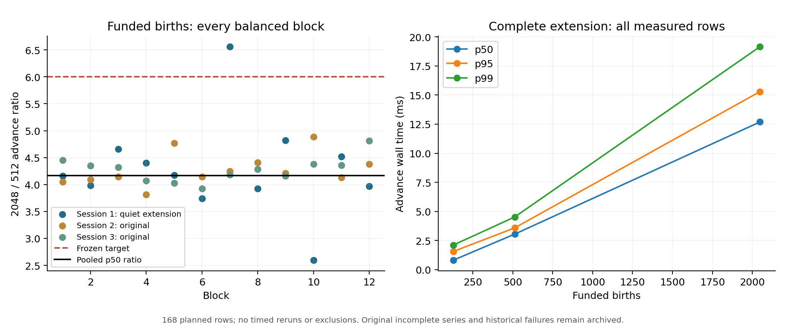

# S6.3.2 performance requalification

**Dense contact advance: PASS within the frozen workload. Funded birth registration: PASS in the user-authorized completion extension (document 50).** The original birth series remains an incomplete historical series with 112/168 rows; its pre-extension findings below are retained. The completed extension has all 168 predeclared rows and does not rerun timed sessions. The <=6 pooled p50 growth criterion is unchanged. No Core algorithm, biological decision, contact frequency, event count, history or random state was changed to obtain these results.

## Frozen design and execution

Protocol 48 was committed as `55e6871` before timing. The exact S6.3.1 Release binaries were reused, with SHA-256 checks before every session: contact `7e79d7aab6d27128e9c5bd58c834b320ba830997f3bef0a733ee2b9ed4edd582`; funded birth `c3cdbb06bfdf998568843917c5e2fbc42db2235a3911db001de3d86ba1d5894a`. Compiler: LLVM-MinGW 20261104 / Clang 23.1.5, CMake 3.31.10, Ninja 1.13.2. The later audit builds use separate directories and do not overwrite these executables.

The three contact sessions retain all **336 rows**, including warmups and 128-worker checks. Each layout has 36 paired ABBA/BAAB blocks, 72 measured observations per 512/2048 population and 12 measured 128 checks. All three schedules were written before admission. No build, simulation, extraction or data analysis overlapped acceptance timing. Source/document review continued, and the complete host process snapshots and background load remain available.

Before a session, 60 one-second samples must show system/core p50 <=10%, p95 <=20%, valid counters, AC on, saver off and fresh temperature/power readings. Failed attempts are retained, separated by at least five minutes, at most three per session. No timed session is repeated because of its outcome. One premature contact retry was rejected by the five-minute guard **before collecting an admission or launching a benchmark**; it produced no timed sample.

## Latency and growth

All entries below are milliseconds. Full setup/advance/checkpoint/restore p50/p95/p99, session summaries, raw samples and paired ratios are in `experiments/s6_3_2/performance_analysis` and `performance`.

| Layout / phase | 512 p50 | 512 p95 | 512 p99 | 2048 p50 | 2048 p95 | 2048 p99 | p50 growth |
|---|---:|---:|---:|---:|---:|---:|---:|
| Dense setup | 3.0953 | 5.3175 | 5.8972 | 10.3146 | 12.2411 | 13.1935 | 3.3323 |
| **Dense advance** | **41.4313** | **46.1830** | **51.1589** | **224.4947** | **232.7625** | **241.6781** | **5.4185** |
| Dense checkpoint | 8.0252 | 10.5667 | 13.3388 | 31.9293 | 34.5487 | 35.6939 | 3.9786 |
| Dense restore | 10.1890 | 12.0380 | 12.8473 | 47.6976 | 51.0404 | 52.3300 | 4.6813 |
| Dispersed advance | 15.3635 | 20.3077 | 21.1810 | 78.1513 | 86.4260 | 90.3872 | 5.0868 |

Dense advance pooled growth is **5.418486**, with **95% session/block bootstrap interval [5.297897, 5.501400]**. The paired-block median is **5.338576 [5.226317, 5.426444]**. Dispersed pooled growth is 5.086816 [4.899987, 5.191410]. Resampling uses all three sessions and intact balanced blocks, 4096 replicates, seed 63201. The point estimator is the frozen acceptance criterion; intervals describe uncertainty and do not replace it. Three sessions on one machine do not establish universal hardware performance.

This original-delivery figure is preserved unchanged. Its footer describes birth qualification before the separate quiet-interval completion documented below.

## Workload and memory identity

Every new row matches the corresponding S6.3.1 state hash, trace hash, event count, pending queue, checkpoint size and contact-work counters. All exact continuation checks pass. Dense 512 -> 2048 gives:

| Metric | 512 | 2048 |
|---|---:|---:|
| Facts | 15,874 | 63,490 |
| Decisions | 4,608 | 18,432 |
| Sampled candidates | 73,728 | 294,912 |
| Contact tree visits | 725,657 | 3,749,887 |
| Resident bytes, p50 | 20,652,032 | 51,531,776 |
| Resident bytes, maximum | 25,530,368 | 52,420,608 |

The process high-water memory is shared across sequential samples, about 93–94 MB, and must not be interpreted as independent per-population peak memory. Phase CPU-time counters are quantized at short durations; some setup/checkpoint CPU fractions exceed one or show zero due to timer resolution. Raw wall time remains the acceptance metric. Cycle and CPU summaries are supplementary, not replacements.

## Hardware telemetry and admission failures

Host: Intel Core i7-13620H, 10 physical / 16 logical processors, approximately 16 GiB RAM, Windows build 26200. Native benchmarks are pinned to logical processor 0 of the highest efficiency-class core; observer affinity excludes both SMT threads of that physical core. Topology, process snapshots, selected masks, timestamps, unchanged power-plan GUID, compiler/binary hashes and all schedules are in configuration/receipt JSON. AC remained on; no power settings or user processes were modified.

| Contact session | System busy p50 / p95 during timing | Package temperature range C | Package power range W | P0 effective clock p50 MHz | Thermal / power-limit flag max |
|---|---|---|---|---:|---|
| 1 | 6.96 / 14.29% | 48–59 | 3.122–14.875 | 2113.10 | 0 / 0 |
| 2 | 7.69 / 19.26% | 49–66 | 3.156–31.204 | 2169.55 | 0 / 0 |
| 3 | 7.46 / 18.48% | 50–67 | 3.422–27.068 | 2155.50 | 0 / 0 |

HWiNFO samples are approximately two seconds apart (maximum gaps 2.010–2.021 s); sub-sample thermal/power excursions cannot be excluded. OS telemetry targets 100 ms. During the three timed contact sessions, respectively 36/21/31 selected-core PDH readings were invalid. **All timed observations remain** under the predeclared no-exclusion rule. Complete valid one-second admission windows, independent system counters and HWiNFO remain available, but invalid in-run core readings limit fine-grained causal attribution.

Birth session 1 failed all three admission attempts, with no native benchmark process launched. System p50/p95 were 2.867/14.091%, 4.185/18.961%, and 3.078/16.361%. Selected-core valid-sample p95 values were 9.532%, 26.569%, and 21.274%, and each attempt also had invalid counter samples. Temperature/power freshness and AC checks passed. The archived values are **not** treated as evidence that every invalid interval was idle or busy. That session is exhausted and was not repeated; a user-arranged quiet interval was requested as protocol 48 requires.

The two other independently preplanned birth sessions retain their original schedules and admission limits. Session 2 qualified immediately; session 3 qualified on its third attempt after two invalid-counter admissions. Both completed all 56 rows. Thus the archive has **112/168 planned birth rows**, with no timing for the exhausted session 1. The available-session 512/2048 advance p50 is 2.98485/12.68810 ms (p95 3.24840/14.40510; p99 3.75406/14.92772). Pooled growth is **4.250833 [4.140750,4.383082]**, paired median **4.228951 [4.136535,4.360389]**, but receives **INCOMPLETE_NO_VERDICT**, not PASS. These intervals condition on the two available sessions; they do not supply the missing third replication or remove admission-related uncertainty.

Each completed birth session has five bracketing HWiNFO samples: session 2 reports 48–59 C / 3.554–19.738 W, session 3 49–59 C / 2.916–19.117 W, with no thermal/power-limit flag. Effective P0 clock medians are 1713.6 and 1573.9 MHz; timing-run system-load medians are 9.09% and 9.91%. No in-run PDH sample was invalid in these two brief runs. Their short duration and two-second sensor cadence limit phase-level thermal/power attribution. Every sample matches the original funded-birth state, history, birth count and conservation checks. Missing sessions are not zero-millisecond measurements.

The invalid status `0x800007D6` is `PDH_CALC_NEGATIVE_DENOMINATOR`. Microsoft's [PDH error reference](https://learn.microsoft.com/en-us/windows/win32/perfctrs/pdh-error-codes) says invalid counter data must not be used. The operating-system cause is unresolved; this is distinct from the valid core-load threshold excursions. The frozen validity rule is not relaxed after seeing failures.

## Retained failures and reviewable next steps

S6.1's **24.229x** anomaly remains archived with unknown cause. S6.3.1's **6.315x contact / 8.154x birth** results remain failed observations; this audit neither deletes them nor claims a proven thermal/background explanation. Lower-load controlled contact evidence now passes the same workload, but cannot establish why every earlier sample was slow.

No algorithm optimization is justified by the passing contact replication. The tree-visit growth of about 5.17x is consistent with bounded sampling plus index traversal; it does not prove a particular CPU bottleneck. Existing S6.2/S6.3 exclusive instrumentation remains historical attribution, not a new S6.3.2 profile. Setup, advance, checkpoint and restore are separately measured here; internal category counters in the uninstrumented acceptance binary are zero and must not be misreported as zero computational cost.

At the original delivery, birth registration received **no PASS and no increased <=6 target**. The proposed follow-up was to retain the exhausted admission series, diagnose PDH raw counter/time-base validity and cross-check another per-core source during a user-arranged quiet interval, then freeze any new admission series before timing. The user subsequently provided that interval; the outcome follows. No sensor substitution was made. If a future qualified workload fails, instrument the unchanged path separately and quantify profiling overhead before proposing optimization. Global allocation scans, history/checkpoint growth and dynamic registration remain broader scaling questions, not established causes of the missing original batch.

## User-authorized quiet-interval completion

After original delivery `1671737`, the user answered the pending request and made a quiet interval available. Document 50 and the diagnostic collector were frozen in `7badade` before any new observation. The new series lives in `performance_quiet_1`; original `performance` and `performance_analysis` files are unchanged. Only the previously untimed session 1 was run; original sessions 2/3 were not repeated. The completion analysis combines precisely these three predeclared sessions, not a favorable subset. All three schedules match the original plans; the runner, binary, topology, affinities and workload are unchanged.

The preceding diagnostic retained 60 one-second samples. Processor Information and legacy Processor counters both returned `0x800007D6` at the same two observations. Their raw values matched: first-value increments 11,562,500 / 12,500,000 versus second-value increments 9,998,802 / 9,994,351; the queried time base stayed 10,000,000. All second-value increments were positive. HWiNFO thread usage at those points was 0.4% / 0%; system load median was 3.411%. This localizes the symptom to inconsistent raw interval accounting shared by both counter objects; it does **not** establish an OS/firmware cause, explain historical slow timings, or license treating invalid data as zero. The two PDH objects are not independent hardware truths, and HWiNFO has different cadence. Raw status/type/timestamp/value data and host metadata are archived in `quiet_1_diagnostic`. The official [raw-counter contract](https://learn.microsoft.com/en-us/windows/win32/api/pdh/ns-pdh-pdh_raw_counter) distinguishes raw values and validity; no alternative source replaced the admission counter.

The first new formal admission passed all 60 valid samples. System busy p50/p95 was **3.1265/4.8107%**, selected core **0.0057/1.5697%**; AC/saver and sensor checks passed. The unchanged executable then completed all **56 rows** once. Combined with the original 112 rows, every state/trace hash, fact count, pending event count, checkpoint size, funded birth count, exact restore and nutrient/energy check matches the historical workload.

| Birth phase | 512 p50 | 512 p95 | 512 p99 | 2048 p50 | 2048 p95 | 2048 p99 | p50 growth |
|---|---:|---:|---:|---:|---:|---:|---:|
| Setup | 2.8058 | 3.3849 | 4.8388 | 12.1905 | 14.0781 | 15.3800 | 4.3448 |
| **Advance** | **3.0433** | **3.5805** | **4.5181** | **12.6881** | **15.2967** | **19.1652** | **4.1693** |
| Checkpoint | 4.1043 | 4.9182 | 5.4826 | 15.3317 | 17.8087 | 21.9585 | 3.7356 |
| Restore | 7.7234 | 9.0309 | 13.6297 | 34.3149 | 37.3432 | 38.2100 | 4.4430 |

Times are milliseconds. Completion-extension advance growth is **4.169260 [4.049359,4.335740]**, paired median **4.194797 [4.115608,4.370482]** (same 4096 session/block bootstrap draws, seed 63201). This meets the unchanged <=6 point-estimator gate. Session 1 alone has advance p50 3.11375/12.73255 ms; all its slow observations remain, including maxima 6.2768/27.1634 ms. Original two-session 4.250833x and incomplete status remain reproducible in their original analysis directory.

The added run lasted about 4.21 s and retained 42 OS readings, including one invalid core reading and system busy p50/p95 **11.7484/25.3167%** during execution. The latter includes benchmark work and is not a pure background-load measurement. The frozen admission rule and no-post-start-exclusion rule were both applied: these excursions are disclosed, not filtered or rerun. Five bracketing HWiNFO rows span 51–64 C / 3.107–24.665 W, maximum gap 2.006 s and no sampled throttling/power-limit flag. Their P0 effective-clock median of 5 MHz includes idle bracketing samples and must not be interpreted as the benchmark's execution frequency; this very short run cannot resolve per-phase thermal/power causation. Raw OS frequency/performance readings remain available.

Combined resident-memory p50 is 14,290,944 / 33,609,728 bytes for 512/2048; maxima 16,965,632 / 36,970,496. Process high-water maxima are shared across sequential samples, 48,443,392 bytes, not independent population peaks. Facts remain 3,587 / 14,339; pending events 2,048 / 8,192; checkpoint bytes 1,426,479 / 5,702,703. N is the benchmark's funded queens/births (2N initial, 3N final ants), not a biological multi-queen claim. Full per-session phase percentiles, CPU/cycles, work, telemetry, admission reconstruction and source hashes are in `completion_analysis`.

This closes the missing controlled measurement for the specified workload only. TD-01/08 broader moving-population/long-history scaling remains open; all scientific blockers for S6.4 are unchanged. No algorithm optimization or threshold adjustment was necessary or performed.

## Reproduction

See `experiments/s6_3_2/README.md` for exact commands and artifact layout. `tools/analyze_s6_3_2_performance.py --check` reproduces raw-work equality, admission status, percentiles and bootstrap intervals using only Python's standard library. Normalized sensor CSVs preserve every selected reading; localized raw HWiNFO prefixes remain private with byte counts and hashes. No facts or slow timing samples were removed.
