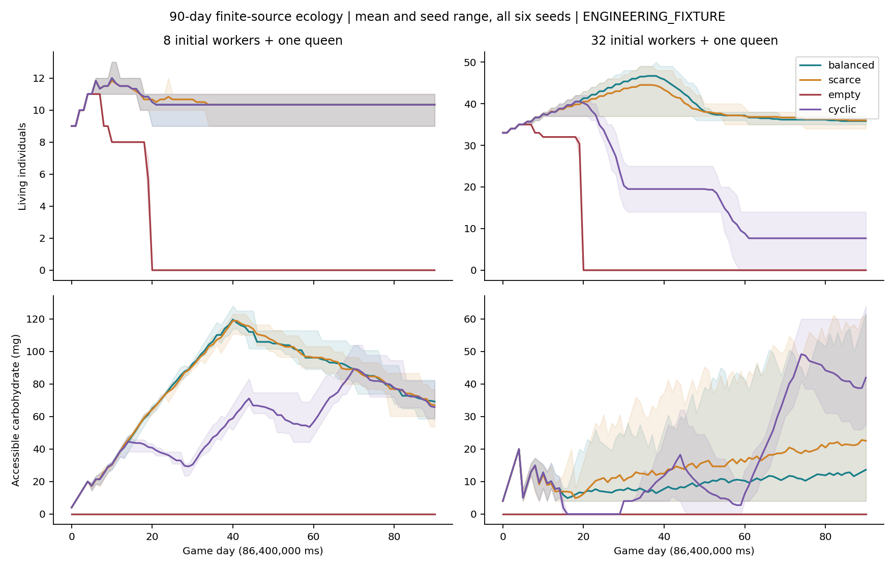
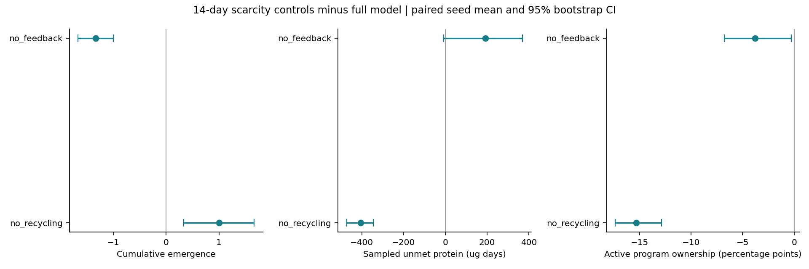
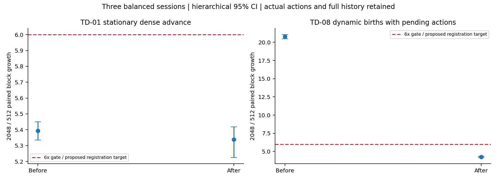

# S6.3: Long-Term Ecological Loop Completion

Status: implementation and local verification complete; evidence receipts are listed below. This is an engineering fixture, not a calibrated Lasius niger colony. Stop at S6.3 for independent review. S6.4 and S7-S9 are not authorized.

## Acceptance boundaries

| Dimension | Conclusion | Scope |
|---|---|---|
| Engineering correctness | PASS | Funded internal birth transfers, finite sourced resources, identity, atomic rollback, deterministic continuation, spatial constraints and authentic event evidence. All 137 inherited regressions are retained; 16 are added. |
| Ecological loop completeness | CONDITIONAL PASS for the bounded headless mechanism | All 48 corrected primary worlds run 90 actual game days; births, development, emergence, deaths, transfers and environmental availability are integrated. Six compact-chamber worlds additionally exercise actual autonomous geometry changes. Survival and indefinite reproduction are not guaranteed. |
| Biological realism | UNVALIDATED | Every numeric biological parameter and new response rule is ENGINEERING_FIXTURE. All primary queens eventually die of accounted energy depletion. Scarcity, reproductive allocation, activity, nesting and social recruitment remain scientific debts. |
| Performance scaling | PASS for measured gates; broader scope OPEN | Controlled stationary dense advance stays below 6x growth; the proposed dynamic-birth registration target also passes. This does not establish 2048-ant, multi-month ecological scaling or indefinite history storage. |

The overall submission is **CONDITIONAL PASS for independent review**, with explicit biological and scale limits. No claim of stable, realistic colony growth is made.

## Frozen audit and implementation

[Protocol 41](docs/41_S6_3_Frozen_Protocol.md) was committed as `5607139` before implementation. It audits the missing queen reproduction, finite resource source, recovery/space feedback and registration cost, specifies the complete seed matrix and fixes all numeric inputs. [Protocol 42](docs/42_S6_3_Correction_Protocol.md), commit `0c26f42`, was frozen after the complete initial negative matrix and before its two corrections. It independently disables each correction and adds compact/ample chamber controls. No numerical ecological input was tuned after either freeze.

[Document 43](docs/43_S6_3_Implementation_and_Metrics.md) defines the interfaces, nine additive statistics, units and event fields. Core facts remain authoritative; storage and the experiment observers cannot change decisions. There is no Unity, external model call, central task allocator, global food map, target population curve or survival rescue.

- **Reproduction:** an adult queen's current protein, body water and energy fund one egg, including an explicit dissipative cost. Maternal debits and the child's initial tissue/body inventories commit together. The new stable ID persists through egg, larva, pupa, adult and death. Dead queens stop laying; unaffordable attempts create no child. New workers enroll in the same local autonomous behavior after development.
- **Finite resource availability:** an explicitly introduced inaccessible reservoir releases bounded material into a stable FoodSource. A 15-day productive/15-day unproductive cycle changes availability independently of ant demand. Release transfers existing material; it does not create food. Accessible stock, reserve, crops, cargo, depot, body compartments and sinks reconcile. This is a finite resource-input model, not a photosynthesis/weather model.
- **Local activity and space:** completed depot visits trigger one recovery interval for that individual. Self state, reachable sampled neighbors, physically contacted depot inventory and bounded local empty sites influence work. Compact geometry can trigger actual soil transport and edits; adequate local space inhibits unnecessary digging. The proxy is not physical crowd packing or semantic chamber demand.
- **Nutrition:** larvae retain carbohydrate/water demand after protein completion; queens signal the next egg's protein requirement. Ingredient-aware withdrawals use self and actual sampled recipient demand. Workers can return real unused crop protein to the contacted depot. A successful nursing intake permits one subsequent local encounter before the next coarse metabolism pulse. All contact, barriers, inventory and capacity checks remain at resolution.
- **Transactions and storage:** births, releases, recycling, owned wakes, counters and derived indexes use the existing single-writer undo journal. Saves retain exact time, queues, RNG, identities, reserves, physiological remainders and authoritative ordered geometry. SQLite indexes both mother and child as participants in a birth. Every event remains in history.

Legacy worlds retain schema 8 / physics 9, canonical behavior and the original S6 60-column experiment exports. Corrected opt-in worlds use schema 9 / physics 11. The unreleased initial 9/10 prototype is deliberately rejected by the corrected reader; its original source, raw data and binary hash are retained. This is not an implicit old-save migration.

## Diagnosis before correction

The initial `primary-v1` matrix contains all 48 seeds/configurations. In completed supplied worlds the queen laid two eggs, neither emerged, and queen/brood died despite remaining food. Eighteen worlds reached the event-budget censoring rule. They are retained, not treated as 90-day extinction observations.

Two event sequences identified mechanism defects:

1. An ant returning through ordinary Explore mode could repeatedly reach the depot without completing its trip. Only the explicit Return path triggered recovery. Empty/seasonally inaccessible worlds accumulated repeated exploration/rest actions, sometimes exceeding the two-million-fact guard. The correction recognizes an actual unloaded depot arrival in either path; it does not move the ant or deliver food automatically.
2. With the frozen six-hour absorption/behavior period, nursing intake was often followed by the worker's own absorption before the next gift decision. For example, initial seed 1 / 8 workers / balanced repeatedly withdrew approximately 47 carbohydrate, 2 protein and 51 water ug; only small protein gifts reached a larva that still lacked maintenance energy. The correction permits one fresh local decision at the existing 1 ms action latency after successful nursing intake. It neither forces a recipient nor creates a continuous fast intake loop. That latency is not measured trophallaxis duration.

The 24-run correction factorial retains both single-correction arms. With trip completion still disabled, six empty `exchange_only` worlds remain censored near day 5. With the ongoing encounter disabled, supplied development remains poor. Complete raw records are retained for both failures. The two fixes change the versioned model, so the report does not pretend that the initial and corrected traces should be identical.

## Ninety-day outcomes and uncertainty

One day is exactly 86,400,000 ms; the primary endpoint is 7,776,000,000 ms. Six predeclared seeds are used in every primary condition. Rows below are means; the full per-seed values, 95% bootstrap intervals, minima and maxima are in [estimates.csv](experiments/s6_3/analysis/estimates.csv). Intervals use 4,096 seed resamples with seed 6303, are descriptive and are not adjusted for multiple endpoints.

| Initial workers | Supply / environment | Births | New emergence | Living at day 90 |
|---:|---|---:|---:|---:|
| 8 | Balanced / constant | 3.50 | 2.33 | 10.33 |
| 8 | Scarce / constant | 3.67 | 2.33 | 10.33 |
| 8 | Empty | 2.00 | 0.00 | 0.00 |
| 8 | Balanced / cyclic | 3.50 | 2.33 | 10.33 |
| 32 | Balanced / constant | 14.00 | 11.83 | 35.83 |
| 32 | Scarce / constant | 12.00 | 10.17 | 36.00 |
| 32 | Empty | 2.00 | 0.00 | 0.00 |
| 32 | Balanced / cyclic | 8.17 | 5.17 | 7.67 |

For example, 32-worker balanced constant emergence is 11.83 [9.00,13.67], versus cyclic 5.17 [4.67,5.67]. The 8-worker cyclic and constant final population outcomes coincide; the same availability change is not consequential under every demand/stock history. Empty worlds still begin with explicitly seeded adult crop/body stores; their first eggs are funded from those stores, not hidden food. All empty worlds become extinct. No condition is removed from the denominator.



**Queen failure is a material limitation.** All 48 primary queens die from energy depletion, latest day 45.405. In 8-worker balanced constant worlds death occurs on days 6.007-11.701; in 32-worker balanced constant worlds on days 10.139-45.405. The last birth in that larger supplied condition is day 38. A colony can retain living workers at day 90 while having lost its reproductive capacity.

The event-derived [diagnosis.csv](experiments/s6_3/analysis/diagnosis.csv) reconciles each queen's initial/received/oxidized energy against egg export, reproductive dissipation, basal metabolism and final body energy. No nutrient loss explains these deaths. Current eligibility only requires enough energy for the immediate egg plus positive remaining reserves. It has no calibrated maintenance horizon or reproductive restraint, and local worker supply may not replenish that reserve before depletion. This motivates new **SD-08**, not an unreviewed parameter rescue. Queen-only claustral nursing, structural protein remobilization, senescence and diapause remain absent.

## Nutrition, activity and geometry controls

The 18-run 14-day scarcity control uses 32 workers and the same six seeds. Relative to the full model, disabling recycling yields:

- **+1.00 emergence [0.333,1.667]**, with **-0.50 births [-1.167,0.000]**.
- **-16.17 ug protein transferred [-54.00,19.83]**, while sampled unmet-protein exposure decreases **404.67 ug days [344.42,473.00]**.
- Approximately 3,221 ug less recycled protein, with more protein retained in workers and less in the depot.

This is an unfavorable completion result for recycling, despite genuine recovery of previously retained material. Per-recipient evidence shows both increased queen provisioning/new demand and altered timing of child supply. Examples: seed 1 full has five births, two emergences, 381 ug child gifts and 19 ug remaining larval need, versus four/three/320/zero without recycling. Seed 4 has seven births in both arms but one versus three emergences; child gifts are 368 versus 400 ug. Therefore fewer births alone does not explain the difference. Local supply timing and compartment/recipient allocation remain unresolved SD-04 mechanisms. No rule was fitted to maximize emergence.

Disabling demand/space feedback reduces emergence by 1.333 [1.000,1.667], but also produces 9.833 [7.50,12.33] additional geometry edits in an already ample chamber. Active program ownership does not monotonically improve with every feature. In the supplied primary matrix it is about 24-28%, and in empty worlds about 1.4-2.5%. These are integrated Nurse/Forage/Excavate program durations, not measured physical activity. They cannot be directly equated with the older short fixture's 97.6%, because the physiological and time-window contracts differ.

The matched six-seed compact-chamber experiment produces **15-19 edits**, mean 16.5 [15.67,17.50], versus zero in the ample chamber. Its emergence difference is -0.833 [-5.667,3.667]; no ecological benefit is established. Material and connectivity remain authoritative, but real nest morphology/functional needs remain SD-06/TD-04.

Timing sensitivity is substantial: three-hour periods yield mean 2.333 emergences at day 14 in seeds 1-3; the matched six-hour observations yield 0.667 (per seed: 0, 1, 1), and twelve-hour periods yield zero. Every individual is retained. This supports an explicit calibration/timing limitation, not selection of a favorable interval.



## TD-01 and TD-08 performance

The frozen balanced protocol runs 128/512/2048 cases, three sessions, ABBA/BAAB 512/2048 order, fixed compiler/configuration/input and core affinity. Setup, advance, checkpoint and restore are separate phases. CPU time/cycles, processor identity, Windows load/frequency/power status and read-only HWiNFO CPU samples are retained. Warmups remain in raw data and are excluded by their predeclared flag. No sample is removed for timing, temperature or power values.

The four acceptance/comparison batches contain **1,008 raw samples, 936 measured samples**. [latency.csv](experiments/s6_3/performance_analysis/latency.csv), [paired_raw.csv](experiments/s6_3/performance_analysis/paired_raw.csv), [memory.csv](experiments/s6_3/performance_analysis/memory.csv) and telemetry include every session, percentile and phase. Original exploratory baseline measurements remain separately archived and are not substituted for the clean final baseline.

| Dense workload / phase | 512 p50 ms | 2048 p50 ms | p50 growth | Paired median [95% CI] |
|---|---:|---:|---:|---|
| Original stationary contact setup | 17.713 | 326.011 | 18.405x | 18.522 [17.640,19.392] |
| Cached stationary contact setup | 2.960 | 10.199 | 3.445x | 3.119 [2.777,3.400] |
| Original stationary contact advance | 40.373 | 219.842 | 5.445x | 5.394 [5.334,5.450] |
| Final stationary contact advance | 42.443 | 227.067 | **5.350x** | **5.338 [5.225,5.418]** |
| Birth advance before pending index | 8.093 | 168.555 | 20.827x | 20.783 [20.474,21.054] |
| Birth advance after pending index | 2.957 | 12.437 | **4.205x** | **4.244 [4.159,4.324]** |

Stationary 2048 final p95/p99 advance is 238.562/241.247 ms. Dynamic birth final p95/p99 is 13.868/14.556 ms. The stationary advance is not claimed to be faster in absolute time; the optimization targets registration. Every corresponding event count, work counter, checkpoint size, state hash and trace hash matches before/after.

Registration originally recomputed population-wide nutritional capacity on each enrollment. Conservative checked cached bounds remove that scan. A separate actual-birth stress fixture then exposed a full pending-queue conflict scan per newborn. The rollback-safe per-ant conflict index removes it while retaining owned-versus-external action validation and restore reconstruction. The birth fixture has N queens and N pending-action workers, then N funded births: initial population 2N, final 3N. N is not total ants and the fixture is not an ecological multi-queen model.

Separate instrumented medians at 2048 attribute actual costs, rather than estimating nanoseconds from operation counts. Original stationary setup makes 2,098,176 physiology queries (243.359 ms exclusive); the cached setup makes zero such repeated queries. Before/after birth policy time falls from 153.129 to 0.632 ms. The remaining measured final costs are:

| Exclusive category | Stationary advance ms | Birth advance ms |
|---|---:|---:|
| Contact index maintenance | 0.000 | 3.010 |
| Candidate sampling | 80.843 | 0.000 |
| Spatial validation | 7.273 | 0.049 |
| Event scheduling | 24.317 | 3.220 |
| Transaction journal | 19.273 | 6.074 |
| Fact history | 4.707 | 0.294 |
| Physiology | 60.868 | 0.000 |
| Policy | 64.531 | 0.632 |
| Residual scoped advance work | 18.050 | 2.491 |

Zero means no instrumentation call for that category in this phase, not that indexing or physiology is free; computation outside those scopes remains in residual work. The full [profile.csv](experiments/s6_3/performance_analysis/profile.csv) includes all sizes/layouts, calls, inclusive/exclusive times, setup and restore. Scope overhead is why these numbers are excluded from the acceptance wall-time distributions.

At 2048, final stationary RSS median is 51.5 MB and birth-fixture RSS median 33.8 MB. Process peak RSS includes warmups/earlier rows; it is not a per-population isolated peak. Bootstrap intervals resample sessions and paired blocks, 4,096 times, seed 6303. Only three host sessions exist. HWiNFO's roughly two-second sampling cannot identify the thermal state of each millisecond-scale birth phase. Power-limit flags/background load and short birth-session durations remain visible; intervals describe this host/protocol, not universal hardware performance. S6.1's 24.229x anomaly and unknown cause remain untouched.



Primary-world descriptive costs range from 14,525 to 524,924 facts and 0.104-2.170 s total simulation advance over 90 days. Maximum observed checkpoint is 83,554,807 bytes; checkpoint encoding 236.680 ms, restore 322.786 ms and process RSS 168,833,024 bytes. These ecological timings are not isolated acceptance runs. Full histories grow; no facts are deleted, no asynchronous save is implemented and no indefinite memory claim is made.

## Verification and evidence retention

Local Clang 23.1.5 / CMake 3.31.10 / Ninja 1.13.2 / SQLite 3.54.1 builds use pinned workspace dependencies. Debug, Release and ASan+UBSan each executed **153/153 tests**. Windows ASan uses `detect_leaks=0`; Linux CI enables leak detection. New cases cover funded birth/death identity, shortage, dead queen, finite cyclic source, integer water remainder, recycling, rollback, month-scale continuation, rechecksummed corruption, trip recovery, post-intake exchange/no-recipient, spatial feedback and pending conflict reconstruction, plus allocation-failure sweeps and durable integration. Existing barrier/contact, geometry, resource-ID, scheduling and persistence regressions remain.

An independent storage-disabled build passes **132/132** tests. A fresh Release build from the committed `cpp` and `scenarios` Git archive passes **153/153** tests in 15.86 s. The five-job CI matrix at `d1aa36a` passes Linux/Windows Debug/Release and Linux sanitizers. The evidence branch additionally runs the two frozen 90-day review cases in CI; [current branch runs](https://github.com/Aquaticfuller/AntWorld/actions?query=branch%3Acodex%2Fs6.3-long-term-ecology) show the final publication checks.

The archive has **150 ecological runs, 8,549 daily observations, 126 completed exact continuations and 24 censored runs**. Eight selected durable saves also compare SQLite recovery against the authoritative checkpoint. Complete canonical 159-byte fact streams are losslessly compressed, with every original CSV row retained. Daily snapshots and readable events are independently reconciled with those streams, including IDs, births, stages, deaths, transfers, accounting and censoring. Complete checkpoint/database duplicates remain local with hashes; their state can be reconstructed by the commands below. Compression is archival only, not a simulation optimization.

Final receipts, profiling attribution and CI links are recorded in [verification.json](experiments/s6_3/verification.json). The final source is rechecked against all 102 corrected cases; host timing fields are excluded, while same-platform fact/checkpoint bytes and all observations must match. Cross-platform CI uses document-18 coordinate tolerance and explicitly excludes binary hashes rather than pretending floating representation is guaranteed portable.

## Reproduction

See [experiments/s6_3/README.md](experiments/s6_3/README.md) for commands, source/binary provenance, raw archive format, hardware sampling and complete analysis. Typical portable commands:

```sh
cmake -S cpp -B build/review -DCMAKE_BUILD_TYPE=Release
cmake --build build/review --parallel 4
ctest --test-dir build/review --output-on-failure
./build/review/antworld_s6_3_experiment out/review-primary primary
python tools/verify_s6_3_reproduction.py out/review-primary --group primary-v2 --report out/review-primary-check.json
python tools/analyze_s6_3.py --check --deep
python tools/analyze_s6_3_performance.py --check
python tools/diagnose_s6_3.py
python tools/plot_s6_3.py
```

Fresh directories are required; experiment tools refuse to overwrite prior results. Repeat with `controls`, `sensitivity`, `factorial`, and `spatial`. On Windows executables have `.exe`; use the pinned local toolchain as documented. Use `--cross-platform` for reproduction across supported compiler/platform boundaries.

## Biological evidence and remaining scope

The qualitative audit uses [a L. niger queen-feeding/founding experiment](https://academic.oup.com/biolinnean/article/142/4/397/7342048), [macronutrient trade-offs in colony growth/survival](https://doi.org/10.1002/ece3.6520), and [local food dissemination experiments](https://www.nature.com/articles/s41598-019-52019-6). These support investigating resource constraints and local exchange, not the numeric fixture rates. The dissemination experiment's queenless/broodless sucrose conditions cannot calibrate queen or larval protein supply. No literature result is converted into an unmeasured species constant.

[Open Questions](docs/08_Open_Questions.md) retains SD-01/02 trail following/recruitment, SD-04 allocation, SD-06 functional nesting, SD-07 activity and new SD-08 reproductive allocation. TD-03/06 synchronous full-history storage, TD-04 geometry expression, TD-05 later geometry-change notification and TD-08 broader dynamic population scaling remain open. Finite reservoir input, three coarse pulse schedules, small spatial fixtures and six primary seeds are substantial limits. Further biological mechanism changes require their own hypotheses and reviewed protocols; S6.3 stops here.
