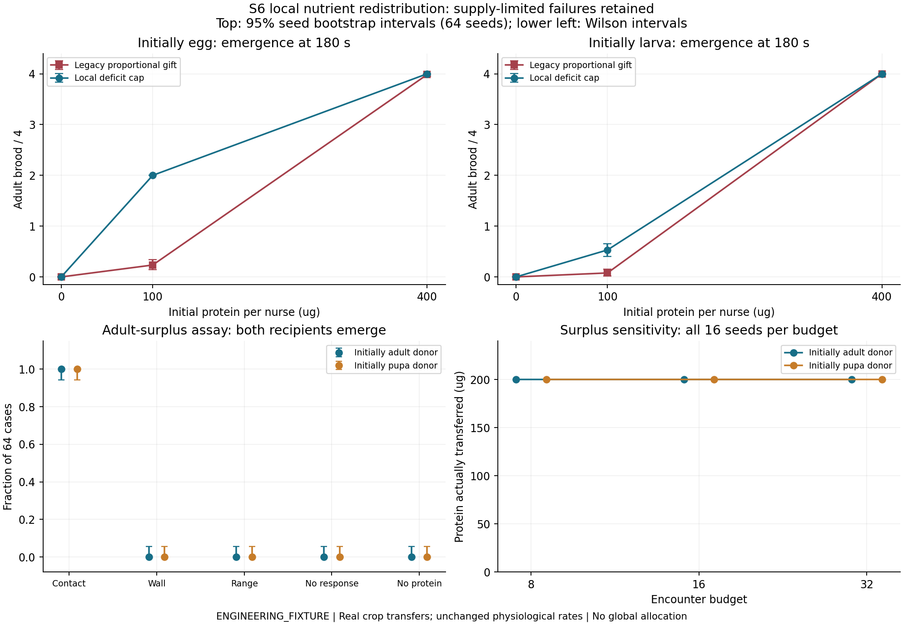
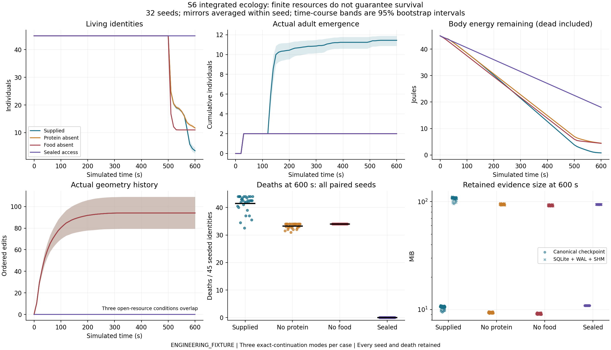
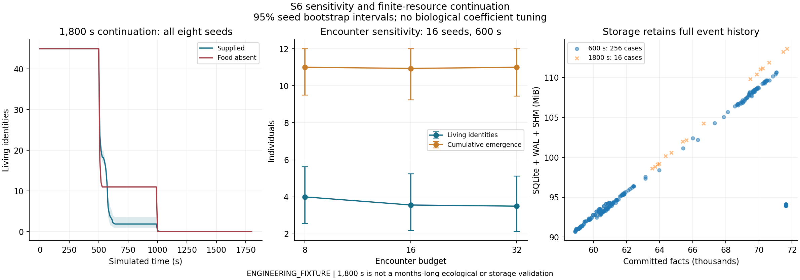
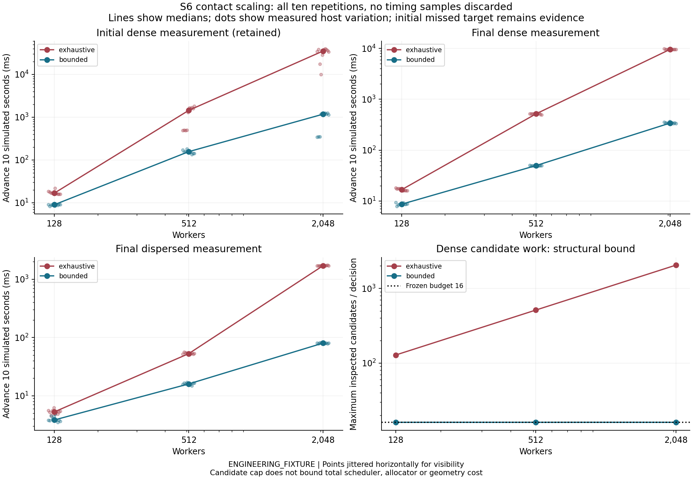

# S6 results: integrated ecological loop

**Self-assessment: CONDITIONAL PASS for the implemented S6 mechanism/invariant scope.** All frozen matrices, local builds, source CI and independent evidence audits completed. Integrated nutrient redistribution remains incomplete (SD-04), and the dense-contact <=6x scaling target failed (TD-01). These are explicit review conditions, not waived requirements or a full biological validation. Work stops at S6 for independent Code Review; S7-S9, Unity and Game Master remain unauthorized.

Branch: `codex/s6-integrated-ecology`. Approved S5 baseline: `54fc129a02f1e21af93b09a0bce8d7cb0172e62b`. [Document 35](docs/35_S6_Integration_and_Validation_Protocol.md) was frozen at `d86372f` before code changes. [Contact details](experiments/s6/CONTACT_PROTOCOL.md) and [integration details](experiments/s6/INTEGRATION_DETAILS.md) were fixed before their measurements. [Document 36](docs/36_S6_Implementation_and_Metric_Definitions.md) defines the implementation, units and evidence; [document 08](docs/08_Open_Questions.md) tracks remaining debt. Every biological input, response weight, encounter budget and interval is **ENGINEERING_FIXTURE**.

Final measured C++ source: `3636f22458d0a6fc0c2c5cb22d776dda98d1d6a9`. The primary/nutrition/surplus matrix began on `e7c36ef858ea92960381213b280f1e5723eca35e`; final-source reproduction of the first complete seed (eight conditions, 24 modes) matches its canonical state/trace hashes and every exported semantic field exactly. The intervening change formats code, freezes scalar contact-work records for allocation-failure portability, and adds a locality test; it does not retune ecology. The [evidence index](experiments/s6/README.md) qualifies each archive by source. All historical reports and S0-S5 raw archives remain unchanged.

## Implemented mechanisms and boundaries

The C++ core remains the single authority and runs without SQLite, Unity or a model API. `configure_social()` explicitly opts a world into the new policy; unchanged historical fixtures keep their original semantics. The existing undo journal handles all new social configuration, index, automatic ownership, queue and evidence changes. No whole-State copy was added to the ordinary mutation path.

Nutrition uses real donor inventory and recipient state. At commit, each ingredient is capped by current recipient deficit, remaining crop capacity, requested work and actual donor crop, after any preceding competing transfer. Tissue protein is not transferable adult surplus. A donor does not read colony-wide nutrient totals or perform global averaging. The exact deficit sensor and selective ingredient composition are engineering abstractions, not measured Lasius niger physiology.

Dense encounters use a disposable order-statistic treap per local spatial bucket. A private seed/identity/decision stream samples ranks without replacement, inspecting at most the configured budget before exact distance, colony/life and solid-barrier qualification. Movement/death update only touched journaled nodes; restore rebuilds the canonical tree. Pure queries consume no simulation time or RNG. Tree/map/scheduler costs remain; the candidate cap is not a bound on total wall time. Exhaustive observer queries and deliberate legacy/performance ablations remain available.

An enrolled worker chooses Rest, Nurse, Forage or Excavate from own reserves/cargo, sampled local nestmates, physically contacted depot stock, a legal local surface step and nearby reachable soil. Choices at a timestamp freeze before any changes commit, then execute in Reschedule with future wakes. There is no global food coordinate, population/task target, blueprint or assigned worker role. Routine travel-program changes require an actual return to the depot and empty cargo; workers cannot discard soil/food or teleport home to change jobs. Manual behavior control disables automatic reconsideration. Enrolled brood activates the same identity after real emergence; death cancels its owned work.

The mixed fixture joins existing planar foraging to actual 3D excavation and contact. Off-plane brood and inactive foragers can occupy legal cavity positions; active foraging remains planar. Nearby individuals across solid soil cannot exchange food, and pending actions recheck actual space. Every cut, carried parcel, drop and fill retains S4 material authority and evidence. This is not general 3D food search, brood relocation, chamber semantics or calibrated nest morphology.

Schema **7** / physics **8** add the social fingerprint, contact-work diagnostics and per-identity automatic state. Existing 115-byte scheduled-event and 159-byte fact codecs remain. An absent social policy adds one byte relative to S5, nine bytes relative to S4. Older schemas are rejected explicitly; no migration is claimed. New automatic decision facts distinguish executed reconsideration from future work. An automatic behavior change and its decision share a scheduled source but have distinct EventIds; decode validates that association without counting two scheduler executions.

## SD-04: diagnosis and controlled validation

The retained S3 seed-43 case starts with four eggs and 800 ug donor protein. Under the legacy policy, three emerged adults each retain 140 ug crop protein, while the remaining larva has only 80 ug tissue protein at 180 s. Fixed proportional gifts admitted concurrent oversupply and inactive emerged recipients did not redistribute it. The same negative outcome remains in the full legacy regressions and S6 matched control.

The local deficit cap yields four adults in that case, exactly 100 ug received protein per brood and 400 ug still held by the original nurses. Across the complete 768-case final nutrition matrix, no local-demand recipient exceeds its 100 ug requirement. Seven legacy cases retain larval protein shortfall alongside accessible colocated surplus; no local-demand case does. This does not guarantee optimal emergence under scarce supply.

Mean adult brood at 180 s out of four, all 64 seeds per cell, with 95% seed bootstrap intervals:

| Initial brood | Protein per nurse | Legacy policy | Local deficit cap |
|---|---:|---:|---:|
| Eggs | 0 ug | 0 [0, 0] | 0 [0, 0] |
| Eggs | 100 ug | 0.2344 [0.1406, 0.3438] | 2 [2, 2] |
| Eggs | 400 ug | 3.9844 [3.9531, 4] | 4 [4, 4] |
| Larvae | 0 ug | 0 [0, 0] | 0 [0, 0] |
| Larvae | 100 ug | 0.0781 [0.0156, 0.1563] | 0.5313 [0.4063, 0.6563] |
| Larvae | 400 ug | 4 [4, 4] | 4 [4, 4] |

The separate surplus assay enrolls one crop-loaded donor and two larvae without assigning a Nurse role. All 64 contact seeds transfer exactly 200 ug protein and produce two adult recipients, both for an initially adult donor and an initially pupal donor that emerges under the same identity. Each donor-stage success proportion is 64/64, Wilson 95% interval **[94.34%, 100%]**. Wall, range, no-response and no-protein controls transfer zero protein and produce zero adult recipients (0/64; Wilson upper bound 5.66%). No-protein controls may transfer other real nutrients; they do not fabricate protein.

The 16-seed budget-8/16/32 surplus sensitivity retains all 96 cases; every contact case transfers 200 ug protein and produces two adult recipients. These tiny three-individual contact assays cannot establish large-colony sufficiency. The initial and final SD-04 archives both remain, including the final policy's additional carbohydrate/water transfers in zero-protein larval cases. Their brood endpoints are identical. Paired differences, ingredient evidence and remaining demand/surplus are in `analysis/nutrition*.csv` and `analysis/surplus.csv`.



## Frozen integrated experiment and independent accounting

Each primary case seeds one queen, 32 workers, four eggs, six larvae and two pupae: **45 identities, no subsequent births or resource injections**. Initial body energy totals 45 J; hydration totals 45,000 ug; the two seeded pupae explicitly contribute 200 ug retained protein. Supplied food adds 1,000 ug carbohydrate, 2,000 ug protein, 5,500 ug water and 500 ug inert mass. With the unchanged yield, all available carbohydrate can supply only one additional joule. These are finite initial conditions, not a sustainable colony feeding regime.

The 32-seed primary protocol uses both mirrored food layouts and supplied, protein-absent, food-absent and sealed-access conditions at 600 s. Sensitivity uses seeds 1..16 and encounter budgets 8/16/32; extended continuation uses seeds 1..8, supplied/no-food and 1,800 s. All cases execute normal 1 s advances, accelerated 60 s advances and actual SQLite save/reload every 60 s. Exact canonical equality is required at every common boundary, covering queues, RNG, time, resource inventory, physiology, geometry and history. Execution-mode copies are verification replicas, not independent statistical observations.

Declared host limits are one million committed facts, 10,000 scheduled events per timestamp and a 256 MiB checkpoint. They are engineering budgets, not biological carrying capacities. The finite experiment is not evidence of indefinite low-memory operation or a full-size multi-colony world.

Each final database is checked against every committed fact, all world/colony gauges, all cumulative flows, every stable identity and every geometry-evidence link. The independent Python audit reconstructs population/stages/deaths, transfer participants, program residence, every ordered geometry edit and food sources from raw CSVs. It checks carbohydrate/protein/water/other, body energy and soil ledgers at every 10 s observation, not only at the endpoint. Dead inventories remain accounted for. A cut's actual changed-material volume can be smaller than its bounding box because it overlaps existing void; the audit reconstructs that material explicitly.

All **256 primary cases / 768 modes**, **48 sensitivity cases / 144 modes** and **16 extended cases / 48 modes** completed: **320 cases / 960 verified execution replicas**. Every declared residual is zero, identities remain continuous, and history/state/geometry reconciliation passes. The audit also checks all **21,440 ten-second observations** and all **14,400 per-case identity endpoints**. Raw files, derived intervals and normalized-LF hashes are in `experiments/s6`; no unfinished or failed ecological outcome is omitted.

Primary endpoints at 600 s, means and 95% seed bootstrap intervals (32 independent seeds; mirrors paired):

| Condition | Living identities / 45 | Cumulative brood emergence / 12 | Deaths | Food deliveries | Excavated q3 |
|---|---:|---:|---:|---:|---:|
| Supplied | 3.469 [2.490, 4.563] | 11.438 [10.875, 11.891] | 41.531 [40.438, 42.510] | 3 | 398.969 [353.324, 445.828] |
| Protein absent | 11.688 [11.406, 12.000] | 2 [2, 2] | 33.313 [33.000, 33.594] | 3 | 398.969 [353.324, 445.828] |
| Food absent | 11 [11, 11] | 2 [2, 2] | 34 [34, 34] | 0 | 398.969 [353.324, 445.828] |
| Sealed access | 45 [45, 45] | 2 [2, 2] | 0 [0, 0] | 0 | 0 |

Every supplied/protein-absent layout collects and returns the available food in three real delivery events. This small fixture is not a test of long-distance recruitment. **Seven of 64 supplied layouts** still have incomplete brood emergence, affecting seeds 7, 15, 21 and 25. Sealed workers remain in Rest, whereas initially adult workers in the three open conditions spend approximately 97.6-97.7% of their observed living time in active programs. Failed brood development in resource controls also leaves more individuals in inactive immature stages. The higher 600 s control survival therefore does not show that less food is beneficial: activity, stage composition, finite energy and access differ in their realized consequences. The complete ledgers, residence and later deaths expose that distinction.

Excavated volume matches across the three open resource conditions for every paired seed/layout. All measured fill volumes are zero in this autonomous fixture; inherited S4 tests cover actual filling and route invalidation. Initial local crowding/soil access can produce real excavation, but this matrix does **not** establish nutrition-sensitive nest organization or biological construction needs (SD-06).



The 48 sensitivity cases and 16 extended cases passed the same independent reconciliation. The 16 default-budget sensitivity cases also match their corresponding primary endpoints, including exact state and trace hashes across the two measured source revisions.

| Encounter budget | Living identities at 600 s | Cumulative brood emergence at 600 s |
|---:|---:|---:|
| 8 | 4.000 [2.563, 5.625] | 11.000 [9.500, 12.000] |
| 16 | 3.563 [2.188, 5.250] | 10.938 [9.250, 12.000] |
| 32 | 3.500 [2.125, 5.125] | 11.000 [9.438, 12.000] |

These are all 16 seeds per budget, not a selected optimum. Increasing candidate availability does not remove the observed nutritional/task-allocation limitations. Paired budget differences are retained in the derived CSV; an overlap of endpoint intervals alone is not a significance test.

At 1,800 s, **all 45 identities are dead in every supplied and food-absent extended case** (eight seeds per treatment). Supplied cumulative brood emergence is 11.125 [9.375, 12], versus 2 [2, 2] without food; the latter are the two initially seeded, already provisioned pupae. Every recorded death cause is EnergyDepleted, and remaining material stays in real dead inventories. The cause enum gives energy priority if energy and hydration reach zero together, so it is not a causal exclusion of water limitation. The simulation continues, saves and restores correctly after extinction. This is a negative ecological result, not a successful sustainability claim.



**SD-04 is not fully closed by the positive local assays.** Supplied seed 7's extended run produces only five of twelve possible brood emergences (including the two initially seeded pupae). At death, 1,549 ug protein remains in crops and 651 ug in tissue; all original food has been collected and delivered. Seven brood have unmet developmental requirements. Donors 19/20 run Nurse from 15 to 25 s, repeatedly withdraw nest food, then leave in Forage without giving protein, each retaining 222 ug. Donors 21/30/31 make only small gifts before switching at 35 s and ultimately retain 368/368/347 ug. These actual event sequences expose interaction between refill-before-gift priority, stochastic task switching and long travel ownership. They do not prove a unique cause for every incomplete case. The engineering portion cap works; whole-colony surplus circulation still needs a separately frozen local-policy study. No post-result weight/duration changes or global redistribution were introduced to hide this outcome.

Primary uncertainty uses 4,096 percentile-bootstrap resamples, seed 6006, with mirrors averaged within each seed. All paired differences and budgets remain in `analysis/ecology.csv`; deaths and failed development remain in the denominators. Degenerate intervals reflect this deterministic fixture, not biological certainty. Local following and full social recruitment are not independently revalidated by this fixed combined trail/memory integration matrix.

## TD-01 performance and retained storage costs

The matched contact protocol was frozen before measurement: 128/512/2,048 initially well-nourished nurses, dense/dispersed layouts, unchanged physiology, ten simulated seconds and ten repetitions per condition. Physical updates, pending work, decision/event counts and complete checkpoint sizes match between exhaustive and bounded policies. It isolates encounter-selection cost; it is not a heterogeneous, hungry 2,048-ant ecological sustainability experiment.

The initial 120-sample archive is retained. Dense 2,048-worker advancement p50 is 35,307.049 ms exhaustive versus 1,176.490 ms bounded (**30.01x**); bounded 512->2,048 growth is **7.518x**, a **FAIL** against the frozen <=6x target. The candidate cap of 16 passes. No sample is trimmed or replaced by a favorable later measurement.

Within each run, exhaustive and bounded cases are the matched algorithm comparison. Differences between the initial and final runs also include host conditions and the intervening integration source changes; they do not isolate a cause for the change in absolute latency. Retaining both prevents a later favorable measurement from concealing the initial miss.

Final source, clean Release build, 120 samples, no concurrent builds/ecological suites (2026-11-08 23:42:46-23:45:09 UTC):

| Workers | Dense exhaustive p50 | Dense bounded p50 | Dispersed exhaustive p50 | Dispersed bounded p50 |
|---:|---:|---:|---:|---:|
| 128 | 16.657 ms | 8.652 ms | 5.280 ms | 3.831 ms |
| 512 | 515.765 ms | 49.644 ms | 52.772 ms | 15.934 ms |
| 2,048 | 9,617.809 ms | 341.347 ms | 1,709.404 ms | 80.082 ms |

Each time advances **ten simulated seconds**. At dense 2,048, bounded p95/p99/max are 362.817/365.547/366.230 ms. Both policies retain 63,490 facts, 4,096 pending events and 18,432 decisions. Candidate inspections fall from 37,748,736 to 294,912, with at most 16 per bounded decision. The measured speedup is **28.176x: PASS against >=4x**. Bounded 512->2,048 growth is **6.876x: FAIL against <=6x**, consistent with the initial miss rather than a resolved latency budget.

The dense bounded 2,048-worker checkpoint is 11,508,598 bytes. Encode/restore p50 are 31.464/46.522 ms. Maximum current RSS in that group is 53.480 MiB; whole-process peak is 119.305 MiB, including prior cases and the live/restored worlds. All setup, encode/restore, p50/p95/p99/max, memory and algorithm-work measurements remain in `performance/contacts.csv` and `analysis/contact_quantiles.csv`. Setup/explicit enrollment checks and other scheduler/map costs are not eliminated by the encounter cap.



Primary cases retain 58,894-71,640 facts, 9,437,604-11,427,893-byte checkpoints and 95,084,544-116,027,392-byte SQLite/WAL/SHM footprints. Supplied-case accumulated save/load means are 10.699/6.680 s over the case's complete recovery schedule; these are shared case totals, not one save and not three independent mode totals. Extended supplied cases retain 66,658-71,705 facts and 109,342,720-119,136,256 database bytes. No host budget was exhausted in the frozen matrices. These retained costs remain substantial even after biological extinction.

TD-03/06 remain open. Saves still synchronously serialize and validate the full history. S5's historical approximately 0.9 s first save at 10,000 edits remains valid evidence; S6 does not claim to have solved it. Two checkpoint generations do not bound factual history, raw observations or the in-memory journal. Integrated save/load timings include real host contention and are descriptive; the final contact timings are taken separately after builds and ecological suites finish. Peak RSS describes the lifetime process maximum. No history was removed to manufacture performance gains.

## Executed verification and contract limits

All **108 inherited test names** remain, plus **16 S6 registrations**. The [601 individual test records](experiments/s6/executed_tests.csv) and [verification metadata](experiments/s6/verification.json) come from actual CTest logs:

| Local build | Passed / total | CTest elapsed |
|---|---:|---:|
| Debug | 124 / 124 | 82.80 s |
| Release | 124 / 124 | 21.90 s |
| ASan + UBSan | 124 / 124 | 383.80 s |
| Git-archive clean Release | 124 / 124 | 19.91 s |
| Clean core only, SQLite disabled | 105 / 105 | 15.68 s |

Correctness runs overlapped experiments; these elapsed times are not isolated performance comparisons. Host: Intel Core i7-13620H, 10 cores / 16 logical processors, 16,890,519,552 bytes RAM, Windows 11 Home build 26200, Balanced power plan. Toolchain: clang 23.1.5 from llvm-mingw 20261104, CMake 3.31.10, Ninja 1.13.2, pinned SQLite 3.54.1. The clean build used `git archive 3636f22`, a fresh source/build directory and the checksum-verified SQLite archive. Plotting uses the existing pinned Matplotlib requirements.

[Source CI run 42531543766](https://github.com/Aquaticfuller/AntWorld/actions/runs/42531543766) passed all five jobs: Windows/Linux Debug/Release and Linux Clang ASan/UBSan with leak detection. The first source CI attempt remains recorded: two GCC warning-as-error failures, one Windows Debug failure with a truncated public diagnostic, and two successes. Formatting, scalar frozen choices and useful failure annotations were committed before rerunning. The available diagnostic does not prove the exact cause of the first Windows failure; the successful rerun is the executed portability evidence.

The full **1,536-case S3, 160-case S4 and 128-case S5** semantic matrices were rerun. Every compared biological/geometry/history result agrees with its original archive, including seed 43. Only declared physics/schema labels, +9 S4 / +1 S5 empty-feature bytes, and filesystem-dependent database sizes are excluded where appropriate. S2-S2.2 original data underwent their complete retained-data audits and their functional CTests remain; those large historical experimental matrices were not newly rerun in full. [Reproduction reports](experiments/s6/reproduction) identify exact exclusions.

| Verification group | Evidence and limit |
|---|---|
| Local nutrition and resource competition | S6_DEMAND, CONCURRENT, SURPLUS, LOCALITY and complete matched assays; inherited S1/S3 conservation and arbitration remain. |
| Contact complexity and reachability | S6_CONTACTS, CONTACT_INDEX, CONTACT_WALL; uniform rank samples, maintenance after motion/death, pure reads and deterministic restore. |
| Identity and independent behavior | S6_AUTONOMY_CONTROL, DETERMINISM; actual emergence, manual pause/resume, death cancellation and reversed enrollment order. |
| Real 3D integration | S6_MIXED_SPACE, OFF_PLANE, SEALED plus all S4 thin-wall, clearance, overlap, fill/navigation and historical geometry checks. |
| Atomic failure and durable history | S6_LIMITS, CORRUPTION, ALLOCATION_FAILURE, DURABLE_INTEGRATION; inherited S5 process-crash, VFS write/sync errors, command deduplication and analytic reconciliation. |

Applicable document-14 mechanisms and evidence map to SCH-01..10, 13, 16..23, 26/27 and existing blockage/crash subcontracts. This is not a blanket pass for every broad P0 promise. Actual API timeout handling (11), rendering/Unity view changes (12), LOD transitions/contact (14/15), async save-worker orchestration and physical power loss (25), parallel simulation (28), rain/LOD response (29), and months-long living ecology/storage (30) are **NOT RUN / deferred**. Headless operation without an API is structurally and experimentally covered (18); implemented future work is preserved (19), but laying/weather do not exist. Large versus small advancement is checked at equal simulation times; a Unity 120x UI speed is not measured.

## Reproduction

Use fresh output directories. The integration runner refuses to overwrite an existing raw summary. Full SQLite histories remain in the reproduction output; CSVs are the reviewable projection. Linux shell commands (Windows executables add `.exe`):

```sh
cmake -S cpp -B build/release -DCMAKE_BUILD_TYPE=Release
cmake --build build/release --parallel 4
ctest --test-dir build/release --output-on-failure

build/release/antworld_s6_nutrition out/s6-repro/nutrition_final 64
build/release/antworld_s6_surplus out/s6-repro/surplus 64 primary
build/release/antworld_s6_surplus out/s6-repro/surplus_sensitivity 16 sensitivity
build/release/antworld_s6_experiment out/s6-repro/integrated 32 primary
build/release/antworld_s6_experiment out/s6-repro/sensitivity 16 sensitivity
build/release/antworld_s6_experiment out/s6-repro/long 8 long
# Run separately after builds and other heavy experiments have finished.
build/release/antworld_s6_contact_benchmark out/s6-repro/performance 10

python tools/analyze_s6.py --check
python tools/ci_verify.py
python -m pip install --target .tools/s2_1-python -r tools/s2_1_plot_requirements.txt
python tools/plot_s6.py
python tools/verify_s6_reproduction.py out/s6-repro/integrated \
  --source-commit REPRODUCED_COMMIT --report out/s6-repro/comparison.json
```

For a different OS/compiler, add `--cross-platform` to the last command: binary state/trace hashes are excluded and exported distances use an explicit 1e-12 m absolute roundoff tolerance; every other semantic field still compares. Same-host final-source reproduction uses **no binary or floating-field exception**. Each platform's normal/accelerated/recovered comparison remains bit-exact internally, as required by document 18.

Actual Windows correctness commands:

```powershell
./tools/bootstrap_windows.ps1
./tools/build_windows.ps1 -Configuration Debug
./tools/build_windows.ps1 -Configuration Release -BuildDirectory build/s6-release-final
$env:ASAN_OPTIONS='halt_on_error=1'
$env:UBSAN_OPTIONS='halt_on_error=1:print_stacktrace=1'
./tools/build_windows.ps1 -Configuration Debug -BuildDirectory build/sanitized -Sanitizers
```

The legacy semantic comparisons use `antworld_s3_experiment ... 64`, `antworld_s4_experiment ... 32`, `antworld_s5_experiment ... 32`, followed by `verify_s4_reproduction.py --checkpoint-byte-delta 9 --physics-version 8 --s3-regression ...` and `verify_s5_reproduction.py --checkpoint-byte-delta 1`. Both verifiers require the reproduced directory, source commit and report path. `record_s6_verification.py` extracts actual local logs; archived verification checks do not depend on having those build directories.

## Interpretation and remaining limits

Local donor/recipient feedback is motivated by [Greenwald, Baltiansky and Feinerman (2018)](https://elifesciences.org/articles/31730), a **Camponotus sanctus** study, not Lasius niger protein calibration. The [Lasius niger food-dissemination study](https://pmc.ncbi.nlm.nih.gov/articles/PMC6821819/) concerns heterogeneous trophallactic networks under a sucrose/starvation protocol. Neither validates exact deficit sensing, ingredient separation, global equalization or these coefficients. S6 establishes declared mechanisms and accounting, not species-calibrated ecology.

- **SD-04:** concurrent oversupply is fixed and controlled adult-surplus exchange works, but integrated seed 7 demonstrates unresolved surplus stranding and incomplete brood development. Local refill/gift priority and demand-sensitive task persistence need further validation; later larval carbohydrate/water signaling and inaccessible donors also remain limitations. There is no global optimizer.
- **TD-01:** bounded encounter selection is established; empirical latency variability and non-contact costs remain visible. No S9-scale or universal real-time claim follows from a 2,048-worker contact fixture.
- **TD-03/06/07:** synchronous save/restore, unbounded full factual history, evidence-preserving archival/memory budgets, older-schema migration and broader durability remain open. Physical power loss is not tested.
- **SD-01/02/06:** approximately two initial continuous trail-following steps, unproven long-distance social recruitment and uncalibrated nest organization remain unchanged. No global information, directional chemical arrows or tuned pheromone weights were introduced.
- **SD-05 / TD-04/05:** fixed fixture life/absorption rates, missing laying/body-growth chemistry/decomposition/climate, box geometry, six-axis navigation, pile collisions, chamber identity and the separate S7 geometry-change API remain explicit limits. The finite-generation fixture is not sustainable reproduction.

The gate is **CONDITIONAL PASS**, not an unconditional ecology/scale approval: local mechanisms, determinism, rollback, spatial authority, conservation and evidence consistency pass; integrated nutrient retention/task coupling remains unresolved, both measured scaling runs miss one frozen target, and the finite colony dies. A review may require additional S6 work before authorizing S7. All negative evidence and remaining debts are retained. Development stops here.
