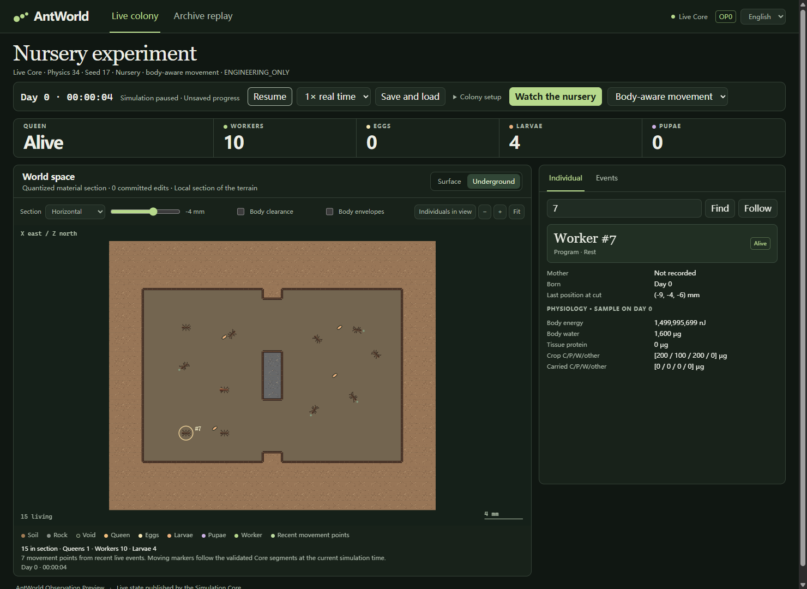

# Live nursery traffic

## Open the comparison

The [nursery continuity follow-up](../nursery_continuity/README.md) contains the one-hour stall reproduction and the new provisioned scene. Its menu calls the physics 34 case **Previous nursery**.

In the AntWorld checkout on Windows, run this command from PowerShell.

```powershell
.\tools\start_m0.cmd --port 8771
```

On a fresh checkout, run `python -m tools.build_m0_live` once with a C++ toolchain and CMake available. In **Live colony**, select **Body-aware movement** and click **Watch the nursery**. The scene starts at 1× in a horizontal underground section. Select a worker to see recent Core events and any current movement. **Body envelopes** shows the clearance boxes used by the model. The same control opens **R0-r1 reference** with the same layout and software seed. The language switch covers both treatments.

The fixture initializes ten workers, one queen and four larvae on supported floor around a rock. Its four-second decision interval and 20-second minimum commitment are `ENGINEERING_FIXTURE` values for this short comparison. The scene has no surface food release. Open **Colony setup** to create an ordinary founding world. Physics 34 with checkpoint schema 27 is selected explicitly through the nursery treatment.



## Source and biological evidence

- JohnBuffer's `updatePosition` integrates a displacement at the current speed and probes terrain along that displacement. The earlier native AntWorld reference probe executed this upstream updater and sampled 19,200 positions. This change revisited the pinned motion and worker sensory code. [Position update](https://github.com/johnBuffer/AntSimulator/blob/57255f5bf0eb361a92d582b4cdf4fa8b96343d61/include/simulation/ant/ant.hpp#L143) · [Worker update](https://github.com/johnBuffer/AntSimulator/blob/57255f5bf0eb361a92d582b4cdf4fa8b96343d61/include/simulation/ant/worker.hpp#L97) · [Native reference receipt](../../r0/REFERENCES.md#native-reference-run).
- SebLague's `HandleMovement` uses desired heading, a steering force and a forward obstacle check. The review used the pinned source. Execution of the Unity project remains `NOT_RUN`. The AntWorld implementation uses its own Core systems and artwork. [Movement and steering](https://github.com/SebLague/Ant-Simulation/blob/e638aa267e0b58eb0092b9c15a2732c501baa2b0/Assets/Scripts/Ant.cs#L111).
- Live *Lasius niger* in matched flat-nest observation groups showed both movement and inactivity. Group sizes, spatial context and brood affected the observations. These records support tracking individuals and distinguishing active bouts from quiet intervals. The positive movement clocks and decision interval in this fixture still require biological calibration. [Oh and Cremer, methods and results](https://doi.org/10.1111/2041-210X.70277).
- Planckaert and colleagues recorded mandible-to-mandible interactions in five queenless, broodless groups of at least 50 black garden ant workers. Their video scans support local exchange and role heterogeneity. The exact receiver cues, transferred doses and approach intervals in this implementation remain modeling assumptions. [Planckaert et al., 2019, Methods and Materials](https://pmc.ncbi.nlm.nih.gov/articles/PMC6821819/).

## What changed in Core

The prior endpoint check let a worker choose an empty destination on the other side of a body. Physics 34 checks the full segment against adult clearance envelopes and pending movement corridors, with larger envelopes for food and soil load. A rejected competitor waits or replans through normal scheduling. An individual that already overlaps a stationary body may move directly out of it. Brood contact still uses the existing nursery and handling rules.

At an eligible program review, an idle worker can choose a short supported step that advances toward nearby visible brood or a locally sensed colony member with an ingredient demand the donor can meet. The worker ranks a bounded fan of possible directions. The selected target, elapsed work interval and completed move enter the regular journal. A subsequent care or offer still requires contact, eligibility and resource payment. These choices consume no further draw from the random number stream. Existing terrain, scheduler and transaction checks continue to own changes.

The same renderer and clock draw a pose within the Core segment for both nursery treatments. The endpoints, turn interval and segment progress have native evidence. Segment artwork and gait are presentational. Core facts and stored positions stay at their actual transaction boundaries. The individual panel displays both storage and movement values. There are no added per-frame facts. Historical movement and excavation witnesses retain their originals.

## Paired result

Seed 17, identical initialized spatial arrangement and resources, 120 simulated seconds. The measurement sampled both treatments every 25 ms. Envelope intersections count pairwise penetration at each cut, including the configured load envelope and available movement segments. Movement and brood outcomes come from an independent scan of canonical facts. [Run receipt](nursery-comparison.json).

| Result | Physics 33 | Physics 34 |
| --- | ---: | ---: |
| Workers with at least one completed displacement | 6 / 10 | 10 / 10 |
| Cuts with intersecting adult bodies | 1,473 / 4,801 | 0 / 4,801 |
| Completed worker moves | 51 | 65 |
| Total worker distance (mm) | 52.69 | 79.65 |
| Completed brood moves | 21 | 17 |
| Blocked care observations | 4 | 12 |
| Positive nutritional exchanges | 0 | 0 |
| Canonical facts | 1,150 | 1,474 |

The candidate reduces sampled intersections and performs more local travel. Diverting or deferring competing movements also interrupts more care bouts. The envelopes are conservative axis-aligned boxes, and reservation can block two safely separated arrivals that would have used overlapping corridors at different times. The all-adult sweep is for this small scene. Dense crossing throughput, realistic stationary bout lengths, dedicated entrance guarding, patrol, grooming, naturally founded colonies and the multiple-chamber objective still require work. This run cannot resolve the long-case survival or transport regression in the parent results.

The treatments compare the local approach and collision changes together. Separate treatment factors would be needed to assign the additional distance or care interruptions to either rule alone. The renderer displays both treatments from native motion cuts. [Chinese viewer capture](nursery-chinese.png) · [Reference capture](nursery-reference.png).

## Reproduce and verify

```powershell
python -B -m tools.run_nursery_comparison out/nursery-comparison.json
python -B -m unittest discover -s op0/tests -v
```

The native `R0_R1_NEST_DYNAMICS` test checks swept paths with separate endpoints, collision-free parallel paths, and byte-exact continuation from an in-flight SQLite save. It passed on Windows in Release and with both AddressSanitizer and UndefinedBehaviorSanitizer in Debug. The OP0 native test independently checks the published motion cut, paused restore, and the conservation ledgers. The Windows Release suite passed 291 CTests. The Windows OP0 suite passed 24 tests and skipped the optional legacy fixture builder test. Two physics 33 golden runs reproduced their durable canonical history after recovery, with 93,378 and 94,404 facts. [Golden-archive verification](legacy-verification.txt).

Run the browser smoke test from a separate terminal while the local live service is running. It checks the actual native pose at 1×, pauses on a selected worker, toggles the body envelopes, switches to Chinese and opens the matched treatment. [Browser receipt](nursery-browser-receipt.json).

```powershell
node op0/tests/browser_smoke.mjs 'C:\Program Files\Google\Chrome\Application\chrome.exe' http://127.0.0.1:8771 out/nursery-browser nursery
```

The nursery result remains `ENGINEERING_ONLY`. Existing scientific and performance qualifications retain their published results.
