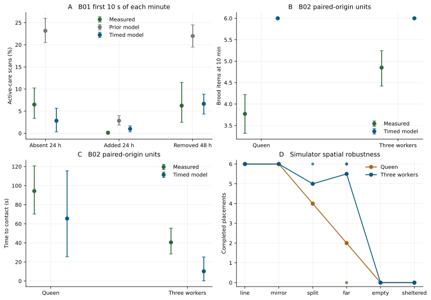

# B01 and B02 quantitative validation

The [frozen protocol](../../docs/58_S6_3_3_2_Frozen_Baseline_and_Protocol.md) uses B01 for exploratory measurement alignment and B02 for exploratory mechanism revision. The 12 historical and 12 prospective simulator streams are all retained. New seeds and layouts measure engineering robustness. Independent biological validation would require new measurements or a separately matched experimental dataset. No coefficient was fitted in this stage.

Intervals use 4,096 percentile bootstrap draws with seed 63302. Resample each paper queen or worker group, holding its two origin trials together. Simulator contrasts pair by seed. Errors resample measured units and seeds independently. Both kinds of intervals describe the tested distributions. There was no preregistered biological equivalence margin.

## B02 displaced brood

Walsh et al. tested a queen or three marked workers in a 50 mm Petri dish after a 180 s acclimation. They used six larvae and/or pupae and a humid Eppendorf tube exposed in the home nest for three days. Each unit received own and conspecific foreign brood in randomized order, 20 minutes apart. The worker groups were about 30 days after eclosion. The simulation matches group size, nominal dish diameter, release interval, six items, both origin treatments and the 600 s endpoint. The tube is a familiar shelter position and a 2 mm radius. Wall guidance, tube odor, cross-trial learning, detailed item coordinates and real maturation remain APPROXIMATE or NOT IMPLEMENTED. [Methods 2.2 and Fig. 1, pp. 10411–10412](https://doi.org/10.1002/ece3.4475), [Dryad](https://doi.org/10.5061/dryad.qm114cj).

The 398 released trials contain 79 queen, 70 first-generation and 50 later-generation units. The article's 67 matched queen/first-worker and 61 productivity units remain separate filters in the [paired raw derivation](../../experiments/s6_3_3_2/analysis/b02_published_pairs.csv). Paper-level published Wilcoxon p-values for retrieval rate are 0.5027, 0.5152 and 0.8146, respectively. The deposited exploratory R code also runs an unpaired formula test with different p-values in the queen and first-worker groups. The reported rate uses task duration. The raw rate is carried through directly. Counts, time-to-first contact, and time-to-first retrieval are different endpoints. The present analysis preserves the paper report and uses paired raw differences, without treating either test as evidence of equivalence.

| Published foreign minus own, all released units | Queen | First-generation workers | Later-generation workers |
| --- | --- | --- | --- |
| Brood items at 10 min | +0.734 [0.114, 1.380] | -0.071 [-0.643, 0.471] | -0.180 [-0.900, 0.560] |
| Reported items/s | +0.00260 [-0.00183, 0.00702] | -0.00323 [-0.00972, 0.00305] | -0.00033 [-0.00685, 0.00642] |

The neutral assay allows foreign larvae and pupae after local discovery and retains their donor membership. The usual policy still excludes them. The neutral line treatment gives zero own/foreign difference in unique placed count, with a ceiling of six in every seed and origin. The zero contrast therefore has limited discriminatory value. Eleven extra successful trips in the first-generation worker own arm carried an already counted item again. The foreign arm does not perform settled manipulation after placement. This difference exposes a sensitivity to the modeled shelter radius and recognition scope. The comparison cannot infer natural adoption, equal rates or preference. [Origin details](../../experiments/s6_3_3_2/analysis/b02_origin_contrasts.csv), [physical episodes](../../experiments/s6_3_3_2/analysis/b02_physical_trips.csv).

| Endpoint | Group | S6.3.3.1 line | Timed neutral line | Paper | Timed minus paper, 95% interval |
| --- | --- | ---: | ---: | ---: | --- |
| Unique items at 600 s | Queen | 3.667 | 6.000 | 3.772 | +2.228 [1.791, 2.684] |
| Unique items at 600 s | Three workers | 4.167 | 6.000 | 4.850 | +1.150 [0.757, 1.564] |
| Capped first handling contact (s) | Queen | 95.010 | 65.511 | 94.37 | -28.86 [-77.58, 23.03] |
| Capped first handling contact (s) | Three workers | 50.010 | 10.210 | 40.51 | -30.30 [-48.22, -12.05] |
| Capped first placement (s) | Queen | entry endpoint | 67.52 | 212.8 | -145.3 [-204.3, -83.3] |
| Capped first placement (s) | Three workers | entry endpoint | 11.97 | 128.4 | -116.4 [-151.9, -83.0] |

The old line counted entry into the shelter radius. The timed endpoint requires a committed unload. The first-contact proxy is the beginning of a validated physical handling act. The archive keeps censor flags separately from the numerical 600 s cap and provides the six-item completion endpoint. Measured no-contact fractions were 6.96% for queens and 1.43% for first-generation groups. The simulated neutral line had none. Forty-eight percent of published queen trials and 73.57% of worker trials moved all six within ten minutes. The simulated line did so in 100% of cases. [All errors and intervals](../../experiments/s6_3_3_2/analysis/b02_paper_errors.csv).

### Decomposition and sensitivity

- The 96 caregivers in the paired neutral historical line arms had at least one eligible item in range on their first decision. The archived diagnostics distinguish this geometric cue exposure from actual selection and handling. A maximum change to unloaded speed shifted line first-contact time by less than one second in each group. Moving the ordinary initiation interval to 15 s shifted it by -7.5 s across the six sensitivity seeds. Moving it to 120 s shifted it by +10 s. Both shifts have paired intervals that reach zero. Approach travel alone explains little of the line timing difference.
- The neutral line held and released real loads. The median loaded worker trip in the foreign arm covered 8 mm in 2.001 s. Queens covered 8 mm in 2.672 s. The three-worker own arm made 83 completed trips for 72 distinct items. All documented line follow-up searches started 1.001 s after unloading. That tight timing comes from the 1 s fixture pause and the action start phase. It is an assumption visible in the output, with no matched paper distribution.
- The prospective mirror retained the six-item endpoint for both groups. The split layout averaged 4.0 items for queens and 5.0 for workers. The far layout averaged 2.0 and 5.5. Far queens failed to make handling contact in 8 of 12 runs and far groups in 1 of 12. Mean capped first contact was 466.35 s and 210.95 s, respectively. Empty and sheltered controls produced zero pickups. A sheltered item can still receive valid tending.
- On the far layout, shortening the search budget to one reduced worker placements by 5.0 [−6.0, −3.0] and increased capped contact time by 258.5 [108.3, 408.4] s. The far-queen mean placement reduction was 1.0 with an interval including zero. Varying either unloaded speed or increasing loaded speed left far placement counts unchanged in the six tested streams for both groups. Slower loaded workers moved 0.333 fewer on average, with an interval reaching zero. Every line speed, search and initiation sensitivity arm still placed all six.

The line fixture is too favorable to detect a credible species-level pace. Nearby starting positions, deterministic local continuation, short handoff and recall clocks, straight return, and the shelter proxy jointly limit interpretability. Strong exposure and time-scale effects are distinguishable in this setup. Their values are not independent evidence about field behavior. Keep the line and far results, the missed contacts, the observed repeat pickups, the origin distinction and all interruption codes. [Run diagnostics](../../experiments/s6_3_3_2/analysis/b02_run_diagnostics.csv), [caregivers](../../experiments/s6_3_3_2/analysis/b02_caregivers.csv), [paired effects](../../experiments/s6_3_3_2/analysis/b02_paired_model_contrasts.csv).

## B01 scan-aligned active care

Score whether active brood handling occurs in the first 10 seconds of each minute, using the original focal window. Count observed inspection, arranging, cleaning, successful feeding contact, and an actual placement instant when present. Exclude locomotion, a load merely being held or carried, worker contact and task residence. Retain the released 50-scan denominator for source comparison and the methods 51-scan variant. The simulation preserves both. Older age, sham and barrier arms are engineering sentinels with one seed. Glass-tube transfer, biological age effects, near-field mesh cues and behavior of introduced live callows are not reproduced. Temperature is recorded metadata only. [Methods 2.1.4, 2.2.4, 2.2.12 and Figs. 1–2](https://doi.org/10.1111/1365-2435.14536), [Dryad](https://doi.org/10.5061/dryad.pnvx0k6wd).

| Treatment and focal time | Paper, 16 queens | S6.3.3.1, 12 seeds | Timed base, 12 seeds | Timed error in percentage points and 95% interval |
| --- | ---: | ---: | ---: | --- |
| Without workers, 24 h | 6.500% | 23.167% | 2.833% | -3.667 [-8.000, 0.583] |
| Added workers, 24 h | 0.125% | 2.833% | 1.000% | +0.875 [0.167, 1.667] |
| Removed workers, 48 h | 6.250% | 22.000% | 6.667% | +0.417 [-5.542, 4.917] |

The qualitative decrease with workers and recovery after removal persist in the focal means. In the added-worker window there were about 297 nearby worker opportunities and 14.83 completed worker contacts per hour. Worker absence and the 48-hour removal window had none. Residence was 100% in these dedicated programs. Actual tactile fractions were 1.056%, 0.171% and 1.093%, while first-instant samples were 0.667%, 0.167% and 1.167%. These distinct quantities show why an active scan cannot be equated with a task or duration. The added-worker estimate is still too high and the absent-worker mean moved below the source mean.

The 0.5 s and 10 s perturbations use the same six seeds as their paired 2 s control and retain the same probabilities. The 10 s absent-worker arm shifted scan positivity by +7.0 [1.33, 12.0] percentage points. The 0.5 s absent-worker arm shifted by +5.67 [−8.0, 20.0]. Shortening a bout can shift its phase relative to a repeated observer window. The data show large phase and seed sensitivity, without identifying a fitted duration. The barrier sentinel had no actual worker contact. No-brood care scoring remained zero. B01 does not distinguish cue lifetime, microenvironment, callow maturity and direct contact as causes of the empirical effect. [Scans and event-derived intervals](../../experiments/s6_3_3_2/analysis/b01_scans.csv), [errors and sensitivities](../../experiments/s6_3_3_2/analysis/b01_paper_errors.csv).

## Independent comparisons

Carthy's trained-worker paths and Khuong's unladen free walking constrain different motion components. Okrutniak's outcome hold was opened after the Core model commit. Its original apparatus included 25 pupae, disturbance and a lit/dark choice. The simulator cannot reproduce that stimulus or real habitat selection. The measured onset and span remain useful separate validation endpoints. Parmentier and Wybouw offer a further same-species rescue control at 120 minutes, without matched trajectories. A matched study should annotate load state, path length, changes in direction, antennal contact, failed pickups, actual deposits and inter-trip intervals. Current species-level quantitative verification remains NOT PASSED. [Source and parameter details](BROOD_MOTION_EVIDENCE_AND_PARAMETERS.md).

