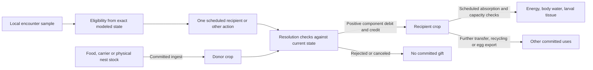

# BR-02 Core source audit

The source anchors in this audit refer to reviewed commit `c9065759bed1b324d99cc606015d59601ac97b0a` and C++ tree `2b9d475fdb0d657dc87e46755d6511779da0c8b4`. Phase 4's reference tree predates the isolated RM-01 application. The RM-02 branch uses the independently accepted RM-01-R1 tree. The integrated evidence and its classifications remain the source of record. [Phase 4 authorization](../s6_4_preflight/S6_4_PHASE4_IMPLEMENTATION_AUTHORIZATION_MATRIX.csv) [Phase 2 blocker BR-02](../s6_4_preflight/S6_4_PHASE2_BLOCKER_REGISTER.csv) [RM-01-R1 performance](../s6_4_rm01/RM01_R1_PERFORMANCE_QUALIFICATION.md)

## Material and decision flow

### Opportunity and selection

- The social sampler examines living same-colony candidates within the configured distance and an unobstructed segment. The bounded route first samples ranks without replacement from 27 neighboring bins using a private stream keyed by seed, actor and decision. The budget applies before validity filtering, so `candidates_examined` can include the actor, another colony, a blocked segment or a distant point in a neighboring bin. The exhaustive social branch scans all identities and applies the same filters. Without social policy the geometry route uses `query_neighborhood` and the legacy route enumerates physiology. The subsequent stage, physiology and contact guards still govern selection. The noncontinuous, nonmixed surface route additionally requires a shared cell. A range and clearance check models reach, with no mouth-contact, orientation or refusal variable. [Social sampler](../../cpp/src/social.cpp#L63-L126) [Geometry query](../../cpp/src/geometry.cpp#L147-L185) [Contact predicate](../../cpp/src/physiology_internal.hpp#L94-L97)
- In `resolve_nutrition_wakes` each wake starts with a rest action. The default order considers taking cargo or reachable nest stock into a crop below half capacity before trying to give. The opt-in `gift_first` tries donation first unless the donor has critically low energy with no crop carbohydrate or critically low water with no crop water. Only the Nurse program with crop contents attempts a gift here. The long-term Rest protein-recycling branch can return crop protein to reachable nest stock. The donor's action request is the configured transfer ceiling. The decision inserts a separate Resolution event 1 ms later. The wake counter and action schedule remain separate from receipt of a gift. [Wake decisions](../../cpp/src/physiology.cpp#L234-L312)
- Legacy gift eligibility checks exact quarter-capacity adult energy/water thresholds or exact larval protein deficit and donor protein, with receiver crop below half capacity. The demand-sensitive branch checks crop room and component overlap with `signaled_need`. This function opens on low energy/water, larval protein shortage, or a queen's adult crop-protein target. The long-term option can signal larval metabolic demand when protein is already sufficient. Once opened, `nutrient_demand` subtracts current crop stores from the full modeled energy, hydration and applicable protein gaps. Equal-weight reservoir sampling selects among eligible sampled individuals. Eligibility and the candidate pool constrain the probability, with no additional preference for larger deficits within that pool. [Demand equations](../../cpp/src/social_internal.hpp#L46-L82) [Legacy and demand-sensitive conditions](../../cpp/src/physiology.cpp#L248-L276)
- The policy evaluates exact, analytically settled recipient stores and the exact reachable nest inventory. The latter can only affect withdrawal after the physical guard. Autonomy uses sampled local needs and the actual stock available at nest contact to choose or retain tasks. Long-term withdrawal can pool per-component maxima of sampled needs to stock a nurse's crop. This is a maximum over its sampled contacts, without access to a colony-wide deficit. Global enumeration in legacy/exhaustive modes is an implementation strategy with a spatial filter. The designated-queen inspection and `nutrition_snapshot` can read broader information for diagnostics. Neither feeds the gift policy. Exact internal-state knowledge within reach remains a stronger assumption than observation of a cue. [Autonomy](../../cpp/src/ecology.cpp#L141-L234) [Nest withdrawal](../../cpp/src/physiology.cpp#L174-L213) [Inspection](../../cpp/src/inspection.cpp#L6-L66)

### Resolution, transfer and role changes

- All nutrition choices in a perception batch are formed before its actions are inserted. Resolution admits one action per actor at that boundary and orders actors by a seeded rank. `resolve_actions` can reject a duplicate, dead or wrong-stage donor or stale donor position before the nutrition resolver receives the action. These generic rejection facts keep the source schedule ID and outcome, with no guaranteed recipient in their payload. When a behavior is stopped or a donor dies, its owned pending action can be removed without a nutrition-specific terminal fact. [World dispatch](../../cpp/src/world_runtime.cpp#L174-L206) [Behavior ownership and death](../../cpp/src/physiology.cpp#L52-L64)
- `resolve_nutrition_action` settles the donor, checks that the target is living Adult or Larva and still in contact, then settles the recipient. With exchange disabled it returns `EmptyInventory`. Demand-sensitive mode clips each component to the recipient's current exact demand and recomputes room. The cap is `min(request, free crop room, eligible supply mass)`. Ingredient proportions come from the eligible supply, using integer largest-remainder allocation with fixed component tie order. Zero room or supply returns `Capacity` or `EmptyInventory`. Success and partial success debit the donor crop and credit the receiver crop by the same positive `FoodMass`. A second donor sees the first committed-in-transaction debit/credit before resolving. The logged payload is the actual mass vector and the recipient ID, not the request or a transfer duration. [Transfer](../../cpp/src/physiology.cpp#L159-L232) [Portion rounding](../../cpp/src/world_runtime.cpp#L23-L36)
- Generic autonomous nutrition is an adult-worker program. External nutrition proposals are explicit actions, with their own Paused and ownership validation, then use the same worker Resolution gate. With the care profile, a caregiver can select a larval feeding bout if locally eligible. The care-end path passes the actual target to the same conserved transfer function, with a separate care outcome and observed timing when available. It allows adult queen care in its documented scope. A `NutritionTransferred` and a completed `BiologicalObservation` for that bout describe one physical exchange. Counting both would double it. Legacy transfers have unknown bout duration. The next nutrition wake normally uses `behavior_interval`. The long-term post-intake rule can resume an actual nurse withdrawal after 1 ms. [Proposal and resume](../../cpp/src/physiology.cpp#L140-L157) [Care selection and commit](../../cpp/src/care.cpp#L290-L321) [Care transfer and terminal observation](../../cpp/src/care.cpp#L434-L486) [Rescheduling](../../cpp/src/physiology.cpp#L324-L331)

### Crop storage, assimilation and accounts

- `settle` uses elapsed model time to debit basal and, for adult Nurse/Forage/Excavate, active energy. It debits body water with an integer remainder and accumulates dissipation, lost water and eligible developmental progress. It runs on a copy for `query_physiology`, and in the owning transaction for state updates. `next_physiology` selects the earliest pulse, depletion or stage boundary. In the Environment phase, depletion wins a tie with stage change or absorption. A tied stage change is recorded before any further pulse at that time. A later Resolution gift cannot rescue a recipient already dead at that time. [Settle and boundaries](../../cpp/src/physiology_internal.hpp#L41-L93) [Execution priority](../../cpp/src/physiology.cpp#L65-L88) [Phase order](../../cpp/include/antworld/core/event.hpp#L11-L20)
- `absorb` consumes crop carbohydrate and water in Adult/Larva and crop protein only in Larva. Each component is bounded by crop supply, body room or tissue requirement, and an integer rate × pulse period allowance with fractional carry. A scheduled pulse advances the clock even with zero eligible uptake. Carbohydrate is marked oxidized and immediately credits `used_carbs_ug × carbohydrate_yield_nj_per_ug` to body energy. Water enters hydration and larval protein enters tissue. Adult queen protein can reside in crop for direct egg export. The code has no general adult protein assimilation, no `other_ug` conversion, no physical digestive lag state and no source-provenance label for mixed crop ingredients. The amount and timing of a later absorption pulse cannot be allocated among earlier gifts in a mixed crop without further evidence. [Pulse and conversion](../../cpp/src/physiology_internal.hpp#L62-L82) [Maternal export](../../cpp/src/long_term.cpp#L93-L129)
- Exact audits use all four integer food components in micrograms and integer energy in nanojoules. For each component, introduced mass equals available food, carried food, nest stock and resource reserves plus crops, retained tissue/body water and the tracked oxidized-carbohydrate or lost-water sinks as applicable. The snapshot includes dead individuals' retained stores. Energy input is external initial body energy plus actual carbohydrate conversion and equals stored body energy plus dissipated energy at a valid cut. Funded offspring inherit transferred energy and water/protein internally. A gift alone changes neither total crop mass nor the world energy balance. Ingestion, recycling, expenditure and reproduction must remain separate from received gifts and absorbed amounts. [Nutrition snapshot](../../cpp/src/physiology.cpp#L333-L360) [Birth facts](../../cpp/src/long_term.cpp#L141-L157)

## Observability and failure boundaries

| Level | Evidence actually present | Limits |
| --- | --- | --- |
| Committed world facts | `NutritionDecision` identifies actor and wake, decision count and, in the social path, examined-candidate work in `random_value`. `NutritionTransferred` identifies donor, recipient payload, actual components, source action and result. `PhysiologyUpdated` can carry actual absorbed components. `AntDied`, `StageChanged`, ingest, recycling and birth facts explain additional stock changes. | Generic rejections can lack action type and target. The decision count is neither a contact nor a selection. Stage or death facts are separate from absorption. An all-zero pulse payload needs its clock/source context to be identified. |
| Committed optional care facts | Where already active, `BiologicalObservation` records Opportunity, Selected and terminal phases with target, source and bout. Care feeding may have a modeled interval. | A nutrition Opportunity records a returned sample member before later eligibility, even when unsuitable. Missing opportunities in worlds without this profile are unobserved. Started/Completed for legacy actions do not establish physical duration. |
| Detached or reconstructed evidence | `query_ant` and `query_physiology` return identities and compartment snapshots, `nutrition_snapshot` gives a ledger cut and `pending_events` exposes owned scheduled actions present at a cut. Existing inspection can report a chosen target and designated-queen reach/sample flags at decision time. The S6.2 harness reconstructs copied states and compares them with queries. | The host cannot query the middle of a committed timestamp. Exact same-tick ordering requires the recorded fact order and enough starting state to replay. An observer reconstruction must report its lineage and residual. The existing inspector is queen-focused and can throw on bad input or vector allocation. |
| Unobserved | Full candidate identities before spatial filtering, exact rejected-candidate conditions and reason, actual oral cues and negative contacts, unlogged cancellation, recipient acceptance, bolus-level provenance through mixed stores. | Outcomes missing at a cut are missing or censored. Internal scalars such as quarter-capacity and demand caps are engineering values even when observable in a host diagnostic. |

One `advance_to` transaction covers all due work in that call. Its destructor restores facts, event counters, queue and state on failure. A side record from inside the call is provisional until successful return and source reconciliation. Environment, perception and resolution can share a millisecond, and multiple donor resolutions share one timestamp. Publish records in fact order with world-qualified IDs and their scheduled source. [Scheduler](../../cpp/src/world_runtime.cpp#L276-L315) [Transaction and fact allocation](../../cpp/src/state.hpp#L311-L337) [Fact identity](../../cpp/src/state.hpp#L387-L393) [Existing observer](../../cpp/include/antworld/core/inspection.hpp)

Restore audits replay pulse timing and amounts and check recorded crop transfers, recipient bounds and ingredient/energy conservation. A per-individual energy balance includes its initial energy, converted carbohydrate, dissipation and funded child export. Global accounting cancels the funded internal transfer. These checks establish the simulated ledger with the saved configuration. They cannot recover unsampled alternatives or a biological uptake rate. [Physiology replay](../../cpp/src/checkpoint_s3.hpp#L99-L154) [Restore balances](../../cpp/src/checkpoint_s3.hpp#L185-L197)

In the accepted S6.3.1 ordinary 32-worker seed 2 run, 782 observer physical opportunity records in the queen's last 48 h reduced to four compatible sampled opportunities, zero selections and zero committed queen gifts. The depot and living-worker crops retained 712 and 1,788 ug carbohydrate at death. These counts are observations from several software contexts, with no distinct-contact interpretation. They expose the need to measure access, sampling, eligibility, actual dose and assimilation separately. The [source–model–evidence matrix](SOURCE_MODEL_EVIDENCE_MATRIX.csv) records exact code anchors and where empirical evidence stops. [Historical simulator result](../../S6_3_1_RESULTS.md#L67) [S6.2 observer](../../docs/40_S6_2_Measurement_and_Observer_Implementation.md)
