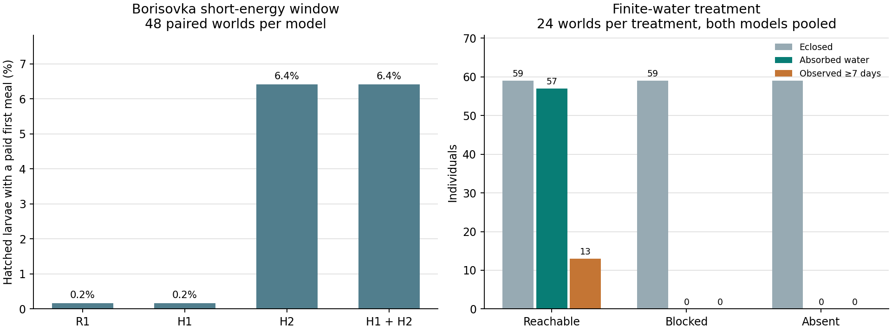

# WP-6B-R2 early-life resource access and first-worker viability

| Scope | Outcome |
|---|---|
| Opt-in F1-R2 functional correctness | `ENGINEERING_PASS` for budgets, contact, versioned state, rollback, and exact continuation |
| H1 accessible owned larval lipid | Positive local engineering result. The original three paid larvae use their lipid at exhaustion and subsequently absorb their meals. |
| H2 first-care opportunity | Positive within the frozen simulation. First meals, pupation and first-worker incidence increase in the affected Borisovka profiles. |
| Ordinary first-worker incidence | H2 and combined pass all population, factor and held-out software-seed floors. H1 alone fails two factor floors. |
| Formal multiscale founding | `FAIL`. The daily B06 comparison remains `INSUFFICIENT` for all candidates and every primary closed-stock adult dehydrates. |
| Finite-water path | Positive engineering result. Actual absorption and longer working lives occur under accessible supply. Every worker ultimately dies in the pure-water environment. |
| Controlled performance | Final native contact and protected observer `INCONCLUSIVE`. Native birth and F1 application `NOT_RUN`. Historical R1 qualifications and failures retain their respective scopes. |
| Simulation and biological acceptance | `SIMULATION_CONDITIONALLY_ACCEPTED` is unsupported for the warm founding model. All nine BR roots remain `BIOLOGICAL_BLOCKED`. |

Reviewed base `74555a0197fe41b6e8183e9c56525d7cca9b549a`. Protocol `d227dc2495b8c71802c1b829816df0d420729697`. Candidate Core tree `bc94a2b1c34b416afccdd8ea30349ba294faaaa8`. The frozen ordinary population, inputs, seeds, paired controls and gates are identical to the reviewed specification. H1 and H2 are separately switchable, and R2 remains an explicitly configured experimental model. [Protocol](FROZEN_R2_PROTOCOL.md) [Model, evidence, and version](R2_EVIDENCE_AND_FORMAT.md)

## Engineering and archive

Completed all 960 ordinary and additional-seed worlds for each of the three candidates. Each arm included the same 108 micro and adverse inputs and 24 wider spacing controls. The combined arm also ran eight independent uninterrupted early-worker references for the protected application design. The 72 pure-water worlds have a separate protocol. Overall there are 3,356 complete new archives and 2,184 exact replays of v1 or R1. Six hashes per legacy case match parameters, initial checkpoint, final frame, facts and both daily tables. Reconstructing the historical archives separately covered all 3,924 old attempts, including their original rejected inputs. The new archive verifier checked 36,916 file hashes and 36,795,102 ordered canonical facts and independently reconciled stage, per-individual nutrient compartments, paid lipid, body energy, water and soil. World and identity joins retain deaths and right-censored observations. [Run and audit receipts](../../experiments/s6_4_wp6b_r2) [Reproduction commands](../../experiments/s6_4_wp6b_r2/README.md)

The five added CTest cases exercise exact exhaustion and water tie, a genuine funded hatch through open versus plugged geometry, bounded eligibility and refusal, queue and WAL recovery, fact-schema mismatch, rollback and finite-water reachability. Eight representative experiments reproduce the initial checkpoint, final frame and complete facts both across day-45 SQLite recovery and with observation disabled. Their original database and WAL files are archived. The application now serializes each read-only row in one write and uses the same snapshots for its ledger assertions and exports. Native paired replays verify byte equality with the old observed daily files. [Tests](../../cpp/tests/test_s6_4_wp6b_r2.cpp) [Exact recovery](../../experiments/s6_4_wp6b_r2/recovery-saved.json)

Local Windows Release, Debug and combined ASan/UBSan each passed 274 of 274 tests in 38.32, 119.10 and 617.38 seconds respectively. The first sanitizer invocation exited 8 after Windows reported loader error `0xc0000135`. Prepending the matching LLVM runtime directory to `PATH` enabled the full repeat without changes to the executable, test selection or assertions. The original failure, the successful repeat and the compiler and build receipts are available together. [Windows test and build receipt](../../experiments/s6_4_wp6b_r2/tests/local_receipt.json) [Candidate Core CI](https://github.com/Aquaticfuller/AntWorld/actions/runs/43321792611)

## First receipt, resource availability, and competing exits

At the audited short-energy boundary, the original R1 larvae hatch with 6,600,000 nJ and no convertible lipid. Of 1,782 hatchlings in 48 worlds, 1,116 have a recorded contact opportunity and only three have a paid first meal. H1 leaves those denominators and first payments unchanged. The three paid larvae each consume 1 µg of actually owned lipid at 5,519,972,572 ms and add 34,000,000 nJ with no earlier crop uptake. The regular 5,529,600,000 ms pulse then supplies 16 µg of tissue protein and 20 µg of water from the already paid meal. Each receives a second meal and dies of energy depletion at 6,527,149,715 ms with 1 µg body water, after 11.66 extra days of survival relative to its original paired death. None reaches the tissue target or pupates. The other 1,779 hatchlings still have no meal in H1. [Historical paths](BASELINE_RESOURCE_ACCESS_DIAGNOSIS.md) [H1 reconstructed paths](../../experiments/s6_4_wp6b_r2/h1-tracks)

| Model in short-energy Borisovka profiles | Hatched | First paid meal | Tissue target | Pupae / workers | Worlds with workers |
|---|---:|---:|---:|---:|---:|
| R1 | 1,782 | 3 | 0 | 0 / 0 | 0/48 |
| H1 | 1,782 | 3 | 0 | 0 / 0 | 0/48 |
| H2 | 1,762 | 113 | 78 | 75 / 75 | 38/48 |
| H1 + H2 | 1,762 | 113 | 78 | 75 / 75 | 38/48 |

H2 records 1,251 local cue wakes, all with the target opportunity, and 650 selected bouts. There are 483 completed and 167 interrupted outcomes. Of the completed bouts, 113 pay a positive maternal ration and 370 complete without payment. The 601 cues without a selection remain explicit. The world-paired H2 increase relative to R1 is 2.292 first meals per world (95% profile-and-seed bootstrap interval 1.771–2.854) and 0.792 in the probability of any worker (0.625–0.938). Neither estimate uses a larva or software seed as a biological replicate. H2 supplies lipid early enough for the normal pulse in this specific intersection. The combined arm uses no emergency conversion there and gives the same endpoints as H2. In other primary profiles H1 operates. The combined arm has 13 more St. Petersburg adults than H2 and identical first-worker incidence. It is useful to keep the mechanisms separate when investigating uptake timing and allocation. [Cue outcomes](../../experiments/s6_4_wp6b_r2/comparison/cue_outcomes.csv) [Paired estimates](../../experiments/s6_4_wp6b_r2/comparison/paired_summary.csv)

For the same 48 worlds, the H2 and combined distributions of 0, 1, 2, 3, 4 and 5 or more protein-positive maternal meals are 1,649, 11, 9, 4, 11 and 78. The R1 distribution is 1,779, 3, 0, 0, 0 and 0. H1 moves those three one-meal larvae to two, with the same 1,779 zero-meal outcomes. The remaining failures preserve resource competition and do not establish an empirically calibrated allocation strategy. [Meal distribution](../../experiments/s6_4_wp6b_r2/comparison/groups.csv)

All five original v1 positive wider-spacing cases reproduce byte-for-byte. The 19 matched v1 failures also reproduce, while all 24 spacing worlds produce at least one worker in R1 and each R2 candidate. Every new candidate fails to produce workers in all 12 low egg lipid and all 12 high coherent-cost controls. Low maternal protein yields 5/12 H1 versus 8/12 in H2 and combined, and low maternal water yields 3/12 versus 10/12. Those sensitivities remain outside the ordinary score. Primary care-off arms have zero pupation. The archive includes the full zero-to-five-or-more protein-positive meal counts, reserves, actual uptake, treatment-specific production and stage-specific competing risks. [Wider spacing](../../experiments/s6_4_wp6b_r2/comparison/wider_spacing_controls.csv) [All cases](../../experiments/s6_4_wp6b_r2/comparison/cases.csv)

## Ordinary robustness and measured timing

| Model | Borisovka worlds with first worker | St. Petersburg worlds with first worker | Primary profile floors | Additional profile floors | Complete B06 worlds |
|---|---:|---:|---|---|---|
| R1 | 136/192 | 154/192 | 24/32 and 27/32 | 6/8 and 8/8 | 0 and 0 |
| H1 | 139/192 | 154/192 | 24/32 and 27/32 | 6/8 and 8/8 | 0 and 0 |
| H2 | 182/192 | 192/192 | 32/32 and 32/32 | 8/8 and 8/8 | 0 and 0 |
| H1 + H2 | 182/192 | 192/192 | 32/32 and 32/32 | 8/8 and 8/8 | 0 and 0 |

H1 still reaches only 8/16 profiles at both the low egg-lipid and high egg-basal Borisovka factor levels, below 10/16. H2 and combined meet 16/16 at every level. The H2/combined fixed-day censoring table retains 27 Borisovka and 16 St. Petersburg worlds reaching the first larval count in simultaneously living pupae. Their conditional medians from the first larval census to that pupal count are 21 and 24 days, longer than the development reference ranges of 7–14 and 8.5–12.5 days. No world subsequently reaches the matched worker count, so the complete daily timing denominator is zero versus the frozen minimum of 12 per population. Under the original timing rule the outcome is `INSUFFICIENT`. It supplies no timing pass. Individual first-worker events remain meaningful but answer a different question. [H2 timing](../../experiments/s6_4_wp6b_r2/h2-analysis/timing_comparison.csv) [Combined timing](../../experiments/s6_4_wp6b_r2/both-analysis/timing_comparison.csv)

H2 ecloses 1,148 individuals in the primary care-on cohorts and combined ecloses 1,161, versus 606 in R1 and 618 in H1. All of these primary adults ultimately dehydrate with the finite starting water treatment. In all four models 168/192 foundresses per population die before day 90. The combined model's day-49 living pupae/worker counts are 210/0 and 226/32 across each population's 192 worlds. The B01-like day-55 proxy records zero handling or feeding scans under this cadence. B01, B03 and B06 keep their existing experimental denominators and condition differences. None provides a new independent model validation dataset. [Population and physiology cuts](../../experiments/s6_4_wp6b_r2/both-analysis/cases.csv) [Study and measurement distinctions](R2_EVIDENCE_AND_FORMAT.md)

## Finite water and real worker function

Across the 72 separate water worlds, each treatment includes 24 worlds and 59 eclosed individuals. Accessible supply yields positive adult uptake in 57/59, compared with 0/59 under a blocked stock and 0/59 with no source. At eclosion the water trial workers have 9–67 µg body water and zero crop water. Median time to first positive water uptake among recipients is 14.4 h. Workers transport 180,000 µg of actual water into nest stores and absorb 111,276 µg in the reachable treatment. No positive water transfer from a social gift is recorded in the water trial. The reachable and blocked conditions both introduce the same amount and resource identity. The absent arm has no resource identity and can shift later ant IDs and their keyed draws. [Paired world data](../../experiments/s6_4_wp6b_r2/comparison/water_paired_worlds.csv) [Adult paths](../../experiments/s6_4_wp6b_r2/comparison/water_adults.csv)

Thirteen accessible adults live at least seven days. All thirteen complete care acts, and twelve also deliver water. The colocated source requires no locomotion in these thirteen lives. No blocked or absent adult lives for seven days. The longest accessible exposure is 240.55 h. Every accessible adult eventually dies, 57 by energy depletion and two by dehydration with zero crop water despite remaining external and nest water. Both controls record 59 dehydration deaths. The pure-water manipulation supplies no carbohydrate. These outcomes establish that the current resource and uptake interfaces can carry water to workers and that access remains opportunity-limited for some individuals. They do not establish a cotton-drinking mechanism, a humidity response, measured water demand, or a sustained, growing early colony. [Hydration and survival contrasts](../../experiments/s6_4_wp6b_r2/comparison/water_paired_summary.csv)

## Costs and qualification

In the unqualified formal assay, primary observed R1 and combined worlds have median 12,780.5 versus 15,968.5 events, 26,805 versus 27,396 frame bytes and 13.1 versus 15.5 MiB peak RSS. The fixed extra version-3 checkpoint data are ten bytes. Different behaviors, fact counts, prior builds and host sessions limit interpretation of these descriptive costs. Across the eight exact recovery examples, individual saves range 39.4–91.9 ms and reopen 5.6–70.6 ms, with separate frame, queue, RSS and WAL counts. They are outside the formal application gate. [Per-world timings](../../experiments/s6_4_wp6b_r2/both-analysis/assay_costs.csv) [Recovery phase costs](../../experiments/s6_4_wp6b_r2/recovery-saved.json)

The final 112 contact rows match the legacy work and provide a descriptive 5.5359× single-session growth ratio. Selected-core load rejected the next session under the original cap. No reserve-birth timing started. A mixed-width live logger prevented formal protected observer qualification despite 168 executed rows. The F1 application batch stopped before starting a timed row. The original three application failures, earlier 693 ms sample, later interrupted preflight and all current admissions remain available. None is omitted from its own collection. [Performance receipts and outcomes](PERFORMANCE_INSTRUMENT_RECEIPT.md)

The supported next hypothesis is that a finite, reachable source supplying water and independently accounted carbohydrates can separate resource acquisition from residual post-eclosion energy limitation. Compare water-only, matched finite carbohydrate plus water, and an equal-stock blocked condition under the same geometry and biological rules. Real first-meal latency and age-resolved callow water data remain the smallest independent biological needs. The next decision requires separate review of that contrast. [Next validation boundaries](NEXT_VALIDATION_BOUNDARIES.md) [Twenty-row frozen gate crosswalk](R2_MULTISCALE_ACCEPTANCE.csv)
